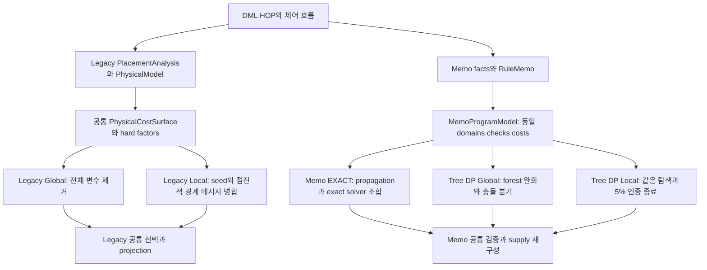
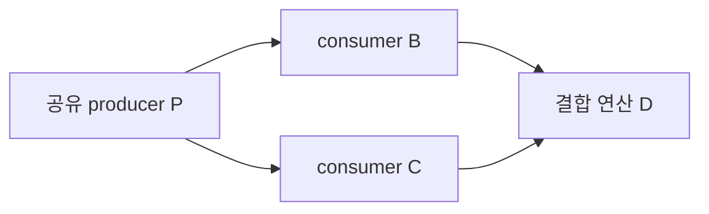

# COFEE Legacy Global Local DP와 Memo EXACT 및 Tree DP 상세 비교

작성일: 2026-10-15. 코드 기준: `origin/main`의 `b8623e3481072940c07ef3962bcd55be526f1d09`에서 분리한 `/home/mchoi/cofee-tree-dp-20261014`와 해당 workspace의 검증 완료 Tree DP 변경분. 브랜치: `feature/memo-tree-dp-certified-20261014`.

Tree DP는 이 workspace에 추가한 구현이다. 기존 Memo EXACT의 기본 선택은 유지했으며, 이 보고서의 내용이 원격 main에 모두 반영됐다는 뜻은 아니다.

## 1. 주요 결론

비교 대상은 legacy Global DP, legacy Local DP, **COMPILE_MEMO 내부 기본 알고리즘인 Memo EXACT**, 새 Tree DP의 Global/Local 모드다. 이름이 비슷해도 최적화 모델과 탐색 방식, 성공으로 인정하는 조건이 다르다.

1. **legacy Local도 전역 하한·상한에 기반한 기본 5% 인증 기능을 갖고 있다.** 단순 지역 탐색으로만 설명하면 부정확하다. 다만 자원 소진으로 끝났을 때는 5%를 달성하지 못한 feasible 계획도 반환·적용할 수 있다. `TARGET_REACHED`/`EXACT`와 `RESOURCE`를 구분해야 한다.
2. **Memo EXACT에도 이미 Tree DP, bucket elimination, leaf/core 분해가 있다.** 새 Tree DP의 차이는 DP를 처음 도입한 것이 아니라, forest relaxation과 전역 frontier의 충돌 분기로 정확·5% 인증을 제공하는 별도 solver라는 점이다.
3. **Memo EXACT와 새 Tree DP는 동일한 후보·제약·비용·재구성을 사용한다.** 따라서 이 둘의 비용과 인증은 같은 문제 위에서 직접 비교할 수 있다. legacy physical model과 Memo model의 전체 동치는 별도로 증명해야 한다.
4. **새 Tree DP의 인증 기능은 검증됐지만, 현재 실측은 일반적인 ML 계획 시간 개선을 뒷받침하지 않는다.** GNMF에서 Global 최적성과 Local 4.6073% 간격을 증명했다. 그러나 기존 Memo EXACT보다 조금 느렸고, LogReg·GLM에서는 설정한 자원 한도 안에 인증하지 못했다.
5. **이번 최종 ML 실험은 세 Memo 알고리즘의 동일 조건 비교다.** legacy Global/Local 전체 생산 경로를 같은 최종 engine·입력으로 측정한 다섯 알고리즘 비교 실험은 아니다. legacy 구성요소 실험과 과거 생산 경로 실험은 각각 범위를 밝혀 별도로 제시한다.

이 보고서의 최적성은 각 모델이 정의한 추정 비용에 대한 것이다. 학습 wall time이 최적이거나 실제 실행 시간이 5% 이내라는 보장은 아니다.

## 2. 명칭과 실제 선택 경로

### 2.1 두 종류의 EXACT와 두 종류의 default

| 보고서 명칭 | planner 설정 | 추가 알고리즘 설정 | 실제 구현 경로 |
|---|---|---|---|
| legacy Global DP | `COMPILE_EXACT` | 없음 | `FederatedPlanExact → ExactPhysicalOptimizer → ExactPhysicalReducedSolver → ExactCategoricalSolver` |
| legacy Local DP | `COMPILE_COST_BASED` | 별도의 Regional 옵션 | `FederatedPlanLocalCost → LocalPhysicalOptimizer → feasible seed + IncrementalRegionalOptimizer` |
| Memo EXACT | `COMPILE_MEMO` | `sysds.fedplanner.memo.algorithm=EXACT` 또는 미설정 | `FederatedPlanMemo → MemoProgramModel → MemoOptimizer` |
| Tree DP Global | `COMPILE_MEMO` | `TREE_DP_GLOBAL` | `FederatedPlanMemo → MemoProgramModel → MemoTreeDpOptimizer(GLOBAL)` |
| Tree DP Local | `COMPILE_MEMO` | `TREE_DP_LOCAL` | `FederatedPlanMemo → MemoProgramModel → MemoTreeDpOptimizer(LOCAL)` |

전체 SystemDS 설정의 기본값은 `sysds.federated.planner=RUNTIME`이다. 이 문서의 “현재 기본 optimizer”는 대화의 Memo 최적화 문맥에 따라 **COMPILE_MEMO를 선택한 뒤의 기본값 EXACT**를 뜻한다. `COMPILE_EXACT`라는 legacy planner와 Memo 내부 `EXACT`는 서로 다른 구현이다.

근거: [planner factory](/home/mchoi/cofee-tree-dp-20261014/src/main/java/org/apache/sysds/hops/ipa/FederatedPlannerFactory.java:35), [SystemDS 기본 설정](/home/mchoi/cofee-tree-dp-20261014/src/main/java/org/apache/sysds/conf/DMLConfig.java:207), [Memo 알고리즘 선택](/home/mchoi/cofee-tree-dp-20261014/src/main/java/org/apache/sysds/hops/fedplanner/memo/FederatedPlanMemo.java:62).

### 2.2 전체 구조



## 3. 무엇을 최적화하는가

### 3.1 공통 수학적 형태

각 결정 변수 `x_v`는 모델이 정의한 물리 대안 선택 단위다. Memo에서는 compiled owner 또는 loop head에 대응하며, occurrence와 call frame은 동일 owner 선택에 대한 비용·제약 문맥으로 참여할 수 있다. 문제는 다음 형태로 볼 수 있다.

```text
minimize C(x) = Σ_v native_v(x_v) + Σ_f cost_f(x_scope(f))
subject to 모든 legality factor가 허용하는 전체 assignment
```

실제로는 다음 차이가 있다.

| 항목 | legacy Global/Local | Memo EXACT/Tree DP |
|---|---|---|
| 모델 | `ExactPhysicalModel`과 `PhysicalCostSurface` | `RuleMemo`와 `MemoProgramModel` |
| 도메인 원소 | 상세 physical alternative의 index | 해당 owner의 실제 rule ordinal |
| 상태의 주요 정보 | placement, authority, anchor, realization, relocation, support | native rule과 입력 binding, 공급·이동·경계 계약 |
| 합법성 표현 | categorical hard factor, 대표적으로 0 또는 +∞ | `Check`의 YES/NO/UNKNOWN |
| 비용 표현 | legacy canonical cost 및 encoding | binary64 primitive를 정확한 `BigDecimal` 값으로 변환해 합산 |
| 공유 비용 | 공통 physical cost surface와 factor ownership | origin identity·retention scope별 movement factor |
| 재구성 | `ExactPhysicalSelection`과 legacy projector | 기존 supply·loop contract·Hop projection 경로 |

두 계열 모두 단순한 “HOP마다 CP 또는 FED 중 하나”보다 풍부한 상태가 필요하다. 같은 FED/FOUT 표시라도 worker layout, 입력 공급 방식, anchor 또는 support가 다르면 서로 다른 대안일 수 있다.

legacy Local/Global은 공통 physical model을 사용한다. Memo EXACT/Tree DP는 동일한 `sizes, coverage, nativeCosts, checks, costs`를 받는다. 그러나 **legacy와 Memo 사이에는 전체 후보 공간·비용 소유권·프로파일까지 같다는 증명이 없다.** 같은 DML, 같은 worker 수, 같은 HOP 개수만으로 이 동치를 대신할 수 없다.

근거: [legacy Alternative](/home/mchoi/cofee-tree-dp-20261014/src/main/java/org/apache/sysds/hops/fedplanner/fedCostBased/fedExact/ExactPhysicalModel.java:100), [legacy 공통 모델 생성](/home/mchoi/cofee-tree-dp-20261014/src/main/java/org/apache/sysds/hops/fedplanner/fedCostBased/fedExact/FederatedPlanLocalCost.java:53), [Memo 동일 입력 전달](/home/mchoi/cofee-tree-dp-20261014/src/main/java/org/apache/sysds/hops/fedplanner/memo/MemoProgramModel.java:438).

### 3.2 HOP DAG가 곧 최적화 문제의 tree는 아니다

예를 들어 하나의 producer `P`를 `B`, `C`가 사용하고 두 결과를 `D`가 다시 사용한다고 하자.



HOP의 실행 의존성에는 방향성 cycle이 없어도, 최적화 변수와 factor의 무방향 관계에는 cycle이 생길 수 있다. 또 `P`의 이동 한 번을 여러 consumer가 재사용한다면 비용은 각 subtree에 독립적으로 붙는 두 항이 아니라 공동 assignment에 의존하는 하나의 항일 수 있다.

그래서 `B`의 최저 비용 subplan과 `C`의 최저 비용 subplan을 각각 하나씩 골라 더하면 다음 문제가 발생한다.

- 같은 `P`에 서로 다른 rule·placement를 요구할 수 있다.
- 공유 업로드·다운로드를 두 번 세거나, 어느 쪽도 비용을 부담하지 않을 수 있다.
- 한 branch나 함수 frame에서만 가능한 공급을 다른 문맥에서 재사용할 수 있다.
- loop entry, backedge, exit의 값을 서로 독립적으로 선택할 수 있다.

세 알고리즘 계열 모두 이 결합을 표현해야 한다. 차이는 결합을 **큰 경계 상태에 함께 넣는지**, **propagation과 정확 분해로 줄이는지**, **하한에서는 완화하고 충돌 분기로 복구하는지**에 있다.

### 3.3 함수·분기·반복문의 의미

Memo에서는 compiled owner와 reachable call frame별로 비용 항을 구성하고, loop-carried value에는 추가 head 변수를 둔다. 경계 checks와 movement factors는 EXACT와 Tree DP에 공통으로 전달된다. Tree DP가 함수나 loop의 비용을 새로 추정하거나 별도 의미론으로 바꾸지는 않는다.

기본 Memo profile은 추정할 수 없는 반복 횟수에 10, branch then 확률에 0.5를 사용한다. 이는 runtime reachability oracle이 아니다. 따라서 “함수·branch·loop 의존성을 보존한다”와 “미래 실행 횟수와 분기를 정확하게 예측한다”는 서로 다른 주장이다. 최적성은 고정된 profile과 모델에 대해 성립한다.

근거: [Memo profile](/home/mchoi/cofee-tree-dp-20261014/src/main/java/org/apache/sysds/hops/fedplanner/memo/MemoProgramModel.java:65), [owner와 loop head 구성](/home/mchoi/cofee-tree-dp-20261014/src/main/java/org/apache/sysds/hops/fedplanner/memo/MemoProgramModel.java:314), [공유 movement 구성](/home/mchoi/cofee-tree-dp-20261014/src/main/java/org/apache/sysds/hops/fedplanner/memo/MemoProgramModel.java:1020).

## 4. Legacy Global DP

### 4.1 핵심 알고리즘

전체 categorical factor graph에 exact min-sum variable elimination을 적용한다. 변수 `v`를 제거할 때 `v`를 참조하는 모든 factor를 하나의 bucket으로 모은다. 나머지 변수 집합을 separator `S`라고 하면:

```text
m_v(x_S) = min_{x_v} Σ_{f ∈ bucket(v)} f(x_scope(f))
```

DP 상태는 **separator에 남은 변수들의 공동 assignment**다. 상태별 최소 비용과 argmin을 저장하고, 마지막에 역추적해 전체 선택을 복원한다. 공유 producer의 모든 관련 factor가 같은 `x_v`를 보므로, 독립 subtree 선택을 나중에 임의로 맞추는 방식이 아니다.

실행은 support reduction, singleton 치환, 정확성을 보존하는 domain compaction, 제거 순서 선택 등을 포함한다. 수치 인증 조건을 만족하는 shared-source encoding도 사용할 수 있다. 해당 encoding을 사용할 수 없을 때 완전한 원래 문제를 유지하는 것은 다른 문제로 바꾸는 우회가 아니다.

### 4.2 보장과 비용

완료된 선택은 원본 hard constraints와 canonical objective로 다시 검증한다. Global의 생산 경로는 전체 문제의 exact 결과를 요구하며, 자원 부족 시 일부 incumbent를 성공으로 내보내지 않는다. 5% 조기 종료 조건은 없다.

도메인 최대 크기를 `d`, 제거 과정의 induced width를 `w`라고 하면 전형적인 dense 계산량은 `O(n·d^(w+1))`, 중간 메시지 크기는 `O(d^w)` 성격을 갖는다. 실제 sparse representation·compaction에 따라 달라지지만, 병목이 HOP 개수만으로 결정되지 않는다는 점은 같다.

장점은 공유 변수와 고차 factor의 상관관계를 메시지에 정확히 포함한다는 것이다. 단점은 separator가 커질 때 메시지와 materialized table이 매우 커질 수 있다는 것이다. 생산 한도는 `Integer.MAX_VALUE` factor cells와 `Long.MAX_VALUE` materialized cells 등 표현 가능성에 연결되고, 실제 allocation 실패 역시 실패로 처리된다. 이 값들이 실제 메모리가 무한하다는 뜻은 아니다.

근거: [Global 표현과 solve](/home/mchoi/cofee-tree-dp-20261014/src/main/java/org/apache/sysds/hops/fedplanner/fedCostBased/fedExact/ExactPhysicalOptimizer.java:50), [bucket elimination](/home/mchoi/cofee-tree-dp-20261014/src/main/java/org/apache/sysds/hops/fedplanner/fedCostBased/fedExact/ExactCategoricalSolver.java:3185), [원본 결과 검증](/home/mchoi/cofee-tree-dp-20261014/src/main/java/org/apache/sysds/hops/fedplanner/fedCostBased/fedExact/ExactPhysicalOptimizer.java:175).

## 5. Legacy Local DP와 Regional 최적화

### 5.1 첫 단계는 전체적으로 feasible한 seed다

`LocalPhysicalOptimizer`는 producer-before-consumer 순서로 `LocalCategoricalOptimizer`를 호출한다. 생산 호출은 일반 local improvement block을 비워 두고 revisit 횟수도 0으로 전달한다. 즉, 이 helper의 일반 block improvement 기능이 현재 legacy Local의 주 최적화 본체는 아니다.

초기 선택에 hard conflict가 있으면 관련 변수를 block으로 묶어 바깥 선택을 고정한 조건부 문제를 푼다. 경계 때문에 해결할 수 없으면 incident hard factor를 따라 block을 넓힌다. 최종적으로 전체 legality와 canonical cost를 검증한 seed가 upper bound가 된다.

### 5.2 두 번째 단계는 boundary message의 점진적 병합이다

`IncrementalRegionalOptimizer`는 preparation·compaction 이후 reduced root의 factor마다 초기 cluster를 만든다. cluster들은 factor를 중복 소유하지 않지만, 같은 결정 변수를 경계로 공유할 수 있다.

```text
M_C(b) = min_{x_internal} Σ_{f owned by C} f(x_internal, b)
```

cluster의 결과는 하나의 지역 정답이 아니라 **경계 assignment마다 다른 최소 비용과 복원 정보**다. pivot 변수 `v`를 선택하면 `v`를 포함하는 모든 active cluster를 함께 합치고 `v`를 제거한다.

```text
M_new(b) = min_{x_v} Σ_i M_i(x_v, b_i)
```

그 결과 각 cluster가 서로 다른 `v`를 선호하던 불일치가 하나의 공동 선택 안에서 해소된다. pivot을 사용하는 cluster 일부만 남겨 놓고 변수를 제거하지 않는다. 병합은 작은 separator를 우선하고 그 안에서 conflict 점수와 예상 작업량을 고려한다. 새로 Global solver를 별도 호출해 다시 시작하는 구조는 아니다.

### 5.3 하한과 5% 인증

active cluster 사이의 경계 일치 조건을 풀어 각각 최소화하면:

```text
LB = Σ_C min_b M_C(b)
UB = C(전체 legality와 canonical cost를 검증한 incumbent)
```

각 cluster가 다른 경계 값을 가정할 수 있기 때문에 이 합은 실제 전역 최적 비용보다 작거나 같다. 병합은 공유 선택을 함께 고려하게 하므로 하한을 강화한다.

여기서 `C`는 active cluster와 경계 제거를 완료한 sealed cluster 전체를 포함한다. 실제 구현은 `sealedLower + active minima`를 합산하며, finite·비음수 bound를 검사한다. Tree DP의 음수 비용 테스트와 동일한 일반 입력 가정을 legacy Local에 자동 적용하지 않는다.

수치 구현은 lower-bound 합산에 `Math.nextDown`, relative gap 계산에 `Math.nextUp`을 사용한다. 현재 코드의 gap은 다음과 같다.

```text
UB == LB이면 gap = 0
LB > 0이면 gap = nextUp(nextUp(UB - LB) / LB)
그 외 gap = +Infinity
```

분모는 **LB**다. 기본 target은 0.05이고 earlyStop은 true지만 설정으로 바꿀 수 있다. 모든 active cluster를 제거하면 `EXACT`, 설정한 gap에 도달하면 `TARGET_REACHED`다. 이 조건으로 종료한 결과는 encoded canonical model에 대한 전역 bound 인증을 제공하도록 구현돼 있다. 이것은 이번 Tree 실험에서 legacy 수치 구현 전체를 새로 독립 검증했다는 의미는 아니다.

### 5.4 Tree DP와 다른 자원 소진 계약

legacy Local은 더 진행할 병합이 없거나 allocation 자원이 부족하면 `RESOURCE`로 종료할 수 있다. 결과에는 feasible incumbent와 LB/UB 및 stop reason이 남는다. 그런데 `LocalPhysicalOptimizer`는 그 stop reason이 `TARGET_REACHED`인지 확인하는 gate 없이 assignment와 upper bound를 채택하는 경로를 갖고 있다.

따라서 다음 둘을 구분해야 한다.

- **실행 가능한 계획 반환:** `RESOURCE`여도 가능하다.
- **설정한 5% 인증 달성:** `TARGET_REACHED`/`EXACT` 및 실제 gap으로 확인해야 한다.

새 Tree DP Local은 요청한 인증을 얻지 못하면 계획을 설치하지 않는다. 두 Local 모드의 가장 중요한 제품 동작 차이다. legacy가 자원 소진 결과를 `TARGET_REACHED`로 위장한다는 뜻은 아니다. stop reason은 남지만, 상위 planner가 feasible 결과를 사용할 수 있다는 뜻이다.

또한 현재 legacy 생산 경로의 과거 고정 assignment·retained-slot·시간·scoring-candidate budget은 제거됐다. 제거된 property는 명시적으로 거부하며, 유한 test Options에 남은 `TIME` 분기를 생산 기본 중단 정책으로 설명해서는 안 된다.

근거: [seed와 Regional 호출](/home/mchoi/cofee-tree-dp-20261014/src/main/java/org/apache/sysds/hops/fedplanner/fedCostBased/fedExact/LocalPhysicalOptimizer.java:81), [자원 결과 채택](/home/mchoi/cofee-tree-dp-20261014/src/main/java/org/apache/sysds/hops/fedplanner/fedCostBased/fedExact/LocalPhysicalOptimizer.java:103), [cluster 생성과 종료](/home/mchoi/cofee-tree-dp-20261014/src/main/java/org/apache/sysds/hops/fedplanner/fedCostBased/fedExact/IncrementalRegionalOptimizer.java:257), [병합 후보](/home/mchoi/cofee-tree-dp-20261014/src/main/java/org/apache/sysds/hops/fedplanner/fedCostBased/fedExact/IncrementalRegionalOptimizer.java:771), [bound와 gap](/home/mchoi/cofee-tree-dp-20261014/src/main/java/org/apache/sysds/hops/fedplanner/fedCostBased/fedExact/IncrementalRegionalOptimizer.java:932), [현행 자원 정책](FEDPLANNER_RESOURCE_POLICY_2026-10-06.md).

## 6. 현재 Memo 기본 EXACT

### 6.1 하나의 탐색 방법이 아닌 정확 solver의 조합

현재 `MemoOptimizer.optimize()`의 주요 순서는 다음과 같다.

```text
candidate coverage 확인
→ support propagation
→ propagation 이후 factor/domain 정규화
→ 전체 residual이 forest이면 exact tree DP
→ certified class 기반 bucket elimination
→ leaf region과 cyclic core 분해
→ 잔여 문제의 전역 탐색과 bound pruning
```

앞 단계가 정확히 해결하면 뒤 단계는 필요 없다. 따라서 “기본 EXACT는 전수 탐색이고 새 Tree DP만 구조를 활용한다”는 설명은 현재 구현과 맞지 않는다.

주요 기법은 다음과 같다.

| 기법 | 역할 | 정확성 경계 |
|---|---|---|
| support propagation | 어떤 rule이 다른 변수의 현재 domain과 함께 가능할지 검사 | NO가 증명될 때만 제거하며 UNKNOWN으로 제거하지 않음 |
| truth/cost class | 특정 factor가 동일하게 관측하는 ordinal을 factor 계산에 활용 | 해당 factor의 모든 다른 축 조합에서 동등하다는 annotation 필요 |
| normalization | 고정·불변 축 제거, 같은 scope의 factor 묶기 | 원래 비용과 feasibility 보존 |
| exact tree solve | 전체 residual factor graph가 unary/binary forest일 때 DP | cyclic/high-arity factor를 버려서 tree로 만들지 않음 |
| bucket elimination | separator class 상태별 정확 메시지 계산 | native cost와 실제 rule witness 보존 |
| leaf/core 분해 | cyclic core 바깥 tree를 정확히 제거 | 경계 메시지로 core와의 의존성 유지 |
| 일반 search | propagation, 하한 pruning, ordinal 분기 | 미탐색·UNKNOWN 영역을 임의로 성공 처리하지 않음 |

bucket elimination의 내부 `MAX_CELLS=2,000,000`, `MAX_ROWS=500,000` 기준은 이 경로의 표현 가능성을 판단하는 기준이다. 초과했다고 근사 계획을 성공 반환하는 것이 아니라 다른 정확 탐색 경로로 진행한다.

### 6.2 하한과 종료 조건

일반 탐색 하한은 fixed cost, 현재 domain의 native minimum, 각 비용 factor의 conditional minimum 등을 조합한다. factor 계산이 너무 넓으면 기존 certified floor를 사용할 수 있다. 부분 열거에서 발견한 최솟값을 전역 하한으로 오인하지 않는다.

기본 limits는 `searchNodes=Long.MAX_VALUE`, `supportEvaluations=256`, `cacheEntries=4096`이다. support 256은 전체 solver를 256회 만에 성공 종료한다는 뜻이 아니다. 유한 search-node 한도를 명시하면 일부 tree/elimination fast path가 비활성화되므로, Tree DP와 단순히 같은 node cap을 주는 것이 동일한 탐색 조건을 만드는 것도 아니다.

Memo EXACT는 요청한 전체 최적성을 증명한 `OPTIMAL` 결과만 설치한다. `RESOURCE_EXHAUSTED`, `UNRESOLVED`, `INFEASIBLE`을 구분한다. public result가 Tree DP와 같은 frontier LB/UB progression API를 노출하지 않는다고 해서, 내부에서 lower bound를 사용하지 않는 것은 아니다.

근거: [전체 solver 순서](/home/mchoi/cofee-tree-dp-20261014/src/main/java/org/apache/sysds/hops/fedplanner/memo/MemoOptimizer.java:286), [elimination](/home/mchoi/cofee-tree-dp-20261014/src/main/java/org/apache/sysds/hops/fedplanner/memo/MemoOptimizer.java:313), [propagation](/home/mchoi/cofee-tree-dp-20261014/src/main/java/org/apache/sysds/hops/fedplanner/memo/MemoOptimizer.java:853), [exact tree solve](/home/mchoi/cofee-tree-dp-20261014/src/main/java/org/apache/sysds/hops/fedplanner/memo/MemoOptimizer.java:997), [leaf/core solve](/home/mchoi/cofee-tree-dp-20261014/src/main/java/org/apache/sysds/hops/fedplanner/memo/MemoOptimizer.java:1144), [conditional lower bound](/home/mchoi/cofee-tree-dp-20261014/src/main/java/org/apache/sysds/hops/fedplanner/memo/MemoOptimizer.java:1753).

## 7. 새 Tree DP와 Conflict Resolution

### 7.1 상태와 forest relaxation

Tree DP는 MemoProgramModel의 owner별 **실제 rule ordinal**을 상태로 유지한다. 전체 graph에서 unary/binary factor의 spanning forest를 선택하고, cycle을 닫거나 고차원인 factor를 deferred 항으로 분리한다. 큰 binary factor도 `factorCells`에 의해 deferred될 수 있다.

유지한 forest에서는 child subtree의 최저 비용을 root ordinal별로 계산한다. 개념적으로:

```text
D_v(r_v) = native_v(r_v) + unaryCosts_v(r_v)
           + Σ_child u min_{r_u with retained checks ≠ NO}
               [D_u(r_u) + retainedEdgeCosts_vu(r_v, r_u)]
```

여기서 버리는 것은 원래 문제의 후보가 아니라 **하한 계산 단계의 일부 결합 조건**이다. retained check도 NO만 제외하고 UNKNOWN은 relaxation에 허용한다. 최종 feasible 검증은 deferred 여부와 관계없이 모든 원래 check가 YES여야 한다. deferred cost는 원래 factor의 current-domain minimum 또는 certified floor로 하한에 정확히 한 번 포함한다.

### 7.2 충돌 해결은 영역 병합이 아니라 domain 분할이다

forest DP의 witness가 원래 제약을 모두 만족하는지 검증한다. 합법이면 원래 비용을 다시 평가해 UB 후보로 사용한다. 불법 제약, UNKNOWN 의무 또는 deferred cost의 비긴밀성이 있으면 관련 owner를 골라 모든 live ordinal로 분기한다.

```text
frontier ← 전체 domain의 relaxation node
반복:
    frontier 및 unresolved 영역의 전역 LB 계산
    exact 또는 Local 5% 인증이 되면 종료
    가장 낮은 bound node 선택
    완전 witness를 원본 checks와 cost로 검증하고 UB 갱신
    해결되지 않은 conflict의 owner를 선택
    해당 owner의 모든 live ordinal로 domain을 서로 겹치지 않게 분할
    자식 relaxation을 계산하고 frontier에 추가
```

legacy Local이 cluster를 병합해 **한 경계 문제의 상관관계를 강화**하는 반면, Tree DP는 **가능한 전체 assignment 집합을 여러 하위 영역으로 나누고 각 영역의 forest 하한을 유지**한다. 둘 다 충돌을 줄이지만 계산량이 증가하는 방식은 다르다.

### 7.3 하한·상한 인증

search node의 domain을 `D`, 유지한 forest를 `T`라고 하면:

```text
LB_node(D) = min_{x ∈ D, retained checks ≠ NO} C_T(x)
             + Σ_deferred f min_{x_scope(f) ∈ D} cost_f(x_scope(f))
```

열거가 너무 큰 deferred 항에는 원래 `CostTerm.certifiedMinimum`을 사용한다. feasible completion은 retained checks를 만족하고 각 항의 비용이 그 항의 하한 이상이므로 `LB_node ≤ 해당 영역의 OPT`다. 비용 factor ownership을 유지해 shared movement를 이중 계상하지 않는다.

충돌 분기가 부모 영역을 모든 ordinal 자식으로 완전히 분할하므로, 미해결 영역 전체의 최소 하한은 전역 하한이다. UNKNOWN 영역도 버리지 않는다. 상한은 원본 checks가 모두 YES인 계획의 원본 비용이다.

```text
LB = min(미해결 frontier 하한, UNKNOWN 영역 하한, feasible incumbent 비용)
LB ≤ OPT ≤ UB
```

처음 feasible 계획을 얻기 전 UB는 개념적으로 +∞이며 trace에는 `null`이다. GLOBAL은 exact proof에서만 `OPTIMAL`이다. LOCAL은 exact proof가 있으면 `OPTIMAL`, 그렇지 않고 다음 식을 만족하면 `EPSILON_OPTIMAL`이다.

```text
LB > 0  and  UB ≤ 1.05 × LB
```

이는 `UB ≤ 1.05 × OPT`를 함의한다. binary64 비용 primitive는 `new BigDecimal(double)`로 변환하고 `1.05`는 정확한 decimal 상수로 곱한다. LB가 0 또는 음수이면 상대 5% 종료를 사용하지 않고 exact proof 또는 명시적 실패까지 진행한다.

### 7.4 재사용과 자원 정책

세 종류의 bounded cache가 있다.

| cache | key에 포함하는 의존성 | 보존하는 의미 |
|---|---|---|
| subtree message | oriented subtree와 descendant들의 실제 domain | 영향받지 않은 subtree DP 재사용 |
| exact cost tuple | factor id와 전체 ordered ordinal/class tuple | 같은 비용 평가 재사용 |
| conditional minimum | factor id와 각 scoped axis의 전체 live domain/class set | 조건부 하한 재사용 |

certified cost class는 해당 factor의 비용 동치에만 쓰인다. legality, native cost, 최종 rule identity를 합치지 않는다. class 대표는 현재 domain에서 고른다. cache eviction은 계산량에 영향을 주지만 후보나 인증 기준을 바꾸지 않는다.

기본 limits는 search nodes `Long.MAX_VALUE`, factor cells 256, 총 cache entries 4096, frontier nodes 10000이다. factor-cell 기준은 sound floor 사용 여부를 결정하며 candidate truncation이 아니다. node/frontier/depth 한도에서 인증하지 못하면 `RESOURCE_EXHAUSTED`다. 분기를 완성할 수 없으면 부모를 유지해 bound의 전체 공간 cover를 보존한다. Local의 성공 종료에 시간이나 고정 반복 횟수를 사용하지 않는다.

model adapter는 certified 결과의 모든 원래 check와 원래 비용을 재확인한 뒤 기존 supply reconstruction으로 전달한다. 인증 실패 결과는 실행 계획으로 설치하지 않는다.

근거: [Tree DP 상태·limits](/home/mchoi/cofee-tree-dp-20261014/src/main/java/org/apache/sysds/hops/fedplanner/memo/MemoTreeDpOptimizer.java:46), [frontier 탐색](/home/mchoi/cofee-tree-dp-20261014/src/main/java/org/apache/sysds/hops/fedplanner/memo/MemoTreeDpOptimizer.java:184), [subtree DP](/home/mchoi/cofee-tree-dp-20261014/src/main/java/org/apache/sysds/hops/fedplanner/memo/MemoTreeDpOptimizer.java:376), [conditional minimum](/home/mchoi/cofee-tree-dp-20261014/src/main/java/org/apache/sysds/hops/fedplanner/memo/MemoTreeDpOptimizer.java:455), [인증 조건](/home/mchoi/cofee-tree-dp-20261014/src/main/java/org/apache/sysds/hops/fedplanner/memo/MemoTreeDpOptimizer.java:671), [원본 model 재검증](/home/mchoi/cofee-tree-dp-20261014/src/main/java/org/apache/sysds/hops/fedplanner/memo/MemoProgramModel.java:454).

## 8. 핵심 차이 비교표

| 기준 | legacy Global | legacy Local | Memo EXACT | Tree Global / Local |
|---|---|---|---|---|
| 기본 분해 | 전체 factor graph의 변수 제거 | factor cluster의 점진적 병합 | propagation 후 tree/elimination/core/search 조합 | 고정 forest relaxation과 domain 분기 |
| DP 상태 | separator 공동 assignment | cluster boundary 공동 assignment | 경로별 tree ordinal, class separator, core 상태 | subtree root의 실제 ordinal과 현재 domains |
| 공유 변수 해결 | incident factor를 같은 bucket에서 공동 최적화 | pivot의 모든 cluster 병합 | support·정확 메시지·전역 탐색 | 원본 검증 후 conflict owner 분기 |
| LB 사용 | 전체 exact solve가 중심 | cluster별 certified minimum 합 | 내부 conditional minima와 pruning | node relaxation 하한의 frontier minimum |
| 5% 종료 | 없음 | 기본 target 5%, 변경 가능 | 없음 | LOCAL만 고정 ε=0.05 |
| exact 성공 | 전체 exact 결과 | `EXACT` | `OPTIMAL` | `OPTIMAL` |
| 근사 성공 표식 | 없음 | `TARGET_REACHED`와 설정 target 확인 | 없음 | `EPSILON_OPTIMAL` |
| 자원 소진 시 적용 | 부분 성공 없음 | feasible incumbent 적용 가능 | uncertified 결과 적용 안 함 | uncertified 결과 적용 안 함 |
| 주된 메모리 위험 | 큰 separator table | 병합된 boundary table | elimination table 또는 잔여 탐색 | frontier domains와 반복 DP/cache |
| candidate/cost 동치가 확인된 짝 | legacy Local | legacy Global | Tree DP | Memo EXACT |

메시지 크기가 작아도 충돌 분기가 많으면 Tree DP는 비싸질 수 있다. 반대로 변수 제거가 큰 table을 요구하더라도 class compaction이 강하면 Memo EXACT가 더 빨리 풀 수 있다. 어떤 방식도 일반적인 HOP DAG/factor graph에 대해 다항시간 최적화를 보장하지 않는다.

## 9. 실험 범위와 측정 정의

### 9.1 최종 비교 조건

직접 비교 가능한 최종 실험은 `results-v2-w3-r2`의 Memo EXACT, Tree Global, Tree Local이다.

| 항목 | 조건 |
|---|---|
| 실제 training 프로그램 | LogReg, GLM, GNMF |
| feature 크기 | 50,000 × 128 |
| worker metadata | 동일 3-worker partition·range·privacy |
| 입력 | 봉인된 DML·metadata·binary data와 renderer receipt |
| mode | 전체 RuntimeProgram 생성까지 compile-only |
| Docker | 동일 pinned image, CPU 4개, container 8 GiB |
| JVM | heap 3 GiB, ActiveProcessorCount 4 |
| Tree limits | search nodes 2000, frontier 10000, factor cells 256, cache 4096 |
| 반복 | 실제 ML은 조건당 fresh container 1회 |
| synthetic | warm-up 후 7회 평균, 같은 JVM에서 순서대로 측정 |

실제 ML 표는 대규모 학습 프로그램의 **planning/compilation 평가**다. 이 세 대규모 데이터의 학습 완료 시간이나 정확도 측정으로 읽으면 안 된다. 별도 Docker runtime suite에서는 실제 2-worker 선형·로지스틱 학습을 작은 입력으로 실행하고 세 Memo 알고리즘의 결과를 독립 계산과 비교했다.

### 9.2 혼동하면 안 되는 지표

- **Optimizer 시간:** Memo phase trace의 optimization 구간.
- **Memo planning 시간:** facts + rules + model + optimization + projection 합.
- **Full compile 시간:** 나머지 컴파일 과정을 포함한 내부 완료 receipt.
- **Container wall:** Docker/JVM 시작과 종료, 외부 관측까지 포함한 성공 또는 실패까지의 시간.
- **Memory:** 샘플링한 Docker MemUsage의 최댓값. RSS가 아니며 charged cache도 포함하고 짧은 peak를 놓칠 수 있다.
- **Tree nodes:** relaxation 호출 수. legacy assignments, Memo EXACT의 search/elimination counters와 같은 단위가 아니다.
- **Tree dpNanos:** forest DP와 deferred conditional-minimum 계산을 포함한 relaxation 전체 시간이다. 좁은 tree recurrence만의 비용이 아니다.
- **Tree conflictNanos:** 원본 witness 검증과 feasible 비용 평가 시간. 분기 관리·자료구조 등 모든 conflict overhead를 단독으로 측정하는 값은 아니다.

실패 셀에는 성공한 full-compile/planning receipt가 없다. 이를 0초나 부분 시간의 합으로 채우지 않았다. 외부 watchdog으로 종료된 실행은 인증 실패이며 알고리즘의 ε 성공 조건이 아니다.

## 10. 실제 ML 프로그램 비교 결과

### 10.1 완료 여부와 전체 비용

| Workload | 알고리즘 | 결과 | Full compile s | Container wall s | Sampled MiB | 최종 LB | 최종 UB |
|---|---|---|---:|---:|---:|---:|---:|
| LogReg | Memo EXACT | OPTIMAL | 3.624 | 4.899 | 330.3 | 4041.331 | 4041.331 |
| LogReg | Tree Global | RESOURCE_EXHAUSTED | — | 8.469 | 747.2 | 2742.536 | 5729.660 |
| LogReg | Tree Local | RESOURCE_EXHAUSTED | — | 8.721 | 932.9 | 2742.536 | 5729.660 |
| GLM | Memo EXACT | OPTIMAL | 9.111 | 10.447 | 1008.0 | 426.223 | 426.223 |
| GLM | Tree Global | RESOURCE_EXHAUSTED | — | 20.045 | 1200.1 | 366.189 | 667.821 |
| GLM | Tree Local | RESOURCE_EXHAUSTED | — | 25.598 | 1181.7 | 366.189 | 667.821 |
| GNMF | Memo EXACT | OPTIMAL | 1.340 | 2.595 | 162.3 | 217.047 | 217.047 |
| GNMF | Tree Global | OPTIMAL | 1.585 | 2.886 | 184.9 | 217.047 | 217.047 |
| GNMF | Tree Local | EPSILON_OPTIMAL | 1.513 | 2.805 | 134.5 | 217.047 | 227.047 |

Memo EXACT의 LB=UB 표기는 독립 실행에서 증명한 optimum을 비교용으로 기재한 것이다. Memo EXACT가 Tree와 동일한 LB/UB API를 출력했다는 뜻은 아니다. 비용은 동일 Memo objective의 값이며 실측 초 단위 학습 시간으로 해석하지 않는다.

### 10.2 GNMF의 phase별 비교

| 알고리즘 | Facts s | Rules s | Model s | Optimization s | Projection s | Memo planning s |
|---|---:|---:|---:|---:|---:|---:|
| Memo EXACT | 0.036 | 0.234 | 0.132 | 0.156 | 0.064 | 0.623 |
| Tree Global | 0.048 | 0.294 | 0.174 | 0.221 | 0.060 | 0.798 |
| Tree Local | 0.031 | 0.203 | 0.112 | 0.196 | 0.120 | 0.662 |

GNMF Local의 interval은 `[217.0473253831, 227.0473253831]`이다.

```text
(227.0473253831 - 217.0473253831) / 217.0473253831 ≈ 4.6073%
```

이 경우 LB가 독립 EXACT optimum과 같으므로 실제 model-cost regret도 4.6073%다. Local은 exact optimum까지 가지 않고 인증된 더 비싼 계획을 반환했다. 하지만 optimizer 시간은 0.196초로 Memo EXACT 0.156초보다 짧지 않았다. 조건당 1회라 작은 시간 차이에 대한 통계적 우열까지 확정할 수는 없다.

### 10.3 인증 gap과 실제 regret의 차이

| Tree Local workload | 인증 판단에 쓰는 `(UB−LB)/LB` | 독립 optimum 기준 `(UB−OPT)/OPT` | 5% 성공 여부 |
|---|---:|---:|---|
| LogReg | 108.9183% | 41.7765% | 실패 |
| GLM | 82.3704% | 56.6835% | 실패 |
| GNMF | 4.6073% | 4.6073% | 성공 |

앞 열은 optimizer가 스스로 증명할 수 있는 gap이고, 뒤 열은 사후에 독립 EXACT 결과로 계산한 regret다. 큰 gap을 “실제 계획이 반드시 그만큼 나쁘다”로 해석하면 안 된다. 반대로 feasible UB가 있어도 gap이 증명되지 않으면 ε-optimal 성공이 아니다.

### 10.4 충돌 처리와 비용 평가

| Workload / mode | Relaxation nodes | Conflict splits | Relaxation s | Witness validation s | Subtree hits | Conditional-min hits |
|---|---:|---:|---:|---:|---:|---:|
| LogReg Global | 1996 | 245 | 2.510 | 1.338 | 625929 | 167672 |
| LogReg Local | 1996 | 245 | 2.209 | 1.371 | 625929 | 167672 |
| GLM Global | 1985 | 232 | 6.435 | 4.781 | 1396395 | 272246 |
| GLM Local | 1985 | 232 | 8.823 | 6.870 | 1396395 | 272246 |
| GNMF Global | 38 | 6 | 0.143 | 0.012 | 2362 | 434 |
| GNMF Local | 38 | 6 | 0.130 | 0.013 | 2362 | 434 |

| Workload | Memo EXACT cost evaluations | Tree Global cost evaluations | Tree deferred checks / costs |
|---|---:|---:|---:|
| LogReg | 1625 | 3248837 | 1065 / 111 |
| GLM | 11556 | 12297700 | 1515 / 165 |
| GNMF | 419 | 2622 | 48 / 15 |

cost evaluation counter는 각 solver의 instrumentation 기준이다. 한 호출의 비용이나 내부 작업이 완전히 같다는 보장은 없으므로 비율을 CPU speedup으로 사용할 수 없다. 다만 Tree가 많은 원본 비용 평가를 반복하고 있다는 관측은 분명하다. 작은 frontier node 수만 보고 더 적은 작업을 했다고 판단해서는 안 된다.

GNMF Global/Local은 둘 다 38개 relaxation node를 생성했다. Local이 더 일찍 인증했다고 해서 생성 node 수가 반드시 줄어드는 것은 아니다. child expansion을 묶어서 수행하고 frontier에서 witness를 검증하는 순서의 영향을 받는다.

### 10.5 더 큰 자원 한도에서도 남은 한계

LogReg Local의 별도 실험은 search node cap을 20000으로 늘리고 frontier cap은 10000으로 유지했다.

| 항목 | 2000-node 실험 | 20000-node 허용 실험 |
|---|---:|---:|
| 실제 relaxation nodes | 1996 | 15958 |
| 최대 frontier | 1253 | 9990 |
| LB | 2742.536 | 2765.574 |
| UB | 5729.660 | 5325.660 |
| gap | 108.9183% | 92.5697% |
| container wall | 8.721 s | 21.616 s |
| 결과 | node cap에서 RESOURCE_EXHAUSTED | 다음 분기 시 frontier cap 초과로 RESOURCE_EXHAUSTED |

두 번째 실험은 20000개 node를 모두 사용하기 전에 frontier 제한에 걸렸다. 따라서 “20000개를 전부 검색해도 실패”보다는 “20000개를 허용했지만 10000-frontier 자원 조건에서 실패”가 정확하다. 메모리는 샘플 기준 775.3 MiB, DP 9.978초, witness validation 6.804초였다.

원자료: [최종 9개 셀과 synthetic/runtime 결과](../experiments/memo-tree-dp-20261014/results-v2-w3-r2/summary.json), [더 큰 한도 실험](../experiments/memo-tree-dp-20261014/results-v2-logreg-20k/summary.json).

## 11. 작은 동일 모델 문제와 legacy 구성요소 비교

### 11.1 Memo EXACT와 Tree DP의 synthetic 결과

단위는 ms이며 warm-up 이후 7회 평균이다. 16-owner 이하 사례는 independent exhaustive enumeration, 32-owner tree는 Memo EXACT로 기준 optimum을 확인했다.

| Case | Memo EXACT | Tree Global | Tree Local | 결과 |
|---|---:|---:|---:|---|
| adversarial shared wide, 6 owners | 1.629 | 1.902 | 1.313 | 모두 exact |
| tree, 32 owners | 1.925 | 1.031 | 0.837 | 모두 exact |
| cycle, 16 owners | 1.088 | 0.272 | 0.250 | 모두 exact |
| diamond, 8 owners | 0.444 | 0.243 | 0.242 | 모두 exact |
| shared wide, 8 owners | 0.630 | 0.377 | 0.383 | 모두 exact |
| ε boundary, 3 owners | 0.164 | 0.124 | 0.068 | Global optimum 100, Local LB 100 / UB 105 |

32-owner tree에서는 Tree Global이 한 번의 relaxation으로 종료했다. ε boundary에서는 Global 5 nodes, Local 1 node로, 인증 기반 조기 종료가 실제로 작동했다. 반면 6-owner adversarial fixture의 Tree Global은 기존 EXACT보다 느렸다.

EXACT 자체에도 tree DP가 있으므로 이 결과를 “기본 solver는 tree를 활용하지 못한다”는 증거로 사용할 수 없다. normalization, 경로 선택, cache·상태 구성 등 실행 비용이 다르고, 고정 순서·JIT·작은 측정 규모의 영향도 있다. synthetic JVM pool peak는 앞 알고리즘의 heap 상태를 이어받아 독립적인 solver별 메모리 비교에 적합하지 않다.

### 11.2 기존 Regional microbenchmark가 실제로 실행한 것

동일 categorical factor fixture에서 다음 결과를 얻었다.

| 호출한 구현 | objective |
|---|---:|
| Memo EXACT | 1.4375 |
| Tree Global | 1.4375 |
| legacy `ExactCategoricalSolver` | 1.4375 |
| legacy `LocalCategoricalOptimizer` | 1.4375 |

`LocalCategoricalOptimizer`는 198개 block assignments를 처리했고 cold 실행 시간은 38.340ms였다. 이 fixture는 위 signed-cost synthetic 사례에서 목적함수를 0.25 올린 비음수 버전이므로 1.1875와 1.4375의 차이는 solver 오류가 아니다.

**이 실험은 legacy Local 전체 생산 경로의 benchmark가 아니다.** `MemoTreeDpRegionalBenchmark`는 `LocalCategoricalOptimizer.optimize`를 직접 호출하며, `LocalPhysicalOptimizer → IncrementalRegionalOptimizer`를 실행하지 않는다. legacy Global 역시 전체 physical model 생성·projection을 포함하지 않고 categorical solver를 호출한다.

따라서 이 결과가 뒷받침하는 것은 **구성요소 수준의 동일 factor objective parity**다. legacy Local의 certified 5% 종료 성능이나 legacy planner의 end-to-end 시간, Memo 대비 speedup은 이 수치로 판단할 수 없다. 별도 cold timing을 위 warmed timing과 나누는 것도 타당하지 않다.

근거: [microbenchmark 실제 호출](/home/mchoi/cofee-tree-dp-20261014/src/test/java/org/apache/sysds/hops/fedplanner/fedCostBased/fedExact/MemoTreeDpRegionalBenchmark.java:74), [raw synthetic 결과](../experiments/memo-tree-dp-20261014/results-v2-w3-r2/synthetic-same-model/result.json).

## 12. Legacy 생산 경로의 과거 자료는 어떻게 해석할 것인가

2026-10-06 resource-policy 실험에는 legacy Local의 28개 compile/planning/lowering 성공이 기록돼 있다. 종료 이유는 TARGET_REACHED 22개, EXACT 2개, RESOURCE 4개다. 즉 **28개 컴파일 성공을 28개 5% 인증 성공으로 바꿔 읽으면 안 된다.**

일부 사례는 다음과 같다. 비용은 당시 legacy 모델의 예상 비용이며, 시간은 당시 checkpoint의 planner 구간이다.

| 과거 사례 | 종료 | 당시 LB | 당시 UB | 당시 gap | Planner s |
|---|---|---:|---:|---:|---:|
| GLM W1 | TARGET_REACHED | 20956.044 | 21967.227 | 4.8253% | 111.996 |
| GLM W3 | TARGET_REACHED | 20620.952 | 20824.360 | 0.9864% | 48.544 |
| GNMF W3 | TARGET_REACHED | 18521.179 | 18521.179 | 약 0% | 0.435 |
| LogReg W3 | RESOURCE | 16969.032 | 21917.009 | 29.1589% | 95.512 |

이 표는 legacy Local의 종료 의미를 보여 주는 **이전 revision의 이력**이다. 최종 Tree 실험과 코드 revision·목적함수·입력 및 측정 범위의 동일성이 성립하지 않으므로, “Legacy GNMF 0.435초 대 Memo 0.623초” 같은 속도 순위를 만들지 않는다. 숫자가 비슷하거나 workload 이름이 같아도 공정한 직접 비교가 되지 않는다.

그 뒤 legacy 통합 보고서는 Global/Local의 미해결 실패와 cost-surface fingerprint 차이도 기록한다. 과거 일부 성공 pair의 Global-minus-Local 수치가 아주 작게 양수였다는 관측은 별도 조사 대상으로 남아 있어, 해당 표를 같은 objective의 exact dominance 증명으로 사용할 수 없다.

마찬가지로 2026-10-14 초기 Memo W1/3/5/7 56조건 보고서의 LogReg·GLM timeout은 이전 frozen revision의 결과다. 현재 workspace의 최종 9개 셀에서는 두 workload의 Memo EXACT가 완료됐다. 이번 성공을 56조건 전체가 이제 지원된다는 주장으로 확대하지 않는다. solver 교체로 facts/catalog/shape/지원 범위 문제가 자동 해결되는 것도 아니다.

근거: [legacy resource-policy 결과](FEDPLANNER_RESOURCE_POLICY_2026-10-06.md), [당시 case별 JSON](experiments/resource-policy-20261006/compile-comparison.json), [후속 통합 검증의 한계](FEDPLANNER_GLOBAL_MAIN_VALIDATION_2026-10-06.md), [이전 Memo 56조건 보고서](FEDPLANNER_MEMO_W1357_PLANNING_MATRIX_RESULT_2026-10-14_KO.md).

## 13. 왜 새 Tree DP가 큰 ML에서 더 느릴 수 있는가

### 13.1 관측으로 확인된 부분

최종 LogReg·GLM에서는 deferred legality/cost 항이 많고, candidate witness 검증 및 비용 평가가 반복됐다. cache hit가 많아도 비용 평가 호출 총량이 컸으며, 좋은 feasible incumbent와 충분히 강한 LB를 동시에 확보하지 못했다.

초기 Tree 구현은 LogReg Global에서 약 187.449초 후 자원 한도로 끝났다. thread dump는 deferred shared-movement minimum 계산을 가리켰다. v2에서 cost tuple·conditional-minimum cache, certified class 활용, 불법 witness 비용 평가 생략 등을 적용한 뒤 같은 2000-node 실험의 wall은 약 8.469초가 됐다. 다만 factor-cell 기준도 4096에서 256으로 바뀌어 **순수 cache 효과만 분리한 ablation은 아니다.** 계산을 줄이는 대신 일부 하한은 더 느슨해질 수 있다.

### 13.2 구조상 가능한 설명

다음은 코드 구조와 관측에 부합하는 설명이며, 각 효과의 크기를 별도로 분리 측정한 결과는 아니다.

- **상관관계의 손실:** 각 deferred factor의 minimum이 서로 다른 assignment에서 달성되면 그 합은 실제 공동 minimum보다 크게 낮을 수 있다.
- **공유 movement floor:** 기존 movement factor의 certified floor 0은 sound하지만, 실제로 반드시 발생할 공동 이동 비용을 충분히 반영하지 못하는 경우가 있다.
- **전파의 차이:** Memo EXACT는 더 넓은 support propagation과 truth-class 정규화를 통해 잔여 문제를 줄인다. Tree는 unary projection과 forest 검사에 집중한다.
- **separator 압축의 차이:** Memo EXACT의 certified-class elimination은 넓은 graph라도 유효 경계 상태 수가 작을 때 강하다. 새 Tree는 그 결합을 deferred로 두고 여러 domain node에서 다시 다룰 수 있다.
- **branch 선택의 한계:** 현재 Tree는 conflict scope에서 분기 가능한 owner를 선택한다. LB 상승량 대비 예상 작업량을 전역적으로 최적화한 선택은 아니다.
- **frontier 비용:** 작은 tree message를 유지하더라도 여러 domain 분기를 동시에 저장하면 전체 메모리가 커진다.

따라서 “HOP 지향 Tree DP는 언제나 빠르다”보다 **factor graph가 forest에 가깝고 deferred coupling이 약하며, domain 조건화로 하한이 빨리 긴밀해지는 경우 유리할 수 있다**는 가설이 현재 결과와 맞는다.

## 14. 정확성 검증과 아직 검증하지 않은 범위

| 검증 층 | 수행 내용 | 결과와 범위 |
|---|---|---|
| small oracle | 40개 random Global, 30개 random Local 및 adversarial 문제의 독립 전수 열거 | exact equality, 5% regret, LB/UB 포함 관계 확인 |
| 경계 조건 | 정확히 5%, 바로 초과, zero/negative/dyadic 비용 | 잘못된 ε 성공 방지 |
| 의존성 | multi-parent, shared movement, cycle, high-arity factor | 공동 legality와 비용 보존 확인 |
| 프로그램 model | parsed 함수·분기·shared producer·0/1/복수 loop | 독립 열거와 비용·공급 재구성 비교 |
| cache | capacity 0/1/4096, 제거된 class representative, 65-rule domain | key 충돌·부적절한 class 병합 방지 |
| 실패 계약 | UNKNOWN, coverage gap, infeasible, deterministic resource cap | uncertified 성공·설치 방지 |
| Java 회귀 | 새 solver/model/runtime와 기존 Memo 회귀 | 132 tests, failure/error/skip 0 |
| Python harness | 정확한 gap 판정, 결과 분류, progression, 경로 처리 | 11 tests 통과 |
| 실제 runtime | Docker의 기존 runtime fixture와 두 worker 선형·로지스틱 학습 | 10 tests 통과, 세 Memo 알고리즘의 수치 일치 |
| ML bound 사후 감사 | 최종 7개 Tree attempt의 interval/progression 1387개 | 같은 source의 독립 EXACT optimum 포함, 단조성 확인 |

선형 학습 최종 weights는 `[0.471, 0.432]`, 로지스틱 학습은 `[0.4893567360937929, 0.3790640837187814]`로 독립 계산과 일치했다. 이는 작은 runtime fixture의 정확성 증거이며 50,000행 전체 학습을 실행했다는 증거는 아니다.

132 Java tests는 전체 SystemDS test suite가 아니라 이 변경에 관련된 선택 회귀다. 10 Docker tests는 별도의 실행 환경 검증이며 132와 더해 서로 완전히 다른 142개 논리 사례라고 계산하지 않는다. 이번 문서 작성에서는 legacy 전체 Java suite나 전체 workload를 새로 재실행하지 않았다.

근거: [Java 검증 집계](evidence/memo-tree-dp-20261014/tests-summary-v2.json), [harness 결과](evidence/memo-tree-dp-20261014/benchmark-harness-v2-final.log), [bound 감사](evidence/memo-tree-dp-20261014/independent-bound-audit.json), [runtime 결과](../experiments/memo-tree-dp-20261014/results-v2-w3-r2/runtime/all-algorithms/result.json).

## 15. 사용 판단과 후속 비교 실험

### 15.1 현재 결과에 근거한 판단

| 목적 | 판단 |
|---|---|
| 지원되는 Memo 문제에서 정확 해가 필요 | 현재 Memo EXACT 유지가 근거 있는 기본 선택 |
| legacy physical model의 정확 해가 필요 | legacy Global의 전체 exact 경로와 해당 모델 지원 범위 확인 |
| legacy 계열에서 feasible 결과를 우선하고 품질을 점진 개선 | legacy Local을 사용할 수 있으나 stop reason과 gap을 함께 소비해야 함 |
| Memo에서 미인증 결과를 거부하는 5% 계약이 필요 | Tree Local이 그 계약을 구현했으며, 자원 실패를 호출자가 처리해야 함 |
| forest 구조 활용과 인증 연구 | Tree DP를 독립 실험 선택지로 유지하고 bound 강도를 개선 |

이 판단은 현재 코드와 이 workspace의 측정 범위에 한정한다. 새 Tree를 Memo의 기본값으로 교체할 성능 근거는 아직 없다.

### 15.2 다섯 알고리즘의 직접 비교를 완성하려면

1. **같은-program 실험과 같은-model 실험을 분리한다.** 전자는 전체 컴파일·학습 동작을 비교하고, 후자는 solver 효율과 최적 비용을 비교한다. 같은 DML만으로 solver 모델 동치를 선언하지 않는다.
2. **legacy 생산 경로 전체를 실행한다.** `LocalCategoricalOptimizer` helper만 호출하는 대신 `LocalPhysicalOptimizer → IncrementalRegionalOptimizer`와 `ExactPhysicalOptimizer`를 포함한다.
3. **모델 동치 receipt를 만든다.** candidate identity, hard truth, cost ownership, execution profile, movement sharing, reconstruction을 대응시키거나, 동일한 categorical 문제를 각 solver에 공급하는 adapter를 검증한다.
4. **같은 Docker 자원에서 반복 측정한다.** 측정 순서를 교차하고 충분한 반복의 median·분산을 제시한다. frontend/optimizer/projection/전체 compile을 각각 분리한다.
5. **성공을 세 축으로 기록한다.** feasible plan 생성, exact 또는 요청 gap 인증, 실제 runtime 완료·수치 정확성을 각각 기록한다. 특히 legacy `RESOURCE`를 5% 성공에 포함하지 않는다.
6. **Tree 개선은 후보 공간을 유지한 ablation으로 평가한다.** support propagation 추가, deferred coupling을 더 강하게 묶는 relaxation, conflict 선택, class compression의 효과를 하나씩 분리한다. 이들은 아직 구현·측정 완료된 기능이 아니다.

## 16. 재현 방법과 산출물

### 16.1 알고리즘 선택

Memo 설정에서는 `sysds.federated.planner=COMPILE_MEMO`를 유지하고 JVM property로 선택한다.

```text
-Dsysds.fedplanner.memo.algorithm=EXACT
-Dsysds.fedplanner.memo.algorithm=TREE_DP_GLOBAL
-Dsysds.fedplanner.memo.algorithm=TREE_DP_LOCAL
```

legacy는 planner 설정 자체를 `COMPILE_EXACT` 또는 `COMPILE_COST_BASED`로 선택한다. Tree 전용 resource property는 Memo EXACT의 동작에 영향을 주지 않도록 분리돼 있다.

legacy Local의 현재 기본 품질 설정을 명시하려면 `-Dsysds.fedplanner.regional.incremental.relativeGap=0.05`와 `-Dsysds.fedplanner.regional.incremental.earlyStop=true`를 사용한다. 이는 `RESOURCE` 결과 적용을 거부하도록 변경하는 설정은 아니다. 새 Tree Local과 동일한 인증 실패 계약을 원한다면 별도의 상위 status gate가 필요하다.

### 16.2 검증 및 최종 비교 재현

workspace에서 실행한다. frozen engine과 result 디렉터리는 기존 경로를 덮어쓰지 않도록 새 절대 경로를 사용한다.

```bash
MAVEN_OPTS='-XX:ActiveProcessorCount=4 -Xmx4g' mvn -q \
  -Dtest='MemoTreeDpOptimizerTest,MemoTreeDpModelTest,MemoTreeDpTrainingRuntimeTest,MemoOptimizer*Test,MemoExhaustiveParityTest,MemoControlFlowParityTest,FederatedPlanMemoTest' \
  -Dtest-forkCount=1 -Djacoco.skip=true test

python3 -m unittest discover -s scripts/fedplanner/tests \
  -p test_run_memo_tree_dp_benchmark.py

python3 scripts/fedplanner/prepare_memo_tree_dp_engine.py \
  --output /absolute/new/engine

scripts/fedplanner/run_LAN_docker.sh --memo-tree-dp-benchmark \
  --engine /absolute/new/engine \
  --sealed-stage /home/mchoi/w1357-stage-main276-fixedpool-20261008T1345Z \
  --output-root /absolute/new/results \
  --workers 3 --search-nodes 2000 --factor-cells 256 \
  --synthetic-repetitions 7 --runtime-smoke
```

LogReg의 larger-cap 진단은 새 output root에 `--workloads logreg --algorithms TREE_DP_LOCAL --search-nodes 20000 --skip-synthetic`를 사용하고 runtime-smoke는 생략한다. 이 단독 실행에는 EXACT baseline이 없으므로 같은 source hash의 앞선 최종 baseline과 별도로 대조해야 한다.

봉인된 stage와 renderer/topology가 있어야 재현할 수 있다. 원자료의 Docker argv, image digest, DML hash, metadata receipt, 각종 한도는 셀별 artifact에 기록돼 있다. 최종 engine manifest SHA-256은 `0f22679a103c2f671e6732d1ddd9fb72ff103a9c9ee8c1915b95ee870fa71fdf`다.

| 자료 | 위치 |
|---|---|
| 기존 Tree 기술 보고서 | [Memo Tree DP certified report](MEMO_TREE_DP_CERTIFIED_REPORT_2026-10-14.md) |
| 최종 ML·synthetic·runtime 결과 | [final report](../experiments/memo-tree-dp-20261014/results-v2-w3-r2/report.md), [JSON](../experiments/memo-tree-dp-20261014/results-v2-w3-r2/summary.json) |
| larger-cap 결과 | [LogReg 20k report](../experiments/memo-tree-dp-20261014/results-v2-logreg-20k/report.md) |
| frozen source와 binary hash | [engine manifest](../experiments/memo-tree-dp-20261014/engine-v2-sha256.json) |
| 독립 solver test | [MemoTreeDpOptimizerTest](/home/mchoi/cofee-tree-dp-20261014/src/test/java/org/apache/sysds/hops/fedplanner/memo/MemoTreeDpOptimizerTest.java:47) |
| 프로그램 의미 검증 | [MemoTreeDpModelTest](/home/mchoi/cofee-tree-dp-20261014/src/test/java/org/apache/sysds/hops/fedplanner/memo/MemoTreeDpModelTest.java:43) |
| 실제 학습 검증 | [MemoTreeDpTrainingRuntimeTest](/home/mchoi/cofee-tree-dp-20261014/src/test/java/org/apache/sysds/hops/fedplanner/memo/MemoTreeDpTrainingRuntimeTest.java) |
| 과거 legacy 설계 | [Local Global DP 설명](FEDPLANNER_LOCAL_GLOBAL_DP_REPORT_2026-10-06_KO.md), [후속 resource policy](FEDPLANNER_RESOURCE_POLICY_2026-10-06.md) |

현재 자료가 입증하는 것은 새 Tree DP의 sound한 인증과 제한된 구조에서의 이점이다. legacy 생산 경로 전체보다 빠르다는 주장, 일반 ML에서 Memo EXACT보다 빠르다는 주장, 혹은 더 싼 모델 비용이 실제 학습 시간을 같은 비율로 줄인다는 주장은 이 결과로 입증되지 않는다.
