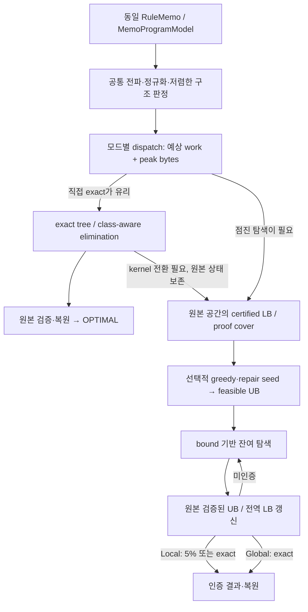

# COFEE Memo Global·Local 최적화 엔진 설계 — 실측 기반 개정안

작성일: 2026-10-15. 개정: **v2, ML 구조 계측과 legacy seed 감사 반영**. 대상 workspace: `/home/mchoi/cofee-tree-dp-20261014`. 기준은 `origin/main`의 `b8623e3481072940c07ef3962bcd55be526f1d09`에서 분리한 작업 브랜치와 검증 완료 변경분이다.

**이 문서는 다음 구현의 설계 명세다.** 현재 코드에서 확인한 사실, 측정 결과, 앞으로 구현할 정책을 구분한다. 이번 개정은 문서 작업이며 새 통합 엔진을 구현하거나 기본 optimizer를 변경한 것이 아니다. 이전 초안은 [원문 snapshot](evidence/memo-tree-dp-20261014/dual-mode-design-v1-before-rewrite.md)으로 보관했다. snapshot의 상대 링크는 원래 `docs/` 위치를 기준으로 해석한다.

## 1. 설계 결정과 요구사항

### 1.1 핵심 결정

**현재 Memo EXACT의 구조 처리 kernel을 기반으로, 직접 exact 실행과 점진 인증 탐색을 분리한다.** Global과 Local이 같은 모델과 kernel을 사용하되, 모든 문제를 같은 anytime 루프에 넣지는 않는다.

| 설계 항목 | 개정안의 결정 |
|---|---|
| Global의 우선 경로 | 준비 비용과 예상 메모리가 합리적이면 exact tree/variable elimination으로 바로 완료한다. 별도 seed·반복 relaxation·frontier·중간 gap 검사를 강제하지 않는다. |
| Global의 잔여 문제 | 큰 exact table이 불리하면 conditioning, context 재사용, B&B를 사용한다. 유용한 bound로 불필요한 대안을 배제한다. |
| Local의 우선 경로 | 직접 exact가 충분히 싸면 같은 경로를 사용한다. 그렇지 않으면 feasible seed와 certified LB를 마련하고 5% 인증까지 개선한다. |
| Local의 initial plan | legacy의 closed-factor greedy → 조건부 exact repair → 원본 전체 검증 아이디어를 Memo의 UB 생성기로 구현한다. |
| Tree 처리 | 전체 비용·제약 관계에서 저렴하게 축약되는 tree/leaf 영역을 공통 fast path로 사용한다. 모든 HOP tree를 먼저 완성하지 않는다. |
| 핵심 상태 압축 | 실제 boundary/separator의 비용·합법성 class를 활용한다. 필요한 실제 rule ordinal과 복원 정보를 유지한다. |
| 메모리 | 임의의 작은 node/frontier 제한 대신 실제 가용 bytes, 표현 선택, 재계산, 증명을 보존하는 탐색 전환으로 관리한다. |
| 성공 조건 | Global은 exact 증명, Local은 exact 또는 `LB > 0`이고 `UB ≤ 1.05 × LB`. 시간이나 고정 반복 수는 성공 사유가 아니다. |

### 1.2 유지할 계약

- `RuleMemo`, `MemoProgramModel`, 후보 universe, 비용 profile, 원본 Check·CostTerm과 plan reconstruction을 유지한다.
- 함수·branch·loop·shared producer·shared movement의 모든 관련 의존성을 보존한다. solver 성능을 위해 runtime이 지원하는 후보를 임의로 제거하지 않는다.
- 인증용 UB는 원본 모델 전체에서 합법성이 검증된 완전한 선택의 비용이다. 불법·UNKNOWN 후보의 부분 점수를 UB로 쓰지 않는다.
- ε 보장은 **고정된 Memo 추정 비용의 최적값**에 대한 것이다. 실제 학습 wall time의 5% 보장은 아니다.
- 기존 `EXACT`, 독립 `TREE_DP_GLOBAL/LOCAL`, legacy solver는 비교 기준으로 유지한다. 새 모드는 opt-in으로 검증하고, 기본값 변경은 별도 검증 뒤 결정한다.

현재 EXACT와 Tree가 같은 solver 입력·원본 비용 검증·재구성을 사용한다는 근거는 [MemoProgramModel](/home/mchoi/cofee-tree-dp-20261014/src/main/java/org/apache/sysds/hops/fedplanner/memo/MemoProgramModel.java:438), 현재 선택 경로는 [FederatedPlanMemo](/home/mchoi/cofee-tree-dp-20261014/src/main/java/org/apache/sysds/hops/fedplanner/memo/FederatedPlanMemo.java:62)에 있다. 알려지지 않은 loop/branch의 기존 profile도 이번 solver 변경으로 바꾸지 않는다. [Profile](/home/mchoi/cofee-tree-dp-20261014/src/main/java/org/apache/sysds/hops/fedplanner/memo/MemoProgramModel.java:65).

## 2. 설계를 결정한 실제 근거

### 2.1 단순 tree의 비중과 작은 separator의 가치

같은 봉인 입력·W3 metadata·Docker 조건에서 LogReg, GLM, GNMF를 진단용 engine으로 다시 compile했다. 모든 cost/check scope를 연결한 primal graph에서 propagation·정확 정규화 후의 선택 구조는 다음과 같다.

| 지표 | LogReg | GLM | GNMF |
|---|---:|---:|---:|
| 전체 모델 변수 슬롯 | 489 | 1,001 | 85 |
| 초기 선택지 2개 이상 변수 | 86 | 171 | 18 |
| 정규화 후 선택지 2개 이상 변수 | 80 | 166 | 16 |
| boundary ≤ 1로 반복 leaf 제거 가능한 변수 | 12 | 21 | 0 |
| 그 비율 | 15.0% | 12.7% | 0.0% |
| 실제 elimination의 최대 separator 변수 수 | 4 | 10 | 3 |
| 최대 class-aware 출력 table rows | 441 | 111,132 | 80 |
| 전체 elimination cells | 14,744 | 1,360,977 | 3,308 |

원자료: [구조 요약](../experiments/memo-tree-dp-20261014/structure-audit-20261015/structure-summary.json), [진단 결과](../experiments/memo-tree-dp-20261014/structure-audit-20261015/results/summary.json). 계측 정의와 전체 수치는 [구조·seed 감사](COFEE_ML_STRUCTURE_AND_SEED_AUDIT_2026-10-15_KO.md)에 있다.

HOP input edge만 보면 leaf 제거 비율은 56~68%였지만, 이 그래프에는 statement 간 binding·control flow·공동 비용 관계가 빠져 있다. 이를 최적화 가능한 tree 비율로 사용하지 않는다. 전체 모델 슬롯에서 active 변수로 줄어든 차이 역시 대부분 초기 singleton 등을 포함하므로 모두 propagation 효과라고 부르지 않는다.

위 leaf 비율은 **단일 boundary로 제거하는 단순 구조**의 비중이다. 고차 factor의 incidence tree, 여러 boundary를 가진 cluster, 모든 가능한 tree decomposition을 센 것은 아니다. 최대 separator는 선택한 제거 순서의 관측값이며 최소 treewidth의 증명이 아니다. 변수 비율은 시간 절감률도 아니다.

이 세 사례에서는 단순 tree만으로 대부분을 해결한다는 가설보다, **작은 separator와 class 압축을 이용한 exact 구조 처리**를 우선 검증하는 것이 타당하다. 특히 GNMF는 위 leaf 영역이 0이어도 최대 80-row 출력 message로 exact elimination이 완료됐다. 이 판단을 모든 ML·shape·worker 조건으로 일반화하지 않는다.

### 2.2 기존 EXACT는 이미 직접 exact 경로로 성공했다

세 baseline 실행은 모두 `nodes == eliminationCells`, `boundPrunes=0`, `conditionalBoundQueries=0`이었다. 정확 DP 내부의 legality 검사와 전파는 수행하지만, 별도 전역 LB/UB 반복 계산이나 incumbent 기반 비용 pruning은 사용하지 않았다. [현재 elimination solve](/home/mchoi/cofee-tree-dp-20261014/src/main/java/org/apache/sysds/hops/fedplanner/memo/MemoOptimizer.java:514).

| 기존 baseline optimization 시간 | LogReg | GLM | GNMF |
|---|---:|---:|---:|
| Memo EXACT | 0.696407157 s | 2.236879600 s | 0.156286576 s |

이 시간은 기존 final engine의 측정이며 진단 계측 실행 시간이 아니다. [최종 baseline](../experiments/memo-tree-dp-20261014/results-v2-w3-r2/summary.json).

반면 독립 Tree solver는 해당 LogReg·GLM 비교에서 2,000-node 진단 cap 안에 인증하지 못했다. GNMF는 Global exact와 Local 4.6073%를 인증했지만 optimization 시간이 각각 0.221227738 s, 0.196144206 s로 기존 EXACT보다 길었다. 이 차이는 알고리즘 전체 비교이며 gap 비교 연산만 제거한 ablation은 아니다. [상세 비교](COFEE_LEGACY_MEMO_TREE_DP_COMPARISON_2026-10-15_KO.md).

### 2.3 Legacy의 seed는 boundary greedy만으로 완성되지 않는다

현재 legacy Local은 producer-before-consumer 순서로 이미 닫힌 incident factor만 평가해 greedy 선택을 한다. 이후 전체 hard-conflict를 찾아 조건부 exact repair와 block 확장을 수행하고, 전체 합법성과 canonical 비용을 검증한다. 이 seed를 encoded model로 lift한 뒤 Regional 탐색의 UB로 사용한다. [regionalSeed](/home/mchoi/cofee-tree-dp-20261014/src/main/java/org/apache/sysds/hops/fedplanner/fedCostBased/fedExact/LocalPhysicalOptimizer.java:184), [closed-factor 선택](/home/mchoi/cofee-tree-dp-20261014/src/main/java/org/apache/sysds/hops/fedplanner/fedCostBased/fedExact/LocalCategoricalOptimizer.java:886), [repair](/home/mchoi/cofee-tree-dp-20261014/src/main/java/org/apache/sysds/hops/fedplanner/fedCostBased/fedExact/LocalCategoricalOptimizer.java:959).

따라서 이 패턴을 **초기 UB 생성 방법**으로 채택한다. 현재 legacy의 encoded auxiliary lifting 클래스 자체를 Memo에 복사하지 않는다. [IncrementalRegionalSeed의 실제 역할](/home/mchoi/cofee-tree-dp-20261014/src/main/java/org/apache/sysds/hops/fedplanner/fedCostBased/fedExact/IncrementalRegionalSeed.java:95).

legacy도 lift 이후 reduced·prepared·canonical 비용을 다시 대조해 UB를 검증한다. [상위 optimizer의 검증](/home/mchoi/cofee-tree-dp-20261014/src/main/java/org/apache/sysds/hops/fedplanner/fedCostBased/fedExact/IncrementalRegionalOptimizer.java:889).

## 3. 공통 모델과 정확한 구조 축약

### 3.1 비용·합법성 관계를 함께 사용한다

선택 변수 `x_v`는 실제 owner/loop boundary의 rule ordinal을 나타낸다. 목적함수는 원본 native 비용과 공동 비용의 합이며, 원본 Check를 모두 만족해야 한다. HOP input graph만으로 독립성을 판정하지 않는다.

```text
C(x) = Σ_v native_v(x_v) + Σ_f cost_f(x_scope(f))
feasible(x) ⇔ 모든 원본 Check(x_scope)가 YES
```

shared producer의 선택, shared movement의 비용 소유권, 함수 호출 문맥, branch의 reaching definition, loop entry/head/backedge/exit 관계가 factor에 남아 있어야 한다. [owner·loop 변수](/home/mchoi/cofee-tree-dp-20261014/src/main/java/org/apache/sysds/hops/fedplanner/memo/MemoProgramModel.java:314), [movement 구성](/home/mchoi/cofee-tree-dp-20261014/src/main/java/org/apache/sysds/hops/fedplanner/memo/MemoProgramModel.java:1020).

### 3.2 Region message의 계약

region 내부 변수 `I`, 외부 경계 `B`에 대해:

```text
M_R(b) = min_{x_I} C_owned(R)(x_I, b)
         subject to R이 소비하는 원본 constraint
```

각 factor는 region 또는 core 한 곳에서만 비용에 기여한다. 내부 변수 제거 시 그 변수를 참조하는 모든 factor를 함께 소비한다. factor를 core에 남기면 그 factor가 참조하는 변수도 boundary/core에 남겨야 한다. boundary는 외부가 구분해야 하는 모든 정보를 담는다.

exact message에는 boundary별 비용과 실제 선택의 argmin 또는 검증된 replay 경로가 필요하다. boundary와 무관하게 최적 계획 하나만 남기면 외부의 최적 선택을 잃을 수 있다. UNKNOWN을 허용해 계산한 lower-bound message는 feasible witness가 보장된 exact message와 타입·계약을 구분한다.

class는 factor별 증명된 동치다. message가 소비한 cost/truth factor의 class를 공통 refinement하되, 소비하지 않은 native cost·외부 factor의 구분과 실제 ordinal을 보존한다. [현재 class-aware elimination 계약](/home/mchoi/cofee-tree-dp-20261014/src/main/java/org/apache/sysds/hops/fedplanner/memo/MemoOptimizer.java:312).

### 3.3 Tree와 table, 그리고 선처리의 범위

Tree DP도 boundary별 table/message를 사용한다. 같은 tree·상태·제거 순서에서는 min-sum과 leaf elimination이 같은 recurrence를 계산하지만, sparse 표현·class 수·평가 비용·계산 순서에 따라 성능은 달라진다. [Cycle-free factor graph 계산](https://www.isiweb.ee.ethz.ch/papers/arch/aloe-2001-1.pdf).

공통 preparation은 domain propagation, singleton/invariant 축약, factor grouping, 저렴한 구조 판정을 먼저 수행한다. 작은 독립 성분 또는 작은 boundary region은 정확히 축약할 수 있다. 그러나 큰 boundary table을 “conflict가 없으므로 먼저” 전부 계산하지 않는다. core propagation이 나중에 제거할 상태를 미리 계산할 수 있기 때문이다.

현재 witness에서 위반이 없다는 사실도 독립성의 증거가 아니다. 구조 독립성, 조건부 독립성, 현재 assignment의 합법성을 구분한다. 현 [tree→elimination→leaf/core→search 순서](/home/mchoi/cofee-tree-dp-20261014/src/main/java/org/apache/sysds/hops/fedplanner/memo/MemoOptimizer.java:286)를 첫 baseline으로 유지하고, 순서 변경의 이득은 ablation으로 확인한다.

## 4. 실행 구조: 공통 kernel, 별도 실행 경로



### 4.1 공유할 것과 강제하지 않을 것

| 공유 | 모드·경로에 따라 선택 |
|---|---|
| 원본 problem identity, domains, factor ownership | seed를 먼저 구할지 |
| propagation·정확 정규화 | 직접 exact DP로 끝낼지 |
| tree/region/class-aware elimination kernel | 어느 relaxation을 얼마나 강화할지 |
| 조건부 exact solve와 안전한 cache | best-bound 또는 DFS 순서 |
| 원본 witness 검증·최종 재구성 | 중간 인증 checkpoint와 상세 trajectory |
| 자원 상태·실패 분류 | Local의 5% 종료 또는 Global의 exact 종료 |

직접 exact 경로에 frontier와 반복적인 LB 생성 객체를 만들지 않는다. 공통 인증 결과 API는 완료 시 사용해도 된다. 유용한 중간 bound가 없으면 보수적인 `LB=−∞`, feasible 해가 없으면 `UB=+∞` 또는 명시적 미정 상태를 유지할 수 있다. 미정 상태는 성공 인증에 사용할 수 없으며, exact 완료 후에는 `LB=UB=검증된 최적 비용`으로 보고한다.

### 4.2 경로 선택 정책

초기 selector는 학습 모델이나 새 dependency 없이 설명 가능한 규칙으로 시작한다. 현재 live domain과 factor class, 예상 separator rows, factor 평가 작업량, 원본·중간 message·복원 정보의 동시 peak bytes를 이용한다.

| 상태 | Global | Local |
|---|---|---|
| 전체 exact tree 또는 작은 exact VE 예상 | 바로 실행 | seed보다 싸면 바로 실행 |
| 큰 결합이 있지만 conditioning 후 작은 분해 | 조건화·exact kernel 재사용 | seed와 LB를 확보한 뒤 gap 기여가 큰 조건화 선택 |
| exact table이 메모리/작업상 불리 | context-cached B&B | certified search와 UB 개선 |
| seed 수선이 커지거나 진전 없음 | seed를 필수로 요구하지 않음 | seed 작업을 중단·전환하고 본 탐색 진행 |
| 유효 LB 강화가 비쌈 | 기존 sound bound 재사용 또는 직접 kernel | gap 개선 예상 이득과 비용을 비교 |

selector의 오판은 작업량에만 영향을 주어야 한다. 후보 공간을 바꾸거나 미완료 table을 exact로 선언하는 근거가 될 수 없다. 전체 graph census 같은 진단 작업도 매 production 호출의 필수 비용으로 넣지 않는다. 기존 incidence/정규화 정보를 재사용하고 상세 계측은 별도로 켠다.

## 5. Global: 직접 Exact 우선, 필요한 경우에만 bound 탐색

### 5.1 직접 exact 실행

1. 원본 universe의 완결성과 모델 지원 상태를 확인한다.
2. 공통 preparation 뒤 exact tree 또는 class-aware elimination의 적용 비용을 추정한다.
3. 유리한 kernel을 한 번 실행해 정확한 message와 witness를 구한다.
4. 원본 전체 합법성·비용을 검증하고 기존 재구성 경로를 적용한다.
5. 요청한 canonical tie 계약까지 만족하면 OPTIMAL을 반환한다.

이 경로에는 별도 초기 feasible-plan 탐색, 반복 relaxation, gap 검사, priority frontier가 필수가 아니다. 정확성은 완료된 elimination/DP의 동치 변환과 원본 검증으로 증명한다. 중간 bound 보고가 필요하더라도 추가 비용을 들여 정밀한 하한을 만들지 않는다.

### 5.2 Exact table이 불리한 경우

conditional tree/region solve, cutset conditioning, context cache, B&B를 사용한다. feasible incumbent와 유효 하한이 탐색을 충분히 줄일 때 계산하며, 변하지 않은 영역의 bound와 message는 재사용한다. 모든 node에서 비싼 relaxation을 새로 만들도록 강제하지 않는다.

kernel이 적용되지 않는다는 사실은 문제 전체가 unsupported/infeasible이라는 뜻이 아니다. 메모리상 비싼 kernel을 거절했으면 같은 문제를 다른 표현·탐색으로 이어 간다. 미완료 작업의 원본 region과 이전 유효 bound를 유지해야 한다.

### 5.3 동률 선택 보존

현재 EXACT는 같은 비용에서 lexicographic rule 선택을 보존한다. `LB=UB`는 비용 최적성만 증명하며, 미해결 동률 영역의 더 작은 witness를 배제하지는 않는다. Global 호환 경로에서는 exact message의 argmin tie 규칙과 lexicographic domain floor를 보존한다. `LB>UB`는 비용상 제거 가능하지만 `LB=UB`인 영역은 필요한 tie 증명 없이 버리지 않는다. [현재 search와 tie 비교](/home/mchoi/cofee-tree-dp-20261014/src/main/java/org/apache/sysds/hops/fedplanner/memo/MemoOptimizer.java:808), [domain floor](/home/mchoi/cofee-tree-dp-20261014/src/main/java/org/apache/sysds/hops/fedplanner/memo/MemoOptimizer.java:1873).

## 6. Local의 초기 합법 계획: Greedy와 조건부 Exact Repair

### 6.1 Seed는 UB 후보를 만드는 독립 작업이다

seed용 임시 assignment/domain과 전역 proof domain을 분리한다. seed가 고른 값이나 임시로 제외한 후보는 전역 최적화 문제의 제약이 아니다. 다음 결과를 구분한다.

| seed 작업 결과 | 전체 solver의 처리 |
|---|---|
| 원본 검증된 완전 assignment 발견 | feasible UB 후보로 등록 |
| greedy dead end, 조건부 repair 해 없음, heuristic 작업 중단 | seed 미발견으로 기록하고 다른 seed/본 탐색으로 진행 |
| 원본 전체 공간을 exact로 풀어 최적성까지 증명 | 증명 범위·소유권 확인 후 전체 exact 결과로 재사용 가능 |
| 조건부 문제만 exact로 해결 | 해당 boundary 조건의 해이며 전역 optimum으로 표시하지 않음 |

### 6.2 Greedy 선택

producer-before-consumer 순서를 기본 힌트로 사용하되, 함수·loop 관계까지 단순 DAG라고 가정하지 않는다. 미선택 변수 중 다음 변수를 정하고 실제 rule 후보를 비교한다.

평가에는 native 비용, 다른 scope 변수가 모두 정해진 check/cost factor, 이미 준비된 exact boundary message를 사용한다. shared movement는 동일 factor의 비용을 한 번만 센다. 닫히지 않은 미래 factor를 무시한 점수는 heuristic이며 LB도 완전 계획 비용도 아니다.

가능하면 닫힌 Check가 YES인 후보를 우선하지만, greedy의 국소 선택으로 미래 feasible extension이 보장되지는 않는다. 임시 후보를 완성한 뒤 원본 전체 검사로 repair 대상을 정한다. UNKNOWN은 feasible 판정에서 제외하고, 단순 NO와 구분해 지원 가능한 분석·재선택으로 해소할 수 있는지 본다.

### 6.3 Conditional exact repair

위반 check의 연결 영역과 직접 영향을 받는 주변 변수부터 block을 만든다. block 내부 변수를 참조하는 **모든** check/cost를 포함하고, 외부 assignment는 명시적 boundary 조건으로 고정한다. 공동 비용도 그 조건에서 정확히 평가한다.

기존 exact kernel로 내부를 풀고, 전체 assignment를 다시 검사한다. 바뀐 변수가 다른 영역의 constraint나 비용을 바꿀 수 있으므로 block 검사만으로 UB를 승인하지 않는다. 외부 고정 때문에 해가 없으면 boundary를 다시 열거나 block을 확장할 수 있어야 한다.

repair가 반복되면 진전 없는 assignment 재방문을 탐지하고, block 확대·다른 초기 선택·본 탐색 전환 중 하나를 수행한다. seed heuristic의 평가량·할당량을 제한하는 것은 허용한다. **그 한도는 seed 작업 전환 조건이며 Local의 성공/실패 종료 조건이 아니다.** 특히 seed cap에 도달했다고 RESOURCE_EXHAUSTED나 ε 성공으로 전체 solver를 끝내지 않는다.

### 6.4 UB 승인과 비용

완전 assignment의 모든 원본 Check가 YES인지 확인하고, native·shared movement를 포함한 원본 objective를 다시 계산한다. 선택과 복원에 필요한 원본 identity를 유지한다. 최종 계획 적용은 기존 supply·loop contract·HOP 재구성 검증을 거쳐야 한다. [원본 검증과 재구성 진입](/home/mchoi/cofee-tree-dp-20261014/src/main/java/org/apache/sysds/hops/fedplanner/memo/MemoProgramModel.java:438).

seed의 국소 비용 합이나 encoded 중간 점수를 그대로 UB로 쓰지 않는다. 초기 feasible 해를 얻지 못하면 UB는 계속 미정/무한대이며 본 탐색이 feasible 해를 찾을 수 있다. 좋은 seed가 인증 시간을 줄인다는 가설은 `seed 시간 + 이후 인증 시간`의 총합으로 검증한다.

## 7. Certified Search: Local의 점진 인증과 Global의 잔여 탐색

### 7.1 첫 하한과 원본 문제의 보존

완결된 후보 공간에서 시작한다. 값이 고정된 비용과 정확히 축약된 message를 포함하고, 나머지 native 항의 minimum 및 각 cost factor의 검증된 floor를 합산하면 legality를 완화한 초기 하한을 만들 수 있다. 같은 factor를 정확 message와 floor 양쪽에서 다시 더하지 않는다. signed 비용을 허용하는 테스트도 있으므로 무조건 0을 하한으로 사용하지 않는다.

초기 bound가 약해도 sound하면 사용할 수 있다. 전역 search domain에는 seed에서 임시로 고정한 boundary를 반영하지 않는다. 합법성 전파 등 원본 문제에서 증명한 제거만 공유한다. 후보 universe가 열려 있고 누락 후보의 하한을 제어할 수 없으면 현재 부분 공간만으로 인증하지 않는다. [기존 coverage 검사](/home/mchoi/cofee-tree-dp-20261014/src/main/java/org/apache/sysds/hops/fedplanner/memo/MemoOptimizer.java:286), [기존 conditional lower bound](/home/mchoi/cofee-tree-dp-20261014/src/main/java/org/apache/sysds/hops/fedplanner/memo/MemoOptimizer.java:1753).

### 7.2 다음 작업은 전역 gap에 기여하는 영역에서 고른다

| 작업 | 사용 조건 | 증명상 효과 |
|---|---|---|
| 작은 region의 exact elimination | boundary class table이 작음 | 해당 region의 상관관계를 정확히 포함 |
| boundary 변수 conditioning | 고정 후 forest/작은 separator로 분해 | 완전한 대안 분할과 conditional message 재사용 |
| context-cached B&B | 넓은 core, 불가능 조합·incumbent pruning 이득 예상 | 가능성이 남은 대안만 탐색 |
| feasible plan 개선 | UB가 높고 기존 선택 주변에 저렴한 후보가 있음 | 원본 검증 후 UB 감소 |
| cluster 병합/mini-bucket 강화 | 약한 LB가 병목이며 추가 작업 이득이 예상됨 | 결합을 더 포함한 certified LB |

seed repair의 조건부 exact 결과가 search에 유용하면 유효 domain·factor provenance를 확인해 재사용한다. 임의의 outside assignment에 조건화된 결과를 다른 boundary의 exact message나 전역 하한으로 확대 적용하지 않는다.

conflict 수만으로 우선순위를 정하지 않는다. 이미 합법적인 incumbent라도 더 싼 계획이 있을 수 있고, 적은 수의 movement factor 하나가 gap 대부분을 만들 수 있다. 현재 전역 bound를 제한하는 영역, 예상 class rows, factor 평가량과 peak bytes를 함께 본다. 시간 계측은 작업량 추정에 쓸 수 있으나 경과 시간 자체로 성공 종료하지 않는다.

### 7.3 Bound 합성의 세 규칙

| 관계 | 합성 |
|---|---|
| 의존성이 분리되고 비용 소유권이 겹치지 않는 AND component | `constant + Σ LB_i` |
| 같은 문제의 미해결 domain 대안들을 덮는 OR 분할 | `min LB_i` |
| 같은 영역·같은 objective에 대한 여러 relaxation | `max LB_i` |

독립 component를 min으로 합치거나, 같은 objective의 두 relaxation을 더하지 않는다. 특히 signed 비용에서 independent optimum이 −5와 −4이면 전체 optimum은 −9이고 min=−5는 잘못된 하한이다. 고정 비용을 제거해 계산하더라도 인증할 때는 원래 objective의 상수를 복원한다. 상수 이동은 argmin을 보존하지만 상대 gap을 보존하지 않는다.

전역 OR 영역들의 cover를 `Q`라고 하면 feasible incumbent가 있을 때:

```text
LB_global = min(UB, min_{q∈Q} LB(q))
LB_child  = max(LB_parent, 새로 계산한 child의 유효 LB)
```

`Q`에는 queue뿐 아니라 계산 중인 영역, 아직 생성하지 않은 sibling, 최적성에 영향을 줄 수 있는 UNKNOWN 영역도 포함한다. 하나를 꺼내 계산한다고 일시적으로 전역 하한에서 빼지 않는다. 초기 UB가 없으면 후보 비용을 끼워 넣지 말고 Q의 하한만 사용한다.

### 7.4 성공 판정과 숫자 표현

원본 전체 문제에 대해 `LB ≤ OPT ≤ UB`를 보존한다. Local의 상대 인증은 정확히 다음 조건이다.

```text
feasible UB 존재
LB > 0
UB <= BigDecimal("1.05") * LB
```

그러면 `UB/OPT−1 ≤ UB/LB−1 ≤ 0.05`다. 분모를 UB로 바꾸거나 component별 gap을 단순 평균하지 않는다. `LB≤0`이면 exact 증명까지 진행하거나 미인증 실패를 보고한다. `LB=UB=0`은 exact가 가능하다.

기존 binary64 primitive를 정확한 `BigDecimal` 값으로 변환해 합산하는 목적함수를 유지한다. 화면에 출력한 반올림 숫자나 임의의 floating tolerance로 인증하지 않는다. [현재 exact 비용 표현](/home/mchoi/cofee-tree-dp-20261014/src/main/java/org/apache/sysds/hops/fedplanner/memo/MemoOptimizer.java:2028), [기존 Tree의 인증 조건](/home/mchoi/cofee-tree-dp-20261014/src/main/java/org/apache/sysds/hops/fedplanner/memo/MemoTreeDpOptimizer.java:671).

Local은 더 싼 경로로 exact가 증명되면 OPTIMAL을 반환할 수 있다. Global은 5%를 달성해도 exact 증명이 끝나기 전에는 성공 종료하지 않는다. Global 호환 모드의 canonical tie 처리는 별도로 유지한다.

### 7.5 Incremental publication과 cache

완료된 bucket, region 또는 유효한 bound 단위에서만 proof 상태를 갱신한다. **일부 후보만 열거한 table의 현재 minimum은 전체 minimum의 LB가 아니다.** 미완료 동안 원래 region과 이전 하한을 유지하고, 완성된 exact message로 교체할 때 원자적으로 factor ownership을 넘긴다.

branch는 child를 한 번에 모두 만들지 않고 lazy하게 생성할 수 있다. 나머지 ordinal 집합은 pending-sibling 영역과 하한으로 남긴다. partial child 생성이나 allocation 실패가 parent 영역을 잃게 해서는 안 된다.

cache의 유효성은 boundary 값만으로 결정되지 않는다. 내부 domain restriction, 소비한 factor 집합, 모델/profile version, 관련 Check의 의미와 원본 ordinal 매핑을 포함한다. seed의 조건부 결과도 같은 계약을 만족할 때만 공유한다. 유효한 cache를 회수하면 재계산이 늘 수 있지만 objective나 certificate가 바뀌면 안 된다.

### 7.6 선택적 강화와 진행 보장

첫 버전은 기존 exact kernel, conditioning, cached B&B를 우선한다. mini-bucket 또는 cluster 병합은 약한 LB가 실제 병목임을 확인한 뒤 하나씩 추가한다. mini-bucket은 다음 완화 부등식을 사용할 수 있다.

```text
Σ_j min_x G_j(x,y_j) ≤ min_x Σ_j G_j(x,y_j)
```

각 원본 factor를 정확히 한 묶음에 배치한다. 서로 다른 heuristic partition의 raw bound가 자동으로 단조 증가한다고 가정하지 말고, 같은 영역의 certified 하한 중 최댓값을 유지한다. [Mini-Buckets, §6–9](https://ics.uci.edu/~dechter/publications/r62.pdf).

loopy min-sum의 수렴만으로 인증하지 않는다. dual 방식은 목적함수 보존과 하한 증명을 별도로 갖춘 뒤 검토할 후속 선택지다. [Cycle-free와 loopy 계산의 구분](https://www.isiweb.ee.ethz.ch/papers/arch/aloe-2001-1.pdf).

같은 domain·partition에서 진전 없는 강화 작업을 무한 반복하지 않는다. 강화가 소진되면 domain을 엄격히 줄이는 분기로 진행하고, 가능한 모든 대안이 처리될 수 있는 순서를 유지한다. finite complete domains·결정 가능한 legality·충분한 자원 아래 탐색 완전성을 보존한다. 이 진행 규칙은 고정 횟수 뒤 미인증 결과를 성공으로 반환하는 정책과 다르다.

## 8. 결과·실패 계약과 실행 의사 코드

| 결과 | 요구 증거 |
|---|---|
| OPTIMAL | 원본 feasible witness와 전역 비용 최적성 증명; 요청한 tie 계약 완료 |
| EPSILON_OPTIMAL | Local에서 원본 feasible UB와 certified positive LB로 요청 gap 증명 |
| INFEASIBLE | 완결된 원본 공간에 feasible 해가 없다는 증명 |
| UNRESOLVED | UNKNOWN 또는 모델 지원/coverage 때문에 필요한 증명을 완료할 수 없음 |
| RESOURCE_EXHAUSTED | 필수 자원 확보 실패 또는 명시적 진단용 solver cap으로 인증 전에 종료 |

kernel 적용 거절, seed 미발견, 조건부 repair 불가능은 위의 전체 solver 실패와 구분하는 내부 상태다. 미인증 실패에는 마지막 유효 bound와 feasible incumbent를 진단 정보로 실을 수 있으나, 성공 계획으로 적용하지 않는다. 외부 취소·watchdog 종료도 인증 성공이 아니다.

```text
problem = 기존 MemoProgramModel의 동일한 원본 입력
if 후보 universe를 완결되게 다룰 수 없음: UNRESOLVED
prepared = 공통 propagation + 정확 정규화
원본 전체 infeasibility가 증명되면 INFEASIBLE

if selector가 직접 exact를 선택:
    result = exact tree / class-aware elimination
    완료된 원본 exact 증명과 witness가 있으면 검증·복원 후 OPTIMAL
    원본 전체 infeasibility가 증명되면 INFEASIBLE
    미완료이면 원본 공간과 완료된 안전한 결과를 보존해 다음 경로로 전환

cover = 원본 공간을 덮는 pending 영역과 certified LB
incumbent = 이전 작업의 원본 검증된 최선 witness, 없으면 미정
필요하면 seed 작업 수행; 원본 검증된 결과만 incumbent로 반영

while 미해결 영역이 있음:
    원본 objective 단위로 전역 bounds 합성
    exact 증명과 필요한 tie 처리가 끝났으면 OPTIMAL
    Local이고 feasible UB와 positive LB가 5%를 증명하면 EPSILON_OPTIMAL
    증명에 영향을 주는 UNKNOWN만 남고 지원 가능한 작업이 없으면 UNRESOLVED

    다음 exact/분기/bound/UB 개선 작업 선택
    큰 allocation은 cache 회수·표현 변경·작은 메모리 탐색 전환 검토
    복구 경로를 소진했고 최소 진행 자원도 없으면 RESOURCE_EXHAUSTED
    기존 cover를 보존한 채 작업 실행
    완료된 exact 결과, certified LB, 검증된 UB만 publish

원본 cover가 닫혔으면 feasible witness 여부에 따라 OPTIMAL 또는 INFEASIBLE
```

UNKNOWN 실패 판단보다 인증 검사를 먼저 한다. 미해결 영역이 있어도 그 하한이 충분히 높으면 요청한 인증에는 영향을 주지 않을 수 있다. singleton UNKNOWN이 증명을 막고 더 할 수 있는 작업이 없으면 반복하지 않고 UNRESOLVED로 끝낸다.

## 9. 메모리: 큰 고정 한도 대신 실제 자원과 표현을 관리한다

### 9.1 한도의 성격을 구분한다

| 현재 항목 | 의미 | 개정 설계 |
|---|---|---|
| EXACT elimination 2M cells / 500k rows | 해당 경로의 적용 threshold | 예상 work와 peak bytes로 대체·보완; 초과 자체로 문제 전체 실패하지 않음 |
| cache별 4,096 entries | 객체 크기를 반영하지 않는 재사용 한도 | 공통 byte 추정과 재계산 가치 기반 회수 |
| Tree frontier 10,000 | 다음 확장을 수용하지 못하면 명시적 resource 실패 | 증명 보존형 탐색 전환을 구현한 뒤 생산 terminal count cap 대체 |
| 실험 node cap | 재현 가능한 실패 진단 | 명시적 실험용으로 유지; 인증 성공 사유로 사용하지 않음 |
| heap·cgroup·array 표현 한계 | 실제 실행/표현 제약 | checked sizing, 다른 표현·탐색 검토, 최종 명시적 실패 |

근거: [EXACT limits](/home/mchoi/cofee-tree-dp-20261014/src/main/java/org/apache/sysds/hops/fedplanner/memo/MemoOptimizer.java:111), [elimination threshold](/home/mchoi/cofee-tree-dp-20261014/src/main/java/org/apache/sysds/hops/fedplanner/memo/MemoOptimizer.java:325), [Tree defaults](/home/mchoi/cofee-tree-dp-20261014/src/main/java/org/apache/sysds/hops/fedplanner/memo/MemoTreeDpOptimizer.java:51).

### 9.2 사용자 의도에 맞는 자원 활용

큰 exact table이 실제 시간을 줄이면 가용 자원을 적극 사용한다. 반면 재사용 이득 없는 cache와 중복 witness 때문에 메모리를 채우지는 않는다. 임의의 작은 비율만 허용하는 대신 **필수 진행·복원·후속 lowering 공간까지 포함한 실제 peak**를 추정한다.

`cells×8`만 세지 않는다. BigDecimal payload, 배열 참조, BitSet/domain, map/key, backpointer, 이전·새 table 동시 생존, 현재 model과 cache, 복원 workspace를 포함한다. heap live·allocated bytes, process RSS, container usage는 서로 다른 지표로 기록한다.

JVM heap 외에도 stack·code·GC·native 사용량이 있고, cgroup OOM kill은 Java 예외로 반드시 복구할 수 없다. 정확한 “다음 allocation 실패 직전”을 예측한다고 약속하지 않는다. [Oracle Java 17 진단 문서](https://docs.oracle.com/en/java/javase/17/troubleshoot/diagnostic-tools.html), [Linux cgroup v2](https://docs.kernel.org/admin-guide/cgroup-v2.html).

### 9.3 압박 시 처리 순서

1. 재계산 가능한 낮은 가치 cache와 임시 상태를 회수한다.
2. sparse/class quotient/conditional 표현 또는 작은 table 분할을 선택한다.
3. 큰 elimination 대신 conditioning·DFS·재계산을 이용해 같은 문제를 계속 푼다.
4. best-bound frontier를 compact pending frames와 sibling 영역으로 전환한다. 모든 미해결 영역이 새 표현에 보존됐음을 확인한 뒤 기존 queue를 해제한다.
5. model·incumbent·proof cover·진행과 복원의 최소 workspace도 확보할 수 없으면 명시적으로 실패한다.

cache와 proof state를 구분한다. 원본 factor를 대체한 유일 exact message를 삭제하려면 원본 또는 검증된 replay 경로가 남아 있어야 한다. pending 영역은 복원 수단 없이 버리지 않는다. tree/search traversal은 iterative하게 하고, 전체 bound history는 파일로 stream해 진단 로그 자체가 RAM을 소진하지 않게 한다.

큰 allocation은 실패 위치를 식별할 수 있는 경계로 모으고 이전 proof 상태를 유지한다. OOME를 임의의 위치에서 잡아 복구했다고 선언하지 않는다. legacy의 guard는 checked multiplication과 일부 primitive allocation 처리의 참고점이며 전체 live-memory manager는 아니다. [PlannerResourceGuard](/home/mchoi/cofee-tree-dp-20261014/src/main/java/org/apache/sysds/hops/fedplanner/fedCostBased/fedExact/PlannerResourceGuard.java:40).

설정된 JVM/container 한도를 조용히 확대하지 않는다. disk spill은 별도 I/O·복구 계약이 필요한 후속 선택지이며 초기 필수 범위에서 제외한다.

## 10. 구현 경계와 단계

### 10.1 책임 분리

아래 새 class 이름은 제안이며 현재 API가 아니다. 기존 자료형을 우선 활용하고, 추출할 책임이 확인될 때 작은 단위로 분리한다. 새 외부 dependency는 필요하지 않다.

| 영역 | 책임과 변경 |
|---|---|
| [MemoOptimizer.java](/home/mchoi/cofee-tree-dp-20261014/src/main/java/org/apache/sysds/hops/fedplanner/memo/MemoOptimizer.java:286) | 기존 direct exact baseline 보존; propagation·normalization·tree·elimination·conditional kernel의 공유 경계를 점진 추출 |
| 제안 `MemoOptimizationPolicy` | mode와 work/bytes 추정에 따라 direct exact 또는 certified search 선택. exact 경로에 search controller를 강제하지 않음 |
| 제안 `MemoFeasibleSeed` | 독립 임시 assignment, closed-factor greedy, conditional repair, 원본 UB 검증 |
| 제안 `MemoCertifiedSearch` | proof cover, LB 합성, incumbent, 작업 선택, Local/Global 성공·실패 판정 |
| 제안 `MemoResourcePolicy` | byte admission·cache 회수·표현/탐색 전환 요청; 정답 공간은 변경하지 않음 |
| [MemoProgramModel.java](/home/mchoi/cofee-tree-dp-20261014/src/main/java/org/apache/sysds/hops/fedplanner/memo/MemoProgramModel.java:438) | 동일 원본 입력과 검증·재구성 제공; 기존 profile과 소유권 유지 |
| [FederatedPlanMemo.java](/home/mchoi/cofee-tree-dp-20261014/src/main/java/org/apache/sysds/hops/fedplanner/memo/FederatedPlanMemo.java:128) | opt-in 선택, 최종 검증된 결과만 적용, 실패 사유 노출 |
| [기존 Tree solver](/home/mchoi/cofee-tree-dp-20261014/src/main/java/org/apache/sysds/hops/fedplanner/memo/MemoTreeDpOptimizer.java:184) | 독립 비교 기준 유지; 검증된 bound/실패 관리 경험 재사용 |

`PreparedProblem`이 필요하면 원본 identity와 증명된 정규화 결과만 담는다. seed의 임시 고정을 공통 mutable domain에 넣지 않는다. conditional cache는 유효성 key를 갖춘 경우에만 경로 간 공유한다. legacy의 model·encoded auxiliary를 Memo 자료형으로 우회 적용하지 않는다.

### 10.2 구현 순서와 완료 조건

| 단계 | 산출물 | 완료 조건 |
|---|---|---|
| P0. 기준선과 계약 | 같은-model fingerprint, dispatch/seed/bound 단계 telemetry, 기존 결과 고정 | 기존 EXACT·Tree 결과와 원본 후보·비용 동일성 재현 |
| P1. 직접 exact 보존 | 공통 preparation/kernel 경계와 opt-in Global direct 경로 | 기존 exact 비용·canonical vector 동치; seed·relaxation 호출 0 확인 |
| P2. Memo initial UB | closed-factor greedy와 conditional exact repair | 독립 conditional oracle, shared movement, dead-end·UNKNOWN·seed cap 사례 통과 |
| P3. certified search | proof cover, 기존 exact kernel과 conditioning/B&B 연결, 5% 종료 | 전수 oracle와 모든 bound checkpoint 검증; seed 고정이 proof domain에 새지 않음 |
| P4. 메모리와 진행 | byte policy, lazy child, frontier→DFS 전환, 안전한 publication | allocation fault injection·작은 heap에서 cover 보존과 명시적 실패 확인 |
| P5. 선택 정책·선택적 강화 | tree-first/seed/selector ablation, 필요 시 mini-bucket 또는 cluster 병합 | 인증까지 총시간·peak bytes 개선을 확인한 경로만 채택 |
| P6. 생산 비교 | 동일 Docker ML·실제 작은 학습·legacy 비교 | correctness 필수 기준 충족, 실패/느린 사례 포함 결과 보고, 기본값 승격 판단 |

각 단계에서 같은-model 회귀를 실행한다. P4가 준비되기 전에 기존 frontier cap만 제거해 메모리 소진 경로를 만들지 않는다. P5에서 mini-bucket·새 cluster 정책을 동시에 넣어 원인을 구분하지 못하는 변경을 피한다.

향후 선택명은 예를 들어 `MEMO_GLOBAL`, `MEMO_LOCAL`로 둘 수 있으나 아직 구현된 옵션이 아니다. 기존 `EXACT`를 새 Global alias로 바꾸는 것은 비용·tie·지원 범위·성능 검증 뒤의 별도 결정이다.

## 11. 구현 수용 기준과 독립 정확성 검증

아래는 **앞으로 구현할 엔진의 통과 조건**이다. 기존 solver의 테스트 통과를 새 설계의 구현 검증으로 대신하지 않는다. oracle은 solver의 propagation·class 압축·message·bound 함수를 호출하지 않고 원본 후보의 Cartesian product를 열거해 원본 비용과 Check를 평가한다. 작은 수식 fixture는 별도 계산한 비용도 사용한다.

| ID | 검증 대상 | 통과 조건 |
|---|---|---|
| C01 | Global exact | 작은 완결 모델의 최적 비용과 canonical rule vector가 독립 전수 oracle와 일치 |
| C02 | Local 5% | 모든 성공에서 원본 feasible UB 확인; EPSILON_OPTIMAL은 `LB>0`, `UB≤1.05×LB`이고 독립 optimum에 대한 오차도 ≤5% |
| C03 | Bound 전체 궤적 | publish된 모든 checkpoint에서 `LB≤OPT≤UB`; 같은 문제의 기존 certified LB와 best UB를 악화시키지 않음 |
| C04 | 숫자·상수·동률 | 정확한 5% 경계와 직전·직후, 큰 고정 상수, 0·음수 비용, 최적 동률을 검증; 임의 tolerance로 성공하지 않음 |
| C05 | AND/OR 합성 | signed 독립 성분은 합, 대안 분할은 min, 동일 영역의 relaxation은 max; 원본 상수 복원 확인 |
| C06 | 공유와 교차 관계 | diamond·multi-parent·shared movement·고차 crossing factor에서 비용을 한 번만 세고 누락한 boundary 없이 oracle와 일치 |
| C07 | 프로그램 의존성 | 함수 호출 문맥·branch 합류·loop entry/head/backedge/exit·반복 비용을 유지하고 기존 reconstruction/runtime 검증 통과 |
| C08 | UNKNOWN·열린 후보 공간 | UNKNOWN을 feasible witness로 사용하지 않음; 증명을 막는 미해결 영역을 보존하고 필요한 경우 UNRESOLVED |
| C09 | Class와 cache 문맥 | native·외부 factor가 실제 ordinal을 구분하는 사례, domain 축소·boundary/profile 변경에서 잘못된 결과 재사용 0건 |
| C10 | Greedy dead end | 가장 싼 초기 선택에는 extension이 없지만 원본 문제에는 해가 있는 fixture에서 seed 실패가 INFEASIBLE 또는 후보 삭제로 이어지지 않음 |
| C11 | Seed 작업 한도 | seed work cap을 0·작음·큼으로 바꿔도 전역 universe와 Global optimum 동일; Local은 각각 인증 성공 또는 명시적 미인증 실패 |
| C12 | 조건부 repair | outside를 고정한 독립 oracle와 repair 최적값 일치; crossing legality·공동 movement를 포함하고 원본 전체 검증 후에만 UB 등록 |
| C13 | Repair 확대·증명 재사용 | 작은 block의 infeasible은 전체 infeasible로 처리하지 않음; 원본 전체를 exact로 푼 경우 유효 증명을 재사용해 중복 전체 solve 회피 |
| C14 | Direct exact 비용 경로 | 전체 tree/작은 VE 사례에서 seed 호출·반복 relaxation 호출·frontier 생성이 0이며 기존 exact 비용·tie와 일치 |
| C15 | Selector 오판·전환 | direct/search를 강제 선택하고 kernel을 중도 거절해도 동일 원본 문제와 exact 결과 보존; 먼저 얻은 feasible incumbent 재사용 |
| C16 | 미완료 table | 최소값이 뒤늦게 등장하는 enumeration과 allocation fault에서 partial minimum을 LB로 publish하지 않음 |
| C17 | Cover와 lazy child | queue pop·in-flight·미생성 sibling·frontier→DFS 전환 전후 원본 대안이 빠지지 않음; 모든 checkpoint에서 C03 유지 |
| C18 | 메모리·복원 | cache 회수·재계산·작은 heap·큰 깊이·표현 전환 후 비용과 witness 동일; 최소 진행 자원 부족 시 성공 대신 RESOURCE_EXHAUSTED |
| C19 | Count cap와 실제 한도 | 기존 frontier 한도를 넘지만 실제 메모리 내에서 처리 가능한 fixture를 새 모드가 계속 처리; 진단 cap은 실패로만 보고 |
| C20 | 최종 적용 계약 | 성공 계획의 원본 Check가 전부 YES이고 재계산 비용 일치; 기존 supply·loop·HOP 재구성 검증 및 작은 실제 학습 oracle 통과 |
| C21 | 종료·진행 | 시간/고정 iteration만으로 성공하는 경로 0개; 진전 없는 bound 강화는 분기로 전환하고 singleton UNKNOWN에서 무한 반복하지 않음 |

solver unit 검증의 출발점은 [MemoOptimizerTest](../src/test/java/org/apache/sysds/hops/fedplanner/memo/MemoOptimizerTest.java), [elimination 테스트](../src/test/java/org/apache/sysds/hops/fedplanner/memo/MemoOptimizerEliminationTest.java), [독립 Tree 테스트](../src/test/java/org/apache/sysds/hops/fedplanner/memo/MemoTreeDpOptimizerTest.java)다. seed·controller·resource 테스트는 해당 책임을 분리할 때 새 fixture로 추가한다. 프로그램 보존은 [MemoProgramModelTest](../src/test/java/org/apache/sysds/hops/fedplanner/memo/MemoProgramModelTest.java), [Tree model 테스트](../src/test/java/org/apache/sysds/hops/fedplanner/memo/MemoTreeDpModelTest.java), [학습 runtime 테스트](../src/test/java/org/apache/sysds/hops/fedplanner/memo/MemoTreeDpTrainingRuntimeTest.java)를 확장한다.

fault injection은 JVM 전체가 임의 위치에서 OOM 난다고 가정하는 대신 table admission, child 생성, message publication, frontier 변환 등 지정된 경계에 넣는다. 실제 작은 heap 실험도 별도로 실행하되 OS kill까지 Java 내부 실패 결과로 복구됐다고 주장하지 않는다.

## 12. 성능 평가와 채택 기준

### 12.1 비교 대상과 동치성

같은 봉인 입력·candidate fingerprint·cost profile에서 기존 Memo EXACT, 독립 Tree Global/Local, 새 Global/Local을 비교한다. [기존 benchmark driver](../scripts/fedplanner/run_memo_tree_dp_benchmark.py)와 [기준 engine manifest](../experiments/memo-tree-dp-20261014/engine-v2-sha256.json)를 재현의 출발점으로 삼는다. 변경된 engine은 별도 manifest와 출력 디렉터리를 사용한다.

legacy Global/Local DP는 candidate·cost·legality·profile가 동치임을 검증한 작은 adapter 사례에서 최적값과 gap을 직접 비교한다. 동치성이 없는 실제 프로그램 비교는 compile 시간·실행 성공·결과 정확성 등으로 분리해 보고한다. 서로 다른 추정 비용을 같은 OPT의 비용처럼 나란히 비교하거나 한쪽의 ε 보장을 다른 모델에 이전하지 않는다.

### 12.2 Workload와 반복 방법

| 범위 | 목적 |
|---|---|
| 합성 small oracle | tree, 고차 factor, 넓은 core, class 압축 이득/손해, seed dead end, shared cost의 correctness와 원인 분리 |
| LogReg·GLM·GNMF W3 기존 조건 | 지금 관측한 direct exact 우위를 유지하는지, 기존 Tree 미인증 사례를 해결하는지 |
| shape·worker·privacy·제어 흐름 변화 | 작은 separator라는 가정이 깨질 때 선택 정책과 메모리 동작 확인 |
| 작은 실제 federated ML training | 기존과 동일한 입력·iteration에서 학습 결과를 독립 실행 결과와 비교 |
| full-size training | 실제 실행까지 검증된 범위를 별도 표시; compile-only 결과를 전체 학습 성능으로 확대하지 않음 |

성능 실행과 graph census 실행을 분리한다. baseline과 새 engine의 Docker image, CPU·container memory·JVM heap·BLAS·metadata·입력을 같게 유지한다. 기존 4 CPU / 8 GiB container / 3 GiB heap 조건을 첫 비교점으로 사용한다. setup·worker 준비는 optimizer 시간과 분리한다.

같은 설정에서 순서를 섞어 7회 이상 독립 반복하고 모든 원시 결과·실패를 남긴다. JVM을 새로 띄우는 cold compile와 동일 JVM의 warm 반복은 별도 집계한다. 명시적인 warm harness가 없는 경우 cold 자료를 warm이라고 부르지 않는다. median·범위와 표본 수를 함께 보고하고 작은 차이는 반복 변동과 구분한다. 이 반복 수는 **benchmark 반복 수**이며 Local solver의 종료 한도가 아니다.

### 12.3 분리해서 측정할 정책

| Ablation | 확인할 질문 |
|---|---|
| 기존 direct EXACT / 새 direct Global | 공통화·selector·telemetry가 exact kernel의 시간을 늘렸는가? |
| gap 비교만 on/off / LB 재계산 빈도 변경 | 단순 부등식 비교와 비싼 relaxation·witness 작업 중 어느 부분이 비용인가? |
| seed 없음 / greedy만 / greedy+repair | 첫 feasible 비용뿐 아니라 seed를 포함한 인증 총시간이 개선되는가? |
| tree 선축약 생략 / 저렴한 영역만 / 적극 선축약 | 나중에 core가 제거할 boundary 상태를 미리 계산하는 낭비가 있는가? |
| class/cache 정책·탐색 순서 | 줄어든 rows와 재사용이 실제 시간·peak bytes 절감으로 이어지는가? |
| byte policy와 heap 크기 변화 | 큰 exact table 사용과 재계산 중 어떤 선택이 이득이며 실제 실패 경계는 어디인가? |
| 선택적 mini-bucket/cluster 강화 | 추가 LB 비용을 포함해 5% 인증 또는 exact 완료 시간이 줄어드는가? |

Global의 gap 비교 ablation은 B&B pruning을 위한 bound까지 제거하는 실험과 구분한다. Local에서 인증 판정 자체를 끈 결과는 진단 자료이며 Local 성공 결과로 취급하지 않는다. 새 정책을 여러 개 동시에 바꾼 차이만으로 개별 원인의 성능 효과를 주장하지 않는다.

### 12.4 기록할 지표

- 준비·전파·구조 판정, seed greedy·repair, table 생성·factor 평가, bound 계산, 탐색, 원본 검증·복원 시간을 구분한다. optimizer 시간과 전체 compile/process wall time도 구분한다.
- 첫 feasible UB·첫 유효 LB·첫 5% 인증·exact 비용 증명·canonical tie 완료 시점을 기록한다. bound trajectory에는 objective fingerprint와 각 갱신의 증명 근거를 연결한다.
- seed의 원본 hard violation 수, repair block 크기·확대 횟수·exact 호출·미발견 사유를 기록한다. 조건부 optimal 비용을 전역 LB로 기록하지 않는다.
- active variables, 선택된 kernel, separator/class rows, 실제 생성 cells, evaluator/cache 호출, live frontier·pending cover, 전환·재계산 횟수를 기록한다.
- peak heap live/allocated bytes, RSS, container usage, GC 시간과 큰 allocation 거절 사유를 기록한다. 관측 불가능한 지표는 추정치라고 표시한다.

상세 event 기록 비용도 측정한다. production 기본 계측은 가볍게 유지하고, allocation profile·모든 node trajectory·graph census는 별도 진단 실행에서 수집할 수 있다. 외부 watchdog은 실험 환경 보호용이며 종료된 실행은 미인증 실패/중단으로 남긴다.

### 12.5 채택 판단

correctness는 C01–C21 전체가 필수다. 세 기존 ML 조건에서 새 Global은 원본 exact 비용·tie를 재현하고, 새 Local은 원본 exact 또는 certified 5%를 증명해야 한다. 같은 자원에서 실패하면 해당 조건에 대한 개선이 완료됐다고 보고하지 않는다.

첫 성능 회귀 기준은 기존 세 direct-exact 사례에서 새 Global median optimization 시간이 baseline의 1.10배 이내인지로 둔다. 이는 측정 변동을 확인하며 사용하는 **개발 회귀 기준**이며 Local의 비용 오차나 solver stopping rule과 무관하다. 초과하면 selector·공통화 overhead를 분석하고 기본값 승격을 보류한다.

Local이 항상 Global보다 빨라야 한다고 전제하지 않는다. 작은 exact 문제에서는 같은 경로로 동일한 optimum을 반환하는 것이 적절하다. seed나 강한 relaxation의 효용은 준비 비용을 포함한 인증 총시간·peak memory로 판단한다. 느려진 workload, 인증 실패, 더 큰 메모리가 필요한 사례도 같은 표에 포함한다.

## 13. 위험과 현재 결론의 범위

| 위험 | 설계 대응·남은 검증 |
|---|---|
| 세 workload의 작은 separator를 일반화 | 더 큰 shape·다른 worker·제어 흐름 사례로 확대; selector에는 안전한 탐색 전환 제공 |
| 최적 cluster를 찾는 비용이 본 solve보다 큼 | 기존 제거 순서·class 정보를 먼저 사용; 고가 cluster 탐색은 근거가 있을 때만 추가 |
| greedy/repair가 사실상 전체 exact만큼 커짐 | seed 작업 중단·본 탐색 전환, 이미 얻은 전체 exact 증명 재사용, 총시간 기준 채택 |
| 좋은 incumbent만 있고 LB가 약함 | gap 병목의 coupling을 조건화하거나 exact로 해결; 필요할 때만 강한 relaxation 도입 |
| shared movement 또는 외부 관계 누락 | 모든 incident factor·고유 소유권·완전 boundary 계약과 원본 검증 |
| 재사용 후 stale context 또는 proof cover 누락 | 원본 identity와 restriction을 cache key에 포함; atomic publication·fault injection |
| 가용 메모리 추정 오차와 외부 OOM kill | 큰 allocation 전 전환, 진행·복원 workspace 확보, OS/JVM 지표 분리, 실패 정직 보고 |
| 추정 비용 optimum과 실제 학습 시간이 다름 | 비용 인증과 실행 성능을 별도 주장; 학습 결과·runtime 평가를 따로 수행 |

현재 근거가 지지하는 구현 순서는 **직접 exact 경로 보존 → Memo용 초기 UB heuristic → certified search 연결 → 메모리 전환 검증 → 선택 정책 ablation**이다. tree·cluster·min-sum·B&B 중 하나를 모든 문제의 최선으로 고정하지 않는다. 같은 원본 문제에서 저렴한 정확 구조 처리를 재사용하고, 남은 불확실성을 인증 가능한 탐색으로 줄이는 것이 공통 원칙이다.

이번 개정에서는 기존 측정값·source anchor·문서 링크와 설계 불변식을 검토했다. 새 엔진의 구현·성능 검증은 §10–12의 후속 작업이며 완료된 것으로 주장하지 않는다. 문서 검증 기록은 [v2 validation](evidence/memo-tree-dp-20261014/dual-mode-design-validation.json), 재현 가능한 기존 근거는 [ML 구조·seed 감사](COFEE_ML_STRUCTURE_AND_SEED_AUDIT_2026-10-15_KO.md)와 [legacy/Memo/Tree 비교 보고서](COFEE_LEGACY_MEMO_TREE_DP_COMPARISON_2026-10-15_KO.md)에 있다.
