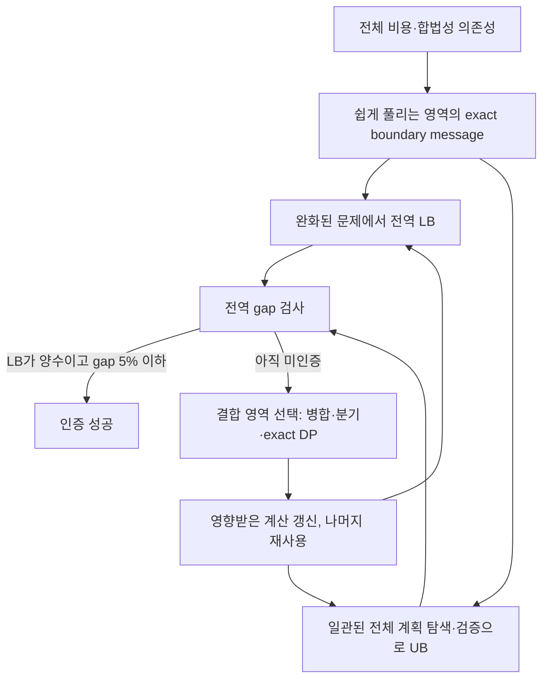

# COFEE의 Tree DP, 경계 상태, Cluster, Global·Local 개념 정리

작성일: 2026-10-15. 대상 workspace: `/home/mchoi/cofee-tree-dp-20261014`.

이 문서는 Tree DP와 table 기반 DP의 관계, 전체 의존성에 따른 cluster 구성, 초기 합법 계획과 LB/UB, Global·Local의 차이를 설명한다. **향후 Memo 통합 엔진의 개념 설명이며, 아래 구조가 모두 구현됐다는 뜻은 아니다.** 파일별 변경 계획·메모리 정책·검증 기준은 [Memo Global·Local 통합 설계서](COFEE_MEMO_DUAL_MODE_OPTIMIZER_DESIGN_2026-10-15_KO.md), 현재 구현과 실측은 [기존 알고리즘 비교 보고서](COFEE_LEGACY_MEMO_TREE_DP_COMPARISON_2026-10-15_KO.md)를 참고한다.

## 1. 먼저 구분할 네 가지

| 질문 | 정확한 구분 |
|---|---|
| Tree DP와 Table DP는 같고 성능 차이도 없는가? | Tree DP도 table을 사용할 수 있다. 같은 상태와 제거 순서에서는 같은 계산이지만, 상태 수·표현·평가·캐시 비용에 따라 성능은 달라진다. |
| constraint가 없는 부분을 먼저 풀면 되는가? | 내부 constraint가 있어도 쉽게 풀릴 수 있다. 핵심은 모든 비용·합법성 의존성을 고려했을 때 외부 boundary를 고정하면 독립적으로 풀리는가이다. |
| cluster별 최적해를 합치면 초기 합법 계획인가? | 공유 boundary 선택이 일치하고 모든 원본 constraint를 만족해야 한다. 독립 최소들의 조합은 불법일 수 있다. |
| Local은 중간 검사하고 Global은 검사 없이 전부 푸는가? | Global은 직접 exact DP로 완료하거나, 탐색이 필요하면 bound와 pruning을 활용한다. Local은 중간 gap 인증을 사용할 수 있으며 작은 문제는 바로 exact로 풀어도 된다. |

## 2. Tree DP와 table은 서로 다른 측면을 가리킨다

**Tree DP는 문제를 트리 구조에 맞춰 분해하고 계산하는 방법이다. Table은 상태별 계산 결과를 저장하는 표현이다.** 따라서 Tree DP에서도 각 subtree의 경계 상태별 최소 비용을 table로 저장하는 것이 자연스럽다.

예를 들어 부모 상태가 `p`일 때 자식 subtree가 낼 수 있는 최소 비용을 `M_child(p)`로 저장한다. 여기에는 자식 하나의 연산 비용만 들어가는 것이 아니라, 그 아래 subtree의 비용과 처리한 constraint가 모두 반영된다. 외부와의 관계가 부모 상태만으로 충분히 표현될 때 작은 메시지로 요약할 수 있다.

대화에서 “Table DP”가 기존 legacy의 bucket elimination을 뜻한다면, **같은 tree에서 같은 경계 상태와 leaf 제거 순서를 사용할 때 Tree DP와 동일한 최소화 recurrence를 수행할 수 있다.** 이는 cycle-free factor graph의 min-sum 계산으로도 설명할 수 있다. [Factor Graphs and the Sum-Product Algorithm, §IV-B](https://www.isiweb.ee.ethz.ch/papers/arch/aloe-2001-1.pdf).

하지만 수학적 계산이 같다는 사실이 구현 시간과 메모리까지 같다는 뜻은 아니다.

| 성능에 영향을 주는 요소 | 차이가 생기는 이유 |
|---|---|
| 경계 상태 수 | 여러 변수를 함께 기억해야 하면 상태 공간이 커진다. |
| dense/sparse 표현 | 불가능한 조합이 많으면 전체 table을 만드는 비용을 줄일 수 있다. |
| 증명된 동치 class | 관련 factor가 구별하지 않는 상태는 계산을 공유할 수 있다. |
| 계산 순서 | 필요한 상태만 계산할지, 전체 table을 미리 계산할지에 따라 작업량이 달라진다. |
| cache와 복원 정보 | 중복 계산을 줄이는 대신 저장·관리 비용이 생긴다. |
| factor 평가와 자료구조 | 같은 cell 수라도 비용 함수 호출, BigDecimal 연산, 객체 할당 비용이 다르다. |

따라서 성능 비교의 단위는 **실제로 만든 상태 수, 수행한 평가 횟수, 재사용량, peak memory**여야 한다. Tree라는 이름만으로 빠르다고 판단하거나, table을 사용한다는 이유로 같은 성능이라고 판단하지 않는다.

## 3. HOP parent-child보다 전체 의존성을 먼저 정의한다

HOP의 입력·출력 연결만으로 최적화 문제의 독립성을 판단할 수 없다. 다음 관계를 모두 포함해야 한다.

| 관계 | 예시 |
|---|---|
| 합법성 constraint | producer와 consumer의 placement·공급 계약, privacy, runtime 지원 여부 |
| 공유 선택 | 여러 consumer가 사용하는 producer에 대해 일관된 rule 선택 |
| 공동 비용 | 여러 consumer가 같은 이동을 재사용할 때 한 번만 부과되는 비용 |
| 함수·분기 의존성 | 호출 문맥과 reaching definition에 따른 공급·비용 관계 |
| loop 의존성 | entry, loop head, backedge, exit 사이의 일관성 |

이를 선택 변수와 factor의 관계로 표현한다. factor는 합법성을 검사하거나 여러 변수의 공동 비용을 계산한다. **합법성만 연결하고 공동 비용을 빠뜨려도 분해는 잘못될 수 있다.**

전체 문제는 다음 형태로 볼 수 있다.

```text
minimize  C(x) = native 비용의 합 + 공동 비용 factor의 합
subject to 모든 원본 legality constraint 충족
```

같은 비용은 정확히 한 번 포함한다. shared movement를 두 subtree가 각각 계산하면 중복 과금이 되고, 양쪽 모두 제외하면 누락이다.

빠르게 처리할 영역은 “constraint가 전혀 없는 영역”으로 한정하지 않는다. 내부에 많은 constraint가 있어도 tree 형태이거나 유효 경계 상태가 작으면 exact DP로 처리할 수 있다. 반대로 HOP가 tree처럼 보여도 공유 비용과 다른 constraint가 넓게 연결되면 단순 tree 처리가 불가능할 수 있다.

## 4. Cluster는 boundary를 조건으로 내부를 요약한다

cluster의 내부 변수 집합을 `I`, 외부와 연결되는 boundary를 `B`라고 하자. boundary assignment `b`마다 다음 값을 구한다.

```text
M_cluster(b) = min_{x_I} cluster가 소유한 비용(x_I, b)
              subject to 해당 cluster가 처리하는 원본 constraint
```

이 값과 내부 선택을 복원할 정보를 저장하면, 외부에서는 내부 전체를 반복 탐색하지 않고 `M_cluster(b)`를 사용할 수 있다.

이 축약이 exact이려면 다음 조건이 필요하다.

1. 외부가 내부 선택에 관해 알아야 하는 정보가 boundary 상태에 모두 표현돼 있어야 한다.
2. 제거할 내부 변수를 참조하는 모든 factor를 해당 제거 과정에서 함께 처리해야 한다.
3. 처리하지 못한 factor를 외부 core에 남기면, 그 factor가 참조하는 변수도 boundary/core에 남겨야 한다.
4. 비용 factor의 소유권을 정해 중복·누락 없이 합산해야 한다.
5. boundary별 최소값에서 실제 rule 선택을 복원할 수 있어야 한다.

따라서 cluster마다 **최적 계획 하나만 남기는 것**과 **boundary별 최적 계획을 남기는 것**은 다르다. 전자는 외부에서 필요한 대안을 잃을 수 있다. 후자는 boundary가 충분하다면 내부를 정확하게 요약한다.

boundary가 작으면 작은 table이 되고, 크면 table도 커진다. 이때 필요한 boundary 상태만 계산하거나 일부 변수를 conditioning하는 방법을 선택할 수 있다. tree를 cluster로 묶는 행위 자체가 효율성을 보장하는 것은 아니다.

## 5. Cluster별 최적해의 조합이 불법일 수 있는 예

두 cluster A, B가 같은 boundary 변수 `s`를 공유한다고 하자. 아래 비용은 각 boundary에서 내부 constraint를 만족하는 최적 비용이며, 다른 비용과 constraint는 없다고 가정한다.

| 비용 | `s=0` | `s=1` |
|---|---:|---:|
| A의 내부 최적 비용 | 1 | 4 |
| B의 내부 최적 비용 | 7 | 1 |
| 같은 boundary로 합친 비용 | 8 | 5 |

A만 보면 `s=0`이 최적이고, B만 보면 `s=1`이 최적이다. 독립 최소의 합은 `1+1=2`다. 그러나 하나의 공유 변수 `s`에 서로 다른 값을 요구하므로 이 두 선택을 합친 계획은 불법이다.

`s`의 일치 조건을 완화한 값 2는 이 예의 **LB**로 사용할 수 있다. 일치를 요구한 최적값보다 작거나 같기 때문이다. 하지만 feasible 계획의 비용인 **UB**로 사용할 수는 없다. 이러한 독립 완화와 feasible 해의 구분은 mini-bucket의 하한 구성에서도 사용된다. [Mini-Buckets: A General Scheme for Bounded Inference, §6](https://ics.uci.edu/~dechter/publications/r62.pdf).

합법 계획은 다음처럼 만든다.

- 둘 다 `s=0`을 선택하면 비용 8: feasible UB를 얻는다.
- 둘 다 `s=1`을 선택하면 비용 5: 더 좋은 feasible UB를 얻는다.
- 이 예의 모든 boundary 대안을 비교하면 최적 비용이 5임을 증명한다.

실제 문제에서는 boundary 일치를 맞추는 것 외에도 boundary 사이의 원본 constraint를 검사하고 공동 비용을 반영해야 한다. 초기 합법 계획을 찾는 과정 자체가 어려울 수 있으며, 독립 cluster 최적화만으로 항상 빠르게 얻을 수 있다고 보장하지 않는다.

또한 비용 8의 계획도 이미 합법이다. 그런데 비용 5보다 비싸다. 이 예는 **합법성 충돌이 사라져도 최적화가 끝난 것은 아니라는 점**을 보여 준다.

## 6. Local은 feasible UB와 certified LB를 함께 개선한다

제안하는 Local의 흐름은 다음과 같다.



여기서 “conflict 해결”은 두 종류의 일을 구분해야 한다.

| 종류 | 의미 | bound에 미치는 영향 |
|---|---|---|
| 합법성·일치 문제 | 독립 subplan이 같은 producer/boundary에 다른 선택을 요구 | 일관된 feasible 계획을 찾아야 UB를 확보할 수 있음 |
| 최적성의 불확실성 | 더 싼 합법 계획의 존재 여부, 완화가 놓친 공동 비용·상관관계 | UB를 내리거나 LB를 올려 gap을 줄여야 함 |

**UB로 유지하는 계획은 처음부터 모든 원본 constraint를 만족해야 한다.** UB의 계획을 일부 불법 상태로 두고 충돌을 차차 고치는 동안 그 비용을 상한이라고 부르면 안 된다. 불법 후보는 탐색의 중간 결과로 사용할 수 있지만 인증용 UB는 아니다.

일단 feasible UB를 얻은 뒤에도, 다른 cluster의 경계 선택을 검토하거나 완화를 강화하면서 더 좋은 계획과 더 강한 LB를 찾는다. 두 bound를 동시에 갱신하는 것은 가능하지만, 매 작업에서 둘 다 개선될 필요는 없다.

### 6.1 “한 conflict씩 exact로 푼다”의 조건

작은 결합 영역을 선택해 exact로 풀고 기존 메시지를 재사용하는 접근은 가능하다. 다만 그 영역에서 선택한 boundary를 근거 없이 영구 고정하면 안 된다.

외부 선택에 따라 해당 영역의 최적 선택이 달라질 수 있으므로 다음 중 하나가 필요하다.

- 관련 boundary 대안별 최적값을 보존한다.
- 한 대안을 탐색하더라도 나머지 대안을 pending branch로 남긴다.
- 다른 대안이 더 좋은 전역 해를 만들 수 없음을 bound로 증명한 뒤 제거한다.

단순한 지역 수선은 feasible 계획을 개선하는 UB heuristic으로 사용할 수 있다. 그러나 그것만으로 전역 LB가 높아지거나 ε 보장이 생기는 것은 아니다.

### 6.2 정확한 5% 종료 조건

Local은 항상 다음 관계를 유지해야 한다.

```text
LB ≤ OPT ≤ UB
```

`UB`는 원본 전체 모델로 검증한 feasible 계획의 비용이고, `LB`는 아직 가능한 모든 전역 대안을 고려한 하한이다. 처리 중인 영역과 아직 생성하지 않은 sibling 대안도 하한 계산에서 누락하지 않는다.

성공 조건은 다음과 같다.

```text
LB > 0
(UB - LB) / LB ≤ 0.05
```

예를 들어 `LB=100`, `UB=105`이면 `OPT≥100`이므로 반환 계획의 최적값 대비 상대 오차는 최대 5%다. `LB≤0`이면 이 상대 조건으로 성공을 선언하지 않고 exact 증명까지 진행하거나 명시적인 실패 상태를 반환한다. `LB=UB=0`은 exact로 처리할 수 있다.

시간이 지났거나 정한 반복 수를 채웠다는 이유로 ε-optimal이라고 표시하지 않는다. 자원 부족·미지원·UNKNOWN 때문에 필요한 증명을 못 하면 그 사실을 보고한다. 또한 이 보장은 **고정된 Memo 추정 비용**에 대한 것이며 실제 학습 실행 시간의 5% 보장은 아니다.

## 7. Global은 직접 Exact 경로와 bound 기반 탐색을 선택한다

Global은 작은 exact tree/variable elimination으로 바로 해결할 수 있다면, 별도의 초기 UB 탐색·반복 relaxation·중간 gap 검사 없이 그 DP를 끝내는 편이 빠를 수 있다. 현재 세 ML의 Memo EXACT가 이 경로로 완료됐다는 사실을 [후속 구조·seed 감사](COFEE_ML_STRUCTURE_AND_SEED_AUDIT_2026-10-15_KO.md)에서 확인했다.

반대로 일반 탐색이 필요할 때는 feasible UB와 LB로 더 좋은 해가 나올 수 없는 영역을 배제할 수 있다. 따라서 직접 exact DP 완료와 모든 assignment의 전수 열거를 구분해야 한다. 공통 kernel을 사용한다고 모든 모드에 동일한 anytime 루프를 강제할 필요는 없다.

| 구분 | Local | Global |
|---|---|---|
| 공통 구조 처리 | exact tree/cluster message, propagation, 조건부 재사용 | 동일 |
| bound 활용 | 중간 5% 종료에는 필수; 직접 exact 완료도 허용 | 직접 exact 경로의 별도 중간 bound는 선택 사항; 검색 경로에서는 pruning에 활용 |
| 작업 우선순위 | 요청 gap 인증까지의 총작업을 줄임 | exact 증명까지의 총작업을 줄임 |
| 성공 종료 | 전역 gap ≤ 5% 또는 exact | 전역 최적성 증명 |
| 모든 조합을 계산해야 하는가? | 아니며 bound로 배제 가능 | 아니며 bound로 배제 가능 |

예를 들어 `LB=100`, `UB=105`이면 Local은 인증 후 종료할 수 있다. Global은 최적성 증명을 위해 계속한다. 이후 UB가 100으로 내려오거나 LB가 105로 올라오는 등 비용 최적성을 증명하면 완료할 수 있다.

Global도 모든 conflict를 직접 하나씩 해결할 필요는 없다. 남은 영역에서 현재 계획보다 좋은 해가 나오지 않음을 증명하면 그 영역의 상세 탐색을 생략할 수 있다. 현재 EXACT와 동일한 동률 선택까지 보존해야 하는 경로에서는 비용 증명 외에 canonical witness의 동률 처리도 유지한다.

작은 exact elimination으로 전체가 빨리 풀리는 문제에서는 두 모드 모두 그 경로를 사용할 수 있다. Global이 먼저 Local을 실행한 뒤 재시작할 필요도 없고, Local이 반드시 suboptimal 계획을 반환할 필요도 없다.

## 8. COFEE에서 구현으로 연결할 때의 기준

사용자가 제안한 방향은 다음처럼 구체화한다.

1. HOP의 형태를 출발점으로 삼되, **모든 원본 비용·합법성 factor를 포함한 의존 관계**로 독립성을 판정한다.
2. 경계가 작고 정확히 풀 수 있는 영역을 공통 kernel로 축약한다. 내부 constraint가 있다는 이유만으로 이 경로에서 제외하지 않는다.
3. cluster마다 하나의 독립 최적해만 저장하지 않고, 외부에 필요한 boundary별 최적값과 복원 정보를 유지한다.
4. 초기 feasible 계획과 certified LB를 구분한다. boundary의 일관된 선택을 찾고 원본 모델로 검증해야 UB가 된다.
5. 잔여 결합은 구조에 따라 cluster 병합, conditioning, exact elimination, B&B로 처리한다. 선택되지 않은 전역 대안을 증명 없이 버리지 않는다.
6. Local과 Global은 이 계산을 공유하고, 요청한 인증 수준과 작업 우선순위에서 차이를 둔다.

메모리도 같은 원칙을 따른다. 재계산 가능한 cache는 회수할 수 있지만, 아직 가능한 boundary 대안과 그 하한을 복원할 방법 없이 버리면 인증이 깨진다. 물리적 자원에 가까이 활용하는 정책은 [통합 설계서의 메모리 정책](COFEE_MEMO_DUAL_MODE_OPTIMIZER_DESIGN_2026-10-15_KO.md)에 별도로 정리했다.

이 문서의 수치 표는 개념을 설명하는 작은 예제이며 benchmark가 아니다. 새 성능 우위나 구현 완료를 주장하지 않는다.
