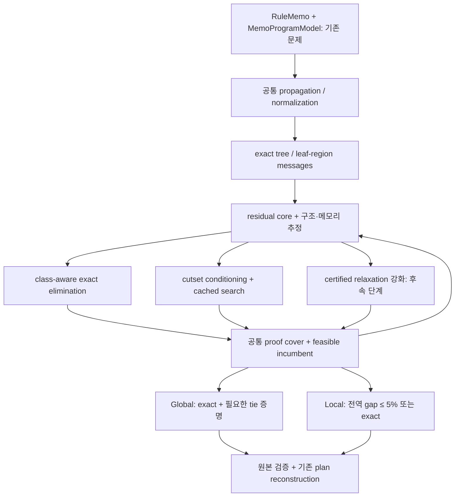

# COFEE Memo Global·Local 통합 최적화 설계와 개선 계획

작성일: 2026-10-15. 대상 workspace: `/home/mchoi/cofee-tree-dp-20261014`. 기준은 `origin/main`의 `b8623e3481072940c07ef3962bcd55be526f1d09`에서 만든 `feature/memo-tree-dp-certified-20261014`와 이 workspace의 검증 완료 변경분이다.

**이 문서는 다음 구현의 설계안이다.** 현재 구현·실측과 향후 제안을 구분한다. 이 문서 작성으로 optimizer 기본값, 메모리 설정 또는 생산 코드를 변경하지 않았다. 기존 구현의 상세 비교와 실험 범위는 [Legacy·Memo·Tree DP 비교 보고서](COFEE_LEGACY_MEMO_TREE_DP_COMPARISON_2026-10-15_KO.md)에 있다.

## 1. 권고하는 방향

**현재 Memo EXACT의 강한 정확 풀이 기능을 공통 엔진으로 만들고, 그 위에 Global과 Local의 탐색 정책·종료 조건을 분리하는 방향을 권고한다.** 이미 추가한 Tree DP의 전역 bound 관리 경험은 재사용하되, 그 forest relaxation을 모든 문제의 유일한 풀이 방식으로 삼지는 않는다.

| 사용자 요구 | 권고 설계 |
|---|---|
| 처음부터 exact를 목표로 하는 모드 | Global: 구조 축약과 정확 제거가 유리하면 바로 사용하고, 필요한 잔여 탐색을 최적성 증명까지 계속한다. Local을 먼저 실행하고 다시 시작하지 않는다. |
| 점진적으로 5%를 인증하는 모드 | Local: 검증된 feasible UB와 전역 LB를 유지하며 `UB ≤ 1.05 × LB`, `LB > 0`을 만족하면 종료한다. 작은 문제는 exact로 끝내도 된다. |
| 두 모드 모두 tree를 빠르게 처리 | 원본 factor 의존성을 보존한 exact tree/leaf-region message를 공통 사용한다. 각 모드가 같은 subtree를 별도 solver로 다시 풀지 않는다. |
| cluster, min-sum, B&B, DP 중 효율적 선택 | 경계 상태 수·factor 평가 비용·표의 실제 예상 bytes에 따라 exact elimination, conditioning, cached B&B를 선택한다. 강한 완화는 이후 실측으로 추가한다. |
| 메모리를 실제 실행 한계 가까이 활용 | 임의의 작은 frontier 개수로 종료하지 않는다. 메모리를 bytes로 관리하고, 캐시 회수·표 표현 변경·메모리를 적게 쓰는 탐색 전환 후에도 필수 상태가 들어가지 않을 때 명시적으로 실패한다. |

이 권고의 근거는 COFEE의 현재 코드와 실측이다. 모든 문제에서 특정 알고리즘이 가장 빠르다는 일반 정리를 주장하지 않는다. 현재 Memo EXACT에는 이미 Tree DP, class-aware elimination, leaf/core 분해가 있으며, ML 실험에서는 새 Tree DP보다 좋은 결과를 냈다. [현재 풀이 순서](/home/mchoi/cofee-tree-dp-20261014/src/main/java/org/apache/sysds/hops/fedplanner/memo/MemoOptimizer.java:286), [최종 ML 실측](../experiments/memo-tree-dp-20261014/results-v2-w3-r2/summary.json).

### 1.1 범위와 고정 계약

최적화 대상은 기존 `RuleMemo`와 `MemoProgramModel`이 정의한 **동일한 후보 공간·합법성·추정 비용**이다. 함수, branch, loop, shared producer, shared movement의 의미를 유지하고, 결과는 기존 재구성 경로를 사용한다. 새 모드의 성능을 위해 후보를 닫거나 runtime fallback을 추가하지 않는다. [공통 solver 입력과 최종 검증](/home/mchoi/cofee-tree-dp-20261014/src/main/java/org/apache/sysds/hops/fedplanner/memo/MemoProgramModel.java:438).

여기서 5%는 해당 비용 모델의 최적값에 대한 보장이다. 실제 학습 wall time이나 미지의 실행 분포에 대한 5% 보장이 아니다. 기존 반복·분기 profile도 그대로 사용하며, profile 개선은 별도 실험으로 분리한다. [현재 profile](/home/mchoi/cofee-tree-dp-20261014/src/main/java/org/apache/sysds/hops/fedplanner/memo/MemoProgramModel.java:65).

기존 EXACT와 `TREE_DP_GLOBAL`/`TREE_DP_LOCAL`은 비교 가능한 독립 baseline으로 남긴다. 공통화는 opt-in 구현과 동치 검증을 거쳐 진행한다. 현재 선택명과 향후 제안 이름을 혼동하지 않는다. [현재 algorithm enum과 기본값](/home/mchoi/cofee-tree-dp-20261014/src/main/java/org/apache/sysds/hops/fedplanner/memo/FederatedPlanMemo.java:62).

## 2. 현재 결과가 알려 주는 개선 우선순위

### 2.1 정확 엔진을 버리고 Tree DP로 통일할 근거는 없다

동일한 최종 engine, Docker image, 4 CPU, 8 GiB container, 3 GiB JVM heap, 50,000×128 입력, W3 metadata 조건의 측정이다. complete RuntimeProgram까지 만드는 **compile-only ML workload**이며, 이 표는 대규모 학습 실행 시간 표가 아니다.

| workload | 현재 Memo EXACT full compile | 기존 Tree Global 결과 / process wall | 기존 Tree Local 결과 / process wall |
|---|---:|---:|---:|
| LogReg | 3.624459 s | RESOURCE_EXHAUSTED / 8.469036 s | RESOURCE_EXHAUSTED / 8.720911 s |
| GLM | 9.111425 s | RESOURCE_EXHAUSTED / 20.045217 s | RESOURCE_EXHAUSTED / 25.597834 s |
| GNMF | 1.340158 s | OPTIMAL / 2.885860 s | EPSILON_OPTIMAL / 2.804851 s |

실패한 실행에는 완료된 full compile 시간이 없으므로 process wall을 표시했다. 같은 지표끼리 비교하면 EXACT process wall은 각각 **4.898759 / 10.447175 / 2.595100 s**이다. GNMF의 solver optimization 단계는 EXACT **0.156286576 s**, Tree Global **0.221227738 s**, Tree Local **0.196144206 s**였다. Local이 4.6073%를 인증했지만, 이 사례에서도 현재 EXACT보다 빠르지 않았다. [원본 9개 측정](../experiments/memo-tree-dp-20261014/results-v2-w3-r2/summary.json).

LogReg·GLM Tree 실험의 2,000-node 제한은 재현 가능한 비교를 위한 실험 설정이다. Tree 구현의 기본 search-node limit은 무제한이지만, 기본 frontier limit은 10,000이다. LogReg Local을 20,000-node 설정으로 확장한 실행도 **15,958 nodes, peak frontier 9,990**에서 다음 자식들을 넣을 frontier 용량이 부족해 종료했다. wall **21.616106 s**, LB **2765.5744753379**, UB **5325.6597890673**, gap **92.5697%**, 관측 peak container memory 약 **775.3 MiB**였다. 이는 명시적 개수 제한에 걸린 실행이지, 실제 heap OOM을 입증한 결과가 아니다. [확장 실험](../experiments/memo-tree-dp-20261014/results-v2-logreg-20k/summary.json), [기본 한도](/home/mchoi/cofee-tree-dp-20261014/src/main/java/org/apache/sysds/hops/fedplanner/memo/MemoTreeDpOptimizer.java:51), [분기 전 한도 검사](/home/mchoi/cofee-tree-dp-20261014/src/main/java/org/apache/sysds/hops/fedplanner/memo/MemoTreeDpOptimizer.java:262).

### 2.2 원인에 따른 변경 순서

| 관측/구현 사실 | 해석 | 우선 변경 |
|---|---|---|
| Memo EXACT가 tree→elimination→leaf/core→search를 이미 사용 | exact 구조 처리를 공유하는 것이 출발점 | 현재 kernel들을 공통 문제·인증 제어와 연결 |
| Tree LogReg/GLM의 gap이 넓고 factor 평가가 많음 | cache hit 증가만으로 약한 하한을 해결하지 못함 | class-aware exact 축약과 residual 구조 선택 우선 |
| 20k 확장에서 frontier 개수 제한으로 종료 | count cap과 물리적 메모리 부족은 다름 | byte accounting, lazy child 생성, proof-preserving DFS 전환 |
| 일부 작은 tree/cycle/diamond에서는 Tree 구현이 빠름 | 구조별 유리한 경로가 있음 | 문제별 dispatch와 ablation으로 경로 유지 여부 결정 |

Tree Global의 cost evaluation 수는 LogReg **3,248,837**, GLM **12,297,700**이었다. 해당 EXACT 카운터는 각각 **1,625**, **11,556**이었다. 이 차이는 조사할 병목을 가리키지만 각 solver의 모든 카운터를 동일한 작업 단위로 해석해서는 안 된다. [단계별 분석과 소형 실험](COFEE_LEGACY_MEMO_TREE_DP_COMPARISON_2026-10-15_KO.md), [현재 elimination의 factor-class 처리](/home/mchoi/cofee-tree-dp-20261014/src/main/java/org/apache/sysds/hops/fedplanner/memo/MemoOptimizer.java:312).

## 3. Tree로 풀면 table보다 가장 효율적인가?

### 3.1 Tree DP도 경계별 table을 만든다

**Tree DP와 table 생성은 서로 대체하는 두 알고리즘이 아니다.** 일반적인 Tree DP는 자식 subtree를 부모가 볼 때 필요한 경계 상태별 최소 비용을 표로 저장한다. 이를 min-sum message passing으로 부를 수도 있고, leaf부터 수행하는 variable elimination으로 볼 수도 있다. cycle-free factor graph의 semiring 계산과 traceback은 이 관계의 이론적 근거다. [Kschischang·Frey·Loeliger, 2001, §IV-B](https://www.isiweb.ee.ethz.ch/papers/arch/aloe-2001-1.pdf).

pairwise tree에서 부모 `p`, 자식 `v`의 메시지는 다음과 같다. `a_v`는 unary 비용, `b_vp`는 두 변수에 걸린 비용과 legality를 모은 항이며, 불가능한 조합에는 `+∞`를 준다.

```text
m(v→p, x_p) = min_{x_v ∈ D_v} [a_v(x_v) + b_vp(x_v,x_p)
                                  + Σ_{u ∈ children(v)} m(u→v,x_v)]
```

표현과 산술 비용을 상수로 두면 일반 dense pairwise tree의 계산량은 대략 `O(Σ_(v,p) |D_v|·|D_p| + Σ_v |D_v|)`다. 메시지와 backpointer는 edge의 경계 상태에 비례해 저장할 수 있다. 입력 pair table 자체의 저장 비용은 별도다. 이는 위 recurrence로부터의 분석이며, 실제 `BigDecimal` 덧셈·객체 할당·factor evaluator 비용은 추가된다.

임의의 dense pair table이 입력이면 최악의 경우 그 원소를 확인해야 한다. 반면 sparse support, 함수형 관계, 비용 동치 class, 분리 가능한 비용 구조가 있으면 더 적게 계산할 수 있다. 따라서 **일반 tree의 기본 exact 경로로 Tree DP는 적합하지만, 모든 표현·도메인·비용 함수에서 단일 구현이 가장 빠르다고 할 수는 없다.** 현재 Memo의 class quotient와 legacy의 sparse backpointer는 상태·저장 표현을 줄이는 구현의 참고점이다. [Memo class refinement](/home/mchoi/cofee-tree-dp-20261014/src/main/java/org/apache/sysds/hops/fedplanner/memo/MemoOptimizer.java:333), [legacy sparse backpointer](/home/mchoi/cofee-tree-dp-20261014/src/main/java/org/apache/sysds/hops/fedplanner/fedCostBased/fedExact/ExactCategoricalSolver.java:5068).

### 3.2 세 가지 tree를 구분해야 한다

| 구조 | exact tree 풀이의 의미 | 주의점 |
|---|---|---|
| 원래 HOP DAG의 tree 모양 | 후보 탐색 순서를 정하는 단서 | 추가 legality·movement·control-flow factor까지 tree라는 증거가 아님 |
| 전체 variable-factor graph가 acyclic | 원본 factor를 모두 포함하는 min-sum 가능 | high-arity factor 하나의 평가가 domain 곱에 비례할 수 있음 |
| cyclic graph에서 선택한 spanning forest | cycle을 끊은 relaxation의 계산 | 빠른 LB가 될 수 있으나 원 문제의 exact 해와 동일하지 않음 |

HOP의 방향성 DAG라는 성질만으로 최적화 factor graph의 무방향 cycle이 사라지지 않는다. shared movement가 producer와 여러 consumer를 묶으면, 그 factor를 없애거나 subtree마다 복제해서는 안 된다. 현재 Tree 구현의 `buildForest`는 retained/deferred factor를 나누므로, 전체 모델을 exact tree로 판정한 것과 다르다. [forest 구성](/home/mchoi/cofee-tree-dp-20261014/src/main/java/org/apache/sysds/hops/fedplanner/memo/MemoTreeDpOptimizer.java:589), [movement factor 생성](/home/mchoi/cofee-tree-dp-20261014/src/main/java/org/apache/sysds/hops/fedplanner/memo/MemoProgramModel.java:1020).

### 3.3 tree 내부가 커도 boundary가 작으면 유리하다

제안하는 공통 처리 단위는 `region R`과 외부에 남는 `boundary B`다. 경계는 HOP parent만 보고 정하지 않고 **모든 crossing Check와 CostTerm의 scope**로 결정한다. 각 factor는 정확히 하나의 region 또는 잔여 core가 소유한다.

```text
M_R(b) = min_{x_internal(R)} C_owned(R)(x_internal(R), b)
         subject to R이 소비하는 모든 원본 legality
```

내부에서 제거할 변수는 그 변수를 참조하는 모든 원본 factor를 해당 제거 과정에서 함께 소비해야 한다. shared movement 등 소비하지 못하는 factor를 core에 남긴다면, 그 scope의 변수도 boundary/core에 남기거나 factor를 포함하도록 region을 확대한다. core factor가 참조하는 변수를 먼저 없애서는 안 된다.

이 조건 아래 메시지가 exact이면 내부 변수를 제거해도, 모든 boundary assignment에 대해 원본 최적값을 보존한다. argmin 또는 검증된 재계산 경로를 보존하면 최종 실제 rule ordinal을 복원할 수 있다. 동일 비용을 message와 core 양쪽에서 다시 더하지 않는다.

boundary가 없으면 독립 성분의 scalar optimum으로, boundary가 하나면 일차원 message로 축약한다. 여러 boundary를 가진 tree region은 separator table이 커질 수 있다. 따라서 **모든 tree를 무조건 큰 table로 완전 축약하는 정책은 사용하지 않는다.** 예상 boundary class 곱이 크면 conditional message를 필요할 때 계산하거나 일부 boundary를 conditioning한다. 이는 기존 exact tree 및 leaf/core 경로를 확장하는 제안이다. [exact forest DP](/home/mchoi/cofee-tree-dp-20261014/src/main/java/org/apache/sysds/hops/fedplanner/memo/MemoOptimizer.java:997), [leaf/core 분해](/home/mchoi/cofee-tree-dp-20261014/src/main/java/org/apache/sysds/hops/fedplanner/memo/MemoOptimizer.java:1144).

## 4. 두 모드가 공유할 구조



### 4.1 공통 kernel과 모드 정책을 분리한다

| 공통 기능 | Global 정책 | Local 정책 |
|---|---|---|
| domain propagation·정확 정규화 | 동일 | 동일 |
| exact tree/leaf/conditional message | 동일하고 가능한 결과를 재사용 | 동일하고 가능한 결과를 재사용 |
| 원본 모델로 feasible witness 검증 | UB와 pruning에 사용 | UB와 5% 종료에 사용 |
| class-aware elimination | 정확 증명에 가장 유리하면 바로 선택 | 큰 table을 시작하기 전 현재 gap과 예상 작업량 확인 |
| 잔여 탐색 | exact proof와 기존 canonical tie에 필요한 영역 해결 | UB 개선 또는 전역 최소 LB를 올릴 작업 우선 |
| 성공 종료 | OPTIMAL | EPSILON_OPTIMAL 또는 OPTIMAL |

두 모드는 같은 초기 문제와 증명 상태를 사용한다. Global은 ε=0인 단순 flag 이상의 정책 차이를 가질 수 있다. 예를 들어 작은 elimination으로 전체가 즉시 풀리는 경우에는 별도 seed 탐색을 생략할 수 있다. Local은 첫 feasible UB를 빨리 얻는 순서를 선호하되, seed를 구하기 위해 큰 exact kernel을 중복 실행하지 않는다. 두 모드 모두 LB/UB는 정확성 계약이고, 작업 선택 점수는 성능 heuristic이다.

**공통 kernel은 동일한 anytime 실행 루프를 강제한다는 뜻이 아니다.** 직접 exact tree/VE가 유리하면 별도 feasible-seed 탐색·반복 relaxation·priority frontier·중간 gap 검사를 생략하고 정확 DP를 완료한다. 이 경로의 중간 하한은 보수적인 기존 값 또는 `−∞`로 둘 수 있으며, 유용한 중간 인증 정보를 만들기 위해 추가 계산할 필요는 없다. 최종 exact 결과는 원본 검증을 거쳐 `LB=UB`로 인증한다. 후속 [실제 ML 구조·seed 감사](COFEE_ML_STRUCTURE_AND_SEED_AUDIT_2026-10-15_KO.md)는 세 baseline의 Memo EXACT가 직접 elimination 경로로 완료됐음을 확인한다.

Local에서 Global로 이어 실행하는 API는 향후 지원할 수 있다. 이때 원본 model identity, domain, factor ownership, cache provenance를 그대로 유지한 채 종료 정책만 바꿔야 한다. 초기 버전에 지속 저장·프로세스 간 resume까지 넣을 필요는 없다.

### 4.2 상태와 메시지의 계약

| 상태 | 필수 내용 |
|---|---|
| 원본 문제 identity | 후보 universe의 완결성, owner/rule ordinal, immutable checks/costs와 profile version |
| region | internal/boundary 변수, 소유·소비 factor 목록, 현재 domain restriction |
| exact message | boundary 상태별 비용, argmin/replay 정보, 원본 factor와 domain에 대한 유효성 |
| lower-bound message | 어떤 relaxation으로 얻었는지, 적용 가능한 domain과 factor 소유권 |
| incumbent | 모든 원본 Check가 YES인 전체 assignment와 원본 비용 |
| pending proof region | 아직 배제하지 않은 assignment 집합, certified LB, 다시 탐색할 상태 |

`Check.UNKNOWN`은 `YES`가 아니다. relaxation에서 UNKNOWN을 허용하면 하한에는 사용할 수 있지만, 그 witness를 feasible UB로 쓰지 않는다. UNKNOWN을 통과한 message는 feasible witness까지 대응된 exact message라고 선언하지 않는다. 영역 전체를 exact로 닫으려면 원본 합법성과 최적값을 증명해야 한다. 미해결 항이 남으면 해당 lower-bound region을 보존하거나 `UNRESOLVED`로 종료한다. [현재 EXACT의 UNKNOWN 처리](/home/mchoi/cofee-tree-dp-20261014/src/main/java/org/apache/sysds/hops/fedplanner/memo/MemoOptimizer.java:286), [Tree relaxation의 NO 필터](/home/mchoi/cofee-tree-dp-20261014/src/main/java/org/apache/sysds/hops/fedplanner/memo/MemoTreeDpOptimizer.java:435).

factor-specific class는 비용 평가 중복을 줄이는 수단이다. 특정 movement cost가 같다는 이유로 native cost·legality·다른 factor에서도 같은 후보라고 합치면 안 된다. exact message는 **소비한 factor들에 필요한 class의 공통 refinement**를 사용하며, 미래 factor의 구분과 실제 ordinal 복원을 유지한다. 이는 기존 elimination의 계약을 유지하는 방향이다. [separator partition 계약](/home/mchoi/cofee-tree-dp-20261014/src/main/java/org/apache/sysds/hops/fedplanner/memo/MemoOptimizer.java:312).

### 4.3 함수·branch·loop를 region에 포함하는 규칙

region 경계 계산은 compiled owner, call-frame 문맥, reaching definition, loop head/entry/backedge/exit의 모든 원본 factor를 따라야 한다. HOP ID가 같거나 연산 모양이 같다는 이유만으로 문맥별 비용·합법성을 합치지 않는다. shared producer도 단일 선택 변수 또는 명시적 일치 관계를 유지한다. [owner/loop 변수 구성](/home/mchoi/cofee-tree-dp-20261014/src/main/java/org/apache/sysds/hops/fedplanner/memo/MemoProgramModel.java:314).

구현 acceptance 조건은 간단하다. 어떤 region을 축약한 뒤에도, boundary를 고정한 원본 작은 문제의 exhaustive optimum과 message 값이 같아야 한다. 함수·branch·loop 사례도 이 조건과 최종 runtime 검증으로 확인한다. factor가 scope를 불완전하게 선언했다면 solver의 tree 정책으로 보정할 수 없으므로 model 문제로 명시한다.

## 5. 전역 LB/UB와 인증의 정확한 규칙

### 5.1 반드시 보존할 불변식

feasible 문제에서 항상 `LB ≤ OPT ≤ UB`를 유지한다. feasible witness를 아직 찾지 못했다면 UB는 미정 또는 `+∞`이며 성공을 선언하지 않는다. 후보 universe가 열려 있어 누락된 후보의 비용을 제어할 수 없으면 현재 후보만 탐색해 전역 최적성이나 ε 인증을 주장하지 않는다. [현재 coverage gate](/home/mchoi/cofee-tree-dp-20261014/src/main/java/org/apache/sysds/hops/fedplanner/memo/MemoOptimizer.java:286).

bound를 합성하는 연산은 세 가지로 구분한다.

| 관계 | 올바른 합성 | 필요한 전제 |
|---|---|---|
| 독립적인 additive component들: AND | `LB = constant + Σ_i LB_i` | 비용 소유권이 겹치지 않고, component 사이 의존성이 없거나 boundary가 일관되게 고정됨 |
| 하나의 문제를 domain으로 분할한 대안들: OR | `LB = min_j LB_j` | 분할 영역들의 합집합이 아직 가능한 모든 해를 덮음 |
| 같은 영역·같은 목적함수의 여러 relaxation | `LB = max_k LB_k` | 각 relaxation이 그 영역의 유효한 하한임 |

같은 비용을 보는 tree relaxation LB와 mini-bucket LB를 더하지 않는다. 둘은 같은 objective의 하한이므로 `max`를 취한다. 독립 component에는 합을 사용한다. `min`은 합의 대체가 아니며 음수 비용이 있으면 하한 자체가 잘못될 수 있다. 예를 들어 독립 최적값이 −5와 −4이면 전체 최적값은 −9인데 `min=−5`는 유효한 전체 하한이 아니다. 모든 계산은 제거된 고정 비용을 포함한 **원래 objective 단위**로 환산한 뒤 인증한다. 상수를 더하거나 빼면 argmin은 같아도 상대 gap은 달라진다.

전역 OR 탐색에서 `Q`를 아직 해를 포함할 수 있는 영역들의 cover라고 하면, feasible incumbent가 있을 때 다음이 전역 하한이다.

```text
LB_global = min(UB, min_{q ∈ Q} LB(q))
LB(child) = max(LB(parent), 새로 계산한 child의 유효 하한)
```

`Q`에는 priority queue뿐 아니라 현재 계산 중인 영역, 아직 만들지 않은 sibling 영역, UNKNOWN으로 미해결인 영역도 포함된다. 최적일 가능성이 남은 영역을 메모리 절약 명목으로 삭제하면 이 식의 근거가 사라진다. 현재 Tree 구현은 분기 한도 실패 시 parent를 복구하는 형태로 이 원칙의 일부를 구현한다. [원자적 분기 검사](/home/mchoi/cofee-tree-dp-20261014/src/main/java/org/apache/sysds/hops/fedplanner/memo/MemoTreeDpOptimizer.java:262), [현재 전역 하한](/home/mchoi/cofee-tree-dp-20261014/src/main/java/org/apache/sysds/hops/fedplanner/memo/MemoTreeDpOptimizer.java:680).

### 5.2 Local의 5% 증명

Local 성공 조건은 원본 검증을 통과한 UB가 존재하고 다음을 만족하는 것이다.

```text
LB > 0
UB ≤ BigDecimal("1.05") × LB
```

이때 `OPT ≥ LB > 0`이므로 `UB/OPT − 1 ≤ UB/LB − 1 ≤ 0.05`다. 따라서 독립 oracle의 실제 optimum을 몰라도 인증할 수 있다. 반면 테스트에서는 독립 optimum을 계산해 이 불변식과 결과 regret를 둘 다 확인한다. **분모를 UB로 바꾸지 않는다.** `LB ≤ 0`이면 상대 인증을 유보하고 exact 증명까지 계속하거나, 자원·지원 한계로 실패했음을 명시한다. `LB=UB=0`은 exact로 처리할 수 있다.

현재 Tree 구현의 binary64 primitive 비용을 정확한 `BigDecimal` 값으로 합산하는 방식을 유지한다. 출력용 반올림 값이나 double epsilon 비교를 인증에 사용하지 않는다. 부동소수점 기반의 더 빠른 bound를 도입하려면 별도의 방향성 오차 보장이 먼저 필요하다. [현재 인증 비교](/home/mchoi/cofee-tree-dp-20261014/src/main/java/org/apache/sysds/hops/fedplanner/memo/MemoTreeDpOptimizer.java:671), [Memo 비용 변환](/home/mchoi/cofee-tree-dp-20261014/src/main/java/org/apache/sysds/hops/fedplanner/memo/MemoOptimizer.java:2028).

독립 component별 gap을 단순 평균해 5%를 선언하지 않는다. 전체 비용으로 합성한 `ΣUB_i`, `ΣLB_i`와 고정 비용을 사용한다. 예를 들어 큰 비용 component 하나의 나쁜 gap을 작은 component 여러 개의 exact 결과로 희석해 평균을 낮추면 잘못된 인증이 될 수 있다.

### 5.3 Global의 비용 증명과 동률 계약

Global은 전체 exact elimination 또는 완전한 cover의 하한과 feasible UB 일치 등으로 비용 최적성을 증명한다. 추가로 현재 EXACT는 동률에서 lexicographic rule 선택을 보존하므로, 향후 EXACT를 공통 Global에 연결한다면 그 출력 계약도 유지해야 한다. [현재 동률 pruning과 witness 비교](/home/mchoi/cofee-tree-dp-20261014/src/main/java/org/apache/sysds/hops/fedplanner/memo/MemoOptimizer.java:808).

`LB=UB`는 최소 **비용**의 증명이지, 미해결 동률 영역 안에 더 작은 lexicographic witness가 없다는 증명은 아니다. Global의 호환 경로에서는 `LB>UB`인 영역을 제거하거나, `LB=UB`이면 그 영역의 lexicographic domain floor 등으로 더 좋은 동률 witness가 없음을 증명해야 한다. 필요하면 비용 증명 후 canonical witness 처리를 마친다. Local은 deterministic witness를 반환하되 전역 lexicographic 최소까지 약속할 필요는 없다. [현재 lexicographic floor](/home/mchoi/cofee-tree-dp-20261014/src/main/java/org/apache/sysds/hops/fedplanner/memo/MemoOptimizer.java:1873).

### 5.4 실패와 성공을 구분하는 결과 계약

| 결과 | 허용하는 주장 |
|---|---|
| OPTIMAL | feasible witness와 전역 비용 최적성을 증명함. Global 호환 모드는 정한 tie 계약도 완료함. |
| EPSILON_OPTIMAL | Local에서 유효 LB와 feasible UB로 요청 ε를 증명함. |
| INFEASIBLE | 완결된 후보 공간에 feasible assignment가 없음을 증명함. |
| UNRESOLVED | UNKNOWN 또는 불완전한 지원/모델 정보 때문에 필요한 증명을 완료하지 못함. |
| RESOURCE_EXHAUSTED | 필수 자원 확보 실패 또는 명시적인 진단용 자원 cap으로 증명 전에 종료함. |

마지막 두 결과에는 얻어 둔 유효 bound와 feasible incumbent를 진단 정보로 실을 수 있다. 이를 성공으로 적용하거나 ε-optimal로 표시하지 않는다. 외부 취소나 watchdog 종료 역시 인증 성공이 아니다. API에 취소 상태를 따로 추가할지는 구현 단계에서 정하되, 실패와 성공의 구분은 바뀌지 않는다.

## 6. 잔여 core에 어떤 알고리즘을 적용할 것인가

### 6.1 초기 구현의 선택 순서

첫 버전은 다음 표의 exact 경로와 B&B를 중심으로 만든다. 여러 새로운 알고리즘을 한꺼번에 도입해 성능 원인을 구분하지 못하는 상황을 피한다.

| 관측 구조 | 먼저 시도할 방법 | 선택 이유와 제한 |
|---|---|---|
| 전체 pairwise forest 또는 작은 boundary leaf region | exact min-sum / Tree DP | 작은 경계 message로 전체 의존성을 표현 가능 |
| quotient class 기준 separator가 작은 core | class-aware bucket elimination | 상관관계를 정확히 처리하고 repeated search를 줄임 |
| 소수 변수 고정 후 forest/작은 separator로 분해 | cutset conditioning + 재사용 message | 큰 joint table 없이 tree kernel을 반복 활용 |
| 넓고 불규칙한 core, 많은 불가능 조합 | propagation + context-cached B&B | 필요한 branch만 계산하고 feasible UB로 pruning |
| 위 경로에서도 LB가 약해 탐색 증가 | mini-bucket 또는 제한적 cluster 병합 추가 | 비용 대비 bound 개선이 확인된 경우 사용 |

이 dispatch의 근거로 현재 `tryTreeSolve`, `tryEliminationSolve`, `tryLeafRegionSolve`, residual search 및 forest/unicycle 처리 코드를 먼저 재사용한다. 순서를 무조건 고정하기보다는 준비 단계에서 추정한 상태 수와 실제 계측으로 조정한다. [현재 상위 순서](/home/mchoi/cofee-tree-dp-20261014/src/main/java/org/apache/sysds/hops/fedplanner/memo/MemoOptimizer.java:286), [cycle conditioning과 tail](/home/mchoi/cofee-tree-dp-20261014/src/main/java/org/apache/sysds/hops/fedplanner/memo/MemoOptimizer.java:1495).

### 6.2 cluster는 HOP 수보다 separator 비용으로 정한다

cluster 병합은 두 tree 사이의 공유 변수·factor를 message 내부로 가져와 상관관계를 복원하는 수단이다. 병합 후 boundary의 상태 공간이 작아지거나 비용이 적당하면 유리하다. 그러나 외부 경계가 많아지면 tree들을 묶는 것만으로 큰 table이 생긴다.

예를 들어 32개 상태를 가진 boundary 변수 8개의 dense table은 `32^8 = 1,099,511,627,776` cells다. 8-byte scalar만 가정해도 8 TiB이며, 실제 Java 객체·복원 정보는 추가된다. 같은 소비 factor들에 대해 증명된 class가 각 2개라면 `2^8 = 256` cells일 수 있다. **이 class 축약이 합법적인지와 미래 factor 구분을 보존하는지가 핵심**이지, HOP 개수가 작다는 사실이 핵심은 아니다.

제안하는 병합 점수는 다음 요소를 사용한다: 소비할 factor의 결합 강도, boundary class 수의 곱, sparse support 밀도, 이전 factor 평가 시간, 예상 peak bytes, 예상 LB 상승 또는 UB 개선. 이 점수는 작업 순서만 정하며 어떤 후보도 heuristic 점수로 제거하지 않는다. 비용 추정이 빗나가면 같은 문제를 다른 exact/relaxation 경로로 이어 간다.

### 6.3 min-sum, elimination, AND/OR search의 관계

tree에서 min-sum과 DP는 같은 최소화 recurrence의 표현이다. 일반 graph의 exact elimination은 cluster/separator를 키워 같은 원리를 적용한다. conditioning과 AND/OR search는 separator context를 조건으로 하위 문제를 나누고 필요할 때 계산한다.

동일한 pseudo tree/bucket tree와 특정 조건에서는 fully cached AND/OR search와 variable elimination이 같은 context 공간을 서로 다른 순서로 다룬다. 그러나 determinism·pruning·cache 정책이 달라지면 어느 쪽도 일반적으로 지배하지 않는다. 따라서 “DP 대 B&B”를 이름만으로 선택하지 말고 **상태 표현, 계산 순서, pruning, 저장량**을 비교해야 한다. [Mateescu·Dechter, 2005, §3](https://www.ics.uci.edu/~dechter/publications/r122.pdf).

cycle이 있는 graph에서 일반 loopy min-sum을 반복해 수렴했다는 사실만으로 전역 LB나 exact 해를 인증하지 않는다. 후속으로 dual reparameterization을 도입할 수는 있지만, 목적함수 보존과 각 단계 하한의 유효성을 별도로 증명해야 한다. 초기 구현의 필수 범위에서는 제외한다. [cycle-free와 loopy 계산의 구분](https://www.isiweb.ee.ethz.ch/papers/arch/aloe-2001-1.pdf).

### 6.4 Mini-bucket을 추가할 경우의 증명

제거할 변수 `x`의 bucket을 작은 묶음 `G_1, …, G_k`로 나눠 각 묶음에서 독립적으로 `x`를 최소화하면 다음 부등식을 사용한다.

```text
Σ_j min_x G_j(x,y_j) ≤ min_x Σ_j G_j(x,y_j)
```

같은 변수의 선택 일치를 완화하므로 최소화 문제의 LB다. factor는 정확히 한 묶음에 들어가며, 묶음을 크게 해 상관관계를 포함하는 방향으로 강화할 수 있다. 충분한 폭을 허용해 exact elimination을 수행하면 완화가 사라진다. 서로 다른 heuristic partition으로 다시 실행한 raw bound가 항상 단조 증가한다고 가정하지 말고, 같은 영역의 검증된 하한들 중 최댓값을 유지한다. [Dechter·Rish, 2003, §6–9](https://ics.uci.edu/~dechter/publications/r62.pdf).

이 방식은 현재 forest relaxation보다 강한 하한을 줄 **가능성**이 있다. COFEE에서 total planning time을 줄이는지는 미측정이다. 표 생성 비용이 인증 절감보다 크면 사용하지 않는 정책이 필요하다. 폭은 단순 변수 개수보다 class별 상태 수와 peak bytes로 선택한다.

### 6.5 incremental 계산을 언제 publish할 것인가

현재 exact kernel이 한 번에 큰 작업을 수행한다면, 밖에서 Local 종료 조건만 붙여도 중간 5% 인증은 빨라지지 않는다. 완료된 bucket, region 또는 안전한 row-batch 경계에서 제어권을 돌려주는 연결이 필요하다. [현재 elimination prepare/solve 진입](/home/mchoi/cofee-tree-dp-20261014/src/main/java/org/apache/sysds/hops/fedplanner/memo/MemoOptimizer.java:312).

**아직 열거하지 않은 상태가 남은 table의 현재 최소값은 전체 최소의 LB가 아니다.** 부분 계산 동안은 이전 certified bound와 원래 pending 영역을 유지한다. 모든 필요한 cell이 완료되어 exact message 계약을 만족했을 때만 원래 영역을 새 message로 대체한다. row 일부를 publish하려면 미완료 row에도 별도의 유효 LB가 있어야 한다.

분기 역시 lazy하게 처리한다. 한 child를 만들 때 나머지 ordinal의 집합을 compact pending-sibling region으로 남겨 cover를 보존한다. 완료된 exact region만 seal하고, 영향을 받지 않은 message는 재사용한다. batch 크기는 응답성과 작업 선택을 위한 단위이며, 정해진 batch 수가 끝났다는 이유로 성공 종료하지 않는다.

### 6.6 무한 개선 반복을 피하는 제어

같은 domain·partition 상태에서 효과가 없었던 bound 강화 작업은 다시 선택하지 않도록 version을 기록한다. 강화가 소진되거나 개선이 없으면 domain을 실제로 줄이는 분기로 진행한다. 유한한 완결 후보 공간·결정 가능한 legality·충분한 자원이라는 전제에서 모든 미해결 영역을 언젠가 처리하는 탐색 순서를 유지한다.

Local은 큰 UB를 내리는 작업과 현재 전역 LB를 제한하는 영역을 올리는 작업을 선택할 수 있다. 특정 region의 gap만 작게 만드는 것보다 **전역 합성 bound에 미치는 영향**을 본다. 측정된 작업 시간은 scheduling 추정치로 사용할 수 있지만, 시간 경과 자체를 성공 종료 조건으로 사용하지 않는다.

## 7. 메모리 정책: 실제 가용 자원을 사용하되 증명을 잃지 않는다

### 7.1 현재 한도는 성격이 다르다

| 현재 항목 | 현재 의미 | 변경 권고 |
|---|---|---|
| Memo EXACT elimination `MAX_CELLS=2,000,000`, `MAX_ROWS=500,000` | 해당 exact 경로의 적용 여부를 정하는 내부 threshold. 초과만으로 전체 solver가 실패하는 것은 아님 | byte·작업량 기반 선택으로 변경. 더 큰 표도 합리적이면 허용 |
| Memo EXACT 여러 cache의 `cacheEntries=4096` | truth/cost/bound/support 등 여러 cache 각각의 entry 제한; 전체 bytes 제한이 아님 | 공통 byte accounting과 재계산 비용 기반 회수 |
| Tree `frontierNodes=10,000` | 다음 확장을 수용하지 못하면 RESOURCE_EXHAUSTED | 증명 보존형 탐색 전환을 구현한 뒤 생산 기본 terminal count cap 제거 |
| Tree `factorCells=256` | 일부 binary factor의 forest 포함 여부와 conditional minimum 열거 비용에 관여 | 그래프 선택 정책과 factor 평가 작업 정책을 분리 |
| 실험 `searchNodes=2,000/20,000` | 재현 가능한 진단 한도 | 명시적 실험 옵션으로만 유지; 도달 시 미인증 실패 |
| JVM heap, cgroup/주소공간, array index 한계 | 실제 프로세스와 표현의 물리적 제약 | 존중하고 계측. 큰 table 분할/표현 변경이 가능한지 검토 |

근거: [Memo limits](/home/mchoi/cofee-tree-dp-20261014/src/main/java/org/apache/sysds/hops/fedplanner/memo/MemoOptimizer.java:111), [Memo cache 생성](/home/mchoi/cofee-tree-dp-20261014/src/main/java/org/apache/sysds/hops/fedplanner/memo/MemoOptimizer.java:264), [elimination 적용 한도](/home/mchoi/cofee-tree-dp-20261014/src/main/java/org/apache/sysds/hops/fedplanner/memo/MemoOptimizer.java:325), [Tree limits](/home/mchoi/cofee-tree-dp-20261014/src/main/java/org/apache/sysds/hops/fedplanner/memo/MemoTreeDpOptimizer.java:51), [wide factor 처리](/home/mchoi/cofee-tree-dp-20261014/src/main/java/org/apache/sysds/hops/fedplanner/memo/MemoTreeDpOptimizer.java:619).

### 7.2 “실행 불가능 직전까지 허용”의 구현 의미

사용자 의도는 작은 고정 제한 때문에 가능한 문제를 포기하지 말자는 것으로 반영한다. 모든 메모리를 무조건 채우는 것이 성능 목표는 아니다. 큰 exact table이 시간을 줄이면 가용 자원을 적극 사용하고, 재사용 이득이 없는 cache와 중복 witness는 줄인다.

JVM의 다음 allocation이 성공할 정확한 경계를 사전에 알 수는 없다. `-Xmx` 외에도 class, thread stack, code cache, GC, native memory와 컨테이너의 다른 사용량이 있다. cgroup의 `memory.max`는 회수 실패 시 OOM kill을 일으킬 수 있어 Java 예외만으로 복구를 보장할 수 없다. [Oracle Java 17 진단 문서](https://docs.oracle.com/en/java/javase/17/troubleshoot/diagnostic-tools.html), [Linux cgroup v2 memory 설명](https://docs.kernel.org/admin-guide/cgroup-v2.html).

따라서 **실제 한도까지 활용하되, 다음 필수 작업을 수행할 공간을 포함해 allocation을 허용하는 정책**을 제안한다. 일괄적으로 heap의 임의 비율을 포기하지 않고, 진행·복원·후속 lowering에 필요한 측정 기반 working set을 예약한다. `totalMemory/freeMemory`는 압박의 신호로 사용하며, 회수 가능한 garbage와 cache를 고려하지 않고 그 숫자만으로 문제 불가능을 선언하지 않는다. 기존 host·container·JVM 설정을 조용히 확대하지 않고, 설정된 자원 안에서 정책을 실행한다.

### 7.3 bytes로 추정하고 실제 측정으로 보정한다

예상 peak는 현재 live 상태와 새 자료구조의 추가 크기, 교체 중 이전·새 표현의 동시 생존, 필수 workspace를 합산한다. `cells×8`만 세지 말고 다음을 포함한다.

| 메모리 계층 | 예시 | 회수 정책 |
|---|---|---|
| 필수 원본/증명 상태 | immutable model, feasible incumbent, 미해결 cover, pending sibling frames | 삭제로 탐색 영역을 잃지 않음 |
| 완료된 축약의 필수 정보 | 원본을 대체한 exact message와 복원 정보 | 원본/replay가 남아 재계산 가능할 때만 cache처럼 회수 |
| 선택적 재사용 상태 | tuple minima, support cache, 재계산 가능한 conditional message | 메모리 압박 시 재계산 비용과 적중률에 따라 먼저 회수 |
| 표현 오버헤드 | BitSet, map entry, key, array reference, BigDecimal payload, backpointer | 압축·공유·전용 구조로 줄이고 중복 복사 제거 |
| 일시적/이후 작업 | 새 table, conversion buffer, traceback, HOP projection, lowering | 작업 시작 전 peak 추정에 포함 |
| 로그·진단 | 전체 LB/UB history, 상세 profile | 파일로 stream; RAM에는 인증 상태와 제한된 요약만 보관 |

현재 Tree cache는 subtree domain signature와 witness map 등을 저장하고, frontier node는 domain 배열·witness·deferred bound vector를 보유한다. entry 개수는 같은데 객체 크기가 달라질 수 있다. bytes와 allocation 수를 계측해야 하는 이유다. [subtree 결과 생성](/home/mchoi/cofee-tree-dp-20261014/src/main/java/org/apache/sysds/hops/fedplanner/memo/MemoTreeDpOptimizer.java:376), [cache key](/home/mchoi/cofee-tree-dp-20261014/src/main/java/org/apache/sysds/hops/fedplanner/memo/MemoTreeDpOptimizer.java:724), [node 상태](/home/mchoi/cofee-tree-dp-20261014/src/main/java/org/apache/sysds/hops/fedplanner/memo/MemoTreeDpOptimizer.java:800).

### 7.4 메모리 압박 시의 실행 순서

1. 재계산 가능한 낮은 가치 cache와 임시 결과를 회수한다. 필요한 exact message의 유일한 복사본은 원본/replay 경로 없이 삭제하지 않는다.
2. dense table을 만들기 전에 sparse/class quotient/conditional 표현이 유리한지 확인한다. 표현 변경도 추가 peak를 계산한다.
3. 큰 elimination 작업을 시작하지 않고 conditioning 또는 depth-first cached search로 같은 잔여 문제를 계속 푼다.
4. best-bound frontier가 커지면 pending 영역을 compact frames와 미생성 sibling 집합으로 전환한다. 이미 존재하는 모든 영역을 새 cover에 옮긴 것이 확인된 뒤 기존 queue를 해제한다.
5. 최소한의 model·incumbent·cover·진행/복원 workspace조차 확보할 수 없으면 RESOURCE_EXHAUSTED로 종료하고 마지막 유효 인증 상태를 기록한다.

4번은 단순히 priority queue 일부를 버리는 방식이 아니다. 새 부모 요약을 만들 때는 이미 처리한 부분과 **아직 탐색하지 않은 부분의 집합**을 구분해야 한다. 그 집합의 하한과 replay 정보를 보존해야 min-cover LB가 유지된다. search stack과 tree traversal은 iterative하게 구현해 깊은 HOP chain에서 Java call stack 한계가 별도 병목이 되지 않게 한다.

AND/OR search의 context caching과 best-first/depth-first 선택은 이러한 메모리·재계산 tradeoff의 이론적 배경이다. 특정 정책이 COFEE에서 항상 빠르다는 뜻은 아니다. [Marinescu·Dechter, 2009](https://ics.uci.edu/~dechter/publications/r153.pdf).

### 7.5 allocation 실패를 어디까지 처리할 수 있는가

legacy의 `PlannerResourceGuard`는 checked multiplication과 일부 primitive array allocation 실패의 명시적 처리에서 참고할 수 있다. 그러나 요청 하나와 max heap을 비교하는 것만으로 전체 live heap을 관리하지는 않는다. 현재 Memo EXACT/Tree에는 이 guard가 적용되어 있지 않으며, 현재 모든 OOM이 typed RESOURCE_EXHAUSTED로 바뀐다고 주장할 수 없다. [legacy resource guard](/home/mchoi/cofee-tree-dp-20261014/src/main/java/org/apache/sysds/hops/fedplanner/fedCostBased/fedExact/PlannerResourceGuard.java:40).

새 구현에서는 큰 allocation을 작고 식별 가능한 경계로 모으고, 실패 시 이전 proof cover가 살아 있도록 한다. 가능한 경우 선택적 상태를 회수하고 더 작은 표현으로 재시도한다. OOME를 아무 위치에서나 잡아 복구했다고 선언하지 않는다. OS kill이나 회복 불가능한 실패는 외부 runner가 실패로 기록하며, 마지막 checkpoint가 있었다고 해서 이후 최적성을 증명한 것으로 취급하지 않는다.

disk spill은 별도 I/O 정책과 crash consistency가 필요한 후속 선택지다. 초기 목표 달성에 필수로 넣지 않는다. 먼저 작은 proof cover와 재계산으로 동일 후보 공간을 완전하게 탐색할 수 있게 한다.

## 8. 구체적인 구현 계획

### 8.1 수정 지점과 책임

다음 class 이름 중 `MemoOptimizationController`, `MemoResourceManager`는 **제안 이름**이며 현재 존재하는 API가 아니다. 큰 framework를 새로 만들기보다 기존 자료형과 작은 책임 분리를 우선한다. 새 외부 dependency는 필요하지 않다.

| 파일/영역 | 변경 방향 | 유지할 계약 |
|---|---|---|
| [MemoOptimizer.java](/home/mchoi/cofee-tree-dp-20261014/src/main/java/org/apache/sysds/hops/fedplanner/memo/MemoOptimizer.java:286) | propagation·normalization·tree·elimination·leaf/core kernel을 단계적으로 공통화; 안전한 작업 완료 경계 노출 | 기존 EXACT cost와 canonical witness, UNKNOWN 의미 |
| 제안 `memo/MemoOptimizationController.java` | cover·incumbent·bound 합성·mode별 작업 선택·성공 판정 | 모든 경로가 동일한 인증 규칙 사용 |
| 제안 `memo/MemoResourceManager.java` | byte 추정, 큰 allocation admission, cache 회수, 탐색 전환 요청 | memory heuristic이 후보·합법성·증명을 바꾸지 않음 |
| [MemoTreeDpOptimizer.java](/home/mchoi/cofee-tree-dp-20261014/src/main/java/org/apache/sysds/hops/fedplanner/memo/MemoTreeDpOptimizer.java:184) | 기존 독립 baseline 유지; certificate·진단 경험 재사용 | 현재 실험과의 비교 가능성, 과거 결과 해석 보존 |
| [MemoProgramModel.java](/home/mchoi/cofee-tree-dp-20261014/src/main/java/org/apache/sysds/hops/fedplanner/memo/MemoProgramModel.java:438) | 같은 inputs를 새 controller에 전달하고 원본 검증·재구성 연결 | profile·movement ownership·RuleMemo 후보 동일 |
| [FederatedPlanMemo.java](/home/mchoi/cofee-tree-dp-20261014/src/main/java/org/apache/sysds/hops/fedplanner/memo/FederatedPlanMemo.java:128) | 새 opt-in 선택과 인증 결과 표시 | uncertified 결과 설치 금지; 기존 기본값을 검증 없이 바꾸지 않음 |
| [benchmark driver](/home/mchoi/cofee-tree-dp-20261014/scripts/fedplanner/run_memo_tree_dp_benchmark.py) | 새 모드·phase·memory·bound event 기록과 실패 분류 | 같은 Docker 조건, 원본 logs/실패 행 보존 |

향후 선택명은 예를 들어 `MEMO_GLOBAL`과 `MEMO_LOCAL`로 둘 수 있다. 이름은 구현 시 확정한다. 기존 `EXACT`를 새 Global의 alias로 바꾸는 것은 **동치·tie·성능 회귀 검증 후의 별도 단계**다. `TREE_DP_*`가 새 통합 엔진으로 조용히 바뀌게 하지 않는다.

### 8.2 단계별 완료 조건

| 단계 | 구현 결과 | 완료 판정 |
|---|---|---|
| A. 계약과 기준선 고정 | 원본 problem fingerprint, 인증 결과, solver phase와 byte telemetry 정의 | 기존 EXACT/Tree 결과 재현; 같은-model 여부와 실패 상태를 자동 판별 |
| B. 공통 인증 제어 | 원본 feasible UB 검증, 전체 proof cover, Global/Local 종료; 기존 exact kernel 연결 | 작은 문제 exhaustive parity와 모든 bound event 검사 통과; 값이 같은 tie 회귀 통과 |
| C. 구조 처리·재사용 | 공통 exact tree/leaf messages, class-aware elimination, conditional reuse, 안전한 incremental checkpoint | boundary별 원본 oracle 동치; 제한 domain·cache eviction·control flow 사례 통과 |
| D. 메모리 정책 | lazy children, byte admission, cache 회수, best-bound→DFS cover 변환 | cap을 넘는 사례가 자원이 있으면 계속됨; allocation fault injection 후에도 LB/UB와 탐색 완전성 보존 |
| E. 선택적 bound 강화 | mini-bucket 또는 cluster 병합 하나씩 추가, selector 계측 | 같은 objective에서 LB soundness와 total-time ablation 통과한 경로만 채택 |
| F. 통합 평가 | real ML 계획·작은 실제 학습·legacy 동치 구간 비교 | 정확성 필수 기준 충족, 실패·느려진 사례 포함 보고; 기본값 승격 여부 결정 |

A–D가 첫 구현의 핵심이다. E는 A–D 결과로 약한 bound가 실제 병목일 때 진행한다. 기존의 빠른 exact 경로로 Local 목표를 달성할 수 있는 문제에서는 approximation 전용 작업을 추가할 필요가 없다. F의 측정은 각 단계에서도 수행하여 큰 회귀를 늦게 발견하지 않게 한다.

### 8.3 제어 흐름의 의사 코드

```text
problem = 기존 MemoProgramModel 입력
if 후보 universe를 완결되게 다룰 수 없음: UNRESOLVED

if 직접 exact tree/VE가 유리함:
    정확 kernel 실행, 원본 검증과 필요한 tie 처리 후 OPTIMAL
    작업 경로 전환 시 원본 문제·이전 유효 증명 상태 보존

state = 원본 영역을 덮는 proof cover + 아직 없는 incumbent
propagation과 정확 정규화 수행
검증된 값만 state의 LB/UB로 반영

while 미해결 영역이 있음:
    전역 bound를 AND/OR 구조와 원본 고정 비용으로 합성
    if 비용 exact 증명 및 요청한 tie 계약 완료: OPTIMAL
    if Local and feasible UB 존재 and LB > 0 and UB <= 1.05*LB:
        EPSILON_OPTIMAL

    if 증명에 영향을 주는 UNKNOWN만 남고 이를 해결할 지원 작업이 없음:
        UNRESOLVED

    work = 구조·남은 gap·평가 비용·가용 bytes로 다음 작업 선택
    work가 큰 저장을 요구하면 cache 회수/표현 변경/탐색 전환 검토
    if 복구 경로가 소진되고 최소 진행 자원을 확보할 수 없음:
        RESOURCE_EXHAUSTED
    원래 cover를 보존한 상태로 work의 안전한 단위 실행
    원본 검증된 witness만 incumbent에 반영
    완료된 exact message 또는 certified LB만 publish
    UNKNOWN 영역과 아직 생성하지 않은 sibling은 cover에 유지
    강화가 소진되면 domain을 엄격히 줄이는 분기로 진행

모든 영역이 닫혔으면 feasible witness 여부에 따라 OPTIMAL/INFEASIBLE
필요한 증명이 UNKNOWN에 막히면 UNRESOLVED
진행에 필요한 최소 자원이 없으면 RESOURCE_EXHAUSTED
```

이 의사 코드의 작업 단위 수나 경과 시간은 성공 조건이 아니다. 정확성을 유지하는 다른 solver kernel으로 작업 방식을 바꾸는 것과, runtime에서 불법 계획을 fallback으로 보정하는 것은 별개의 일이다. 후자는 계속 금지한다.

UNKNOWN 실패 판단보다 인증 검사를 먼저 수행한다. 미해결 영역이 있더라도 그 하한이 충분히 높으면 요청한 인증에는 영향을 주지 않을 수 있기 때문이다. 반대로 singleton domain의 UNKNOWN이 증명을 막고 더 수행할 수 있는 작업이 없으면 반복하지 않고 UNRESOLVED로 끝낸다.

## 9. Acceptance criteria와 독립 검증

아래는 **미래 구현의 합격 조건**이다. 현재 추가 Tree DP에 대한 기존 검증 결과를 새 통합 엔진의 검증으로 대신하지 않는다. 기존 132 Java·11 harness·10 Docker runtime 검증과 1,387개 bound point 감사는 기준선 자료다. [기존 Java 집계](evidence/memo-tree-dp-20261014/tests-summary-v2.json), [기존 bound 감사](evidence/memo-tree-dp-20261014/independent-bound-audit.json).

| ID | 검증 사례 | 합격 조건 |
|---|---|---|
| C1 | 작은 무작위 문제 + 전수 열거 oracle | Global 비용이 independent optimum과 정확히 같고, 원본 전체 Check가 YES이며 재구성 성공 |
| C2 | 동률·class quotient·ordinal 순서 교란 | Global 호환 경로의 전체 선택 vector가 기존 EXACT의 canonical tie와 같음 |
| C3 | Local의 모든 publish/checkpoint | `LB ≤ independent OPT ≤ UB`; 성공 시 원본 비용 기준 regret ≤ 0.05 |
| C4 | 정확히 5%, 바로 초과, LB=0/음수, 고정 상수 포함 | exact decimal 경계 판정; UB 분모 사용·상수 누락·미인증 성공 0건 |
| C5 | disconnected components + 공유 비용이 있는 반례 | 독립일 때만 합산; OR/min·동일 relaxation/max 구분; factor 중복·누락 0건 |
| C6 | diamond·multi-parent·shared movement·high-arity tree factor | HOP tree 오판 없이 원본 optimum/경계별 message oracle와 일치 |
| C7 | 함수 다중 호출·branch 공유·loop 0/1/복수 iteration·loop-carried 변수 | 기존 model의 의존성과 비용 보존; 실제 가능한 fixture는 runtime 수치 검증 |
| C8 | UNKNOWN·open coverage·infeasible | 구분된 실패/불가능 상태; UNKNOWN witness가 UB로 등록되지 않음 |
| C9 | cache 0·작음·큼, branch에서 대표 ordinal 제거 | 같은 비용·인증 결과; 다른 domain/model의 stale message 재사용 0건 |
| C10 | 동일 cost class지만 다른 native cost·legality·외부 factor | 부적절한 후보 병합 없이 exhaustive parity |
| C11 | bucket 중간·child 생성·frontier 변환·재구성 전 allocation 실패 주입 | 옛 cover 또는 새 cover가 완전하게 남고, 마지막 LB/UB sound; 미인증 성공 0건 |
| C12 | queue→DFS 전환 전후 모든 작은 assignment 열거 | 아직 배제하지 않은 영역의 union 보존, orphan sibling 0건, 최종 optimum 동일 |
| C13 | 이전 2M cells/500k rows/10k frontier를 넘는 설계 사례 | 자원이 충분하고 그 경로가 유리하면 진행; count 초과만으로 생산 실패하지 않음 |
| C14 | 깊은 chain, 낮은 heap, 반복 cache eviction | iterative traversal과 lower-memory 경로로 정상 완료하거나 명시적 자원 실패; silent truncation 0건 |
| C15 | 사용자 설정·기본 EXACT·원본 input fingerprint | 미선택 모드의 옵션이 기존 solver 동작을 바꾸지 않음; 후보·check·cost 동일 |
| C16 | production Local의 성공 사유 검사 | time budget·고정 iteration·node cap 도달을 EPSILON_OPTIMAL로 표시하는 사례 0건 |

독립 oracle는 production DP·bound 계산 함수를 재호출해 정답을 만들지 않는다. 작은 domain의 전체 assignment를 원본 truth/cost evaluator로 평가하고, 별도 열거 코드로 minimum을 구한다. 경계 message 테스트도 boundary별로 내부를 직접 열거한다. 메모리 전환 검증은 최종 해만 확인하지 않고 **전환 직후의 cover**를 확인해야 삭제된 영역을 잡을 수 있다.

기존 테스트 확장 지점은 [exhaustive parity](/home/mchoi/cofee-tree-dp-20261014/src/test/java/org/apache/sysds/hops/fedplanner/memo/MemoExhaustiveParityTest.java), [elimination](/home/mchoi/cofee-tree-dp-20261014/src/test/java/org/apache/sysds/hops/fedplanner/memo/MemoOptimizerEliminationTest.java), [Tree oracle·resource cases](/home/mchoi/cofee-tree-dp-20261014/src/test/java/org/apache/sysds/hops/fedplanner/memo/MemoTreeDpOptimizerTest.java), [model dependency cases](/home/mchoi/cofee-tree-dp-20261014/src/test/java/org/apache/sysds/hops/fedplanner/memo/MemoTreeDpModelTest.java), [training runtime](/home/mchoi/cofee-tree-dp-20261014/src/test/java/org/apache/sysds/hops/fedplanner/memo/MemoTreeDpTrainingRuntimeTest.java)다. 필요한 새 테스트는 controller·memory 전환 책임에 맞춰 분리한다.

## 10. 성능·메모리 평가 계획

### 10.1 비교군과 workload

| 층 | 비교/입력 | 확인할 것 |
|---|---|---|
| 동일 Memo 문제 | 현 EXACT, 기존 Tree Global/Local, 새 Memo Global/Local | solver 비용·인증·계획 시간의 직접 비교 |
| 구조별 synthetic | chain/tree, diamond, multi-parent, high-arity, 큰 separator, sparse/dense, class 수 변화 | 어떤 kernel·표현이 유리한지, selector 오판 비용 |
| 실제 ML planning | 기존 LogReg·GLM·GNMF 50k×128 W3 조건부터 재현; 이후 worker/shape 확장 | 현재 실패 사례의 인증 완료, 단계별 시간·메모리 |
| 실제 federated 학습 | 기존 2-worker 선형/로지스틱 fixture; 지원되는 ML 크기 확대 | 계획 적용·runtime 완료·독립 수치 결과 |
| legacy 비교 | Global/Local 전체 production path; 동일 모델이 입증되는 사례는 solver 비교 | 같은 DML 비교와 같은 objective 비교를 구분 |

legacy `LocalCategoricalOptimizer`만 호출한 component benchmark를 production Local 전체 결과로 사용하지 않는다. 모델 동치를 주장하려면 candidate, hard truth, cost ownership, profile, shared movement, 재구성의 대응을 기록한다. 동치가 없는 사례도 같은-program latency/runtime 비교는 가능하지만 optimum 비용 우열의 증거로 쓰지 않는다. [기존 비교의 범위](COFEE_LEGACY_MEMO_TREE_DP_COMPARISON_2026-10-15_KO.md).

### 10.2 필수 지표

| 지표 | 정의 |
|---|---|
| 첫 feasible UB까지 시간 | 원본 검증을 통과한 전체 witness를 처음 얻은 시점 |
| 첫 certified LB까지 시간 | 원본 전체 문제를 덮는 첫 유효 하한 시점 |
| 5% 인증까지 시간 | 모든 모드에서 동일 식을 처음 만족한 시점; Global도 사건으로 기록 가능 |
| exact proof까지 시간 | 비용 증명 시점과 canonical tie 완료 시점을 분리 |
| 계획 단계 시간 | facts/rules/model/optimization/projection/lowering/full compile/process wall 분리 |
| solver 작업량 | factor 평가, propagation, exact message 생성, recomputation, branch, bound 강화 |
| bound trajectory | 원본 단위 LB/UB, 발생 event, 처리 영역/노드 수, 시각; 단조 envelope |
| 메모리 | heap live/peak/allocated bytes, process RSS, container usage, cache/message/frontier bytes를 별도 기록 |
| runtime 결과 | 실행 완료, 수치 오차, 실제 학습 wall time; 추정 비용 인증과 별도 |

container memory만 보고 JVM live heap이라고 표시하지 않는다. 상세 native 진단은 성능 측정과 분리한다. Java NMT도 모든 third-party native allocation을 포괄하지 않으므로 측정 범위를 기록한다. [Oracle NMT 범위와 진단 도구](https://docs.oracle.com/en/java/javase/17/troubleshoot/diagnostic-tools.html).

### 10.3 실행 조건과 ablation

모든 성능 실험은 repository 규칙대로 [run_LAN_docker.sh](/home/mchoi/cofee-tree-dp-20261014/scripts/fedplanner/run_LAN_docker.sh)를 사용한다. 각 campaign은 source/binary hash, Docker image digest, CPU, container memory, heap, native BLAS, 입력 hash, privacy, worker metadata, cost profile을 고정해 저장한다. 기존 [benchmark driver](/home/mchoi/cofee-tree-dp-20261014/scripts/fedplanner/run_memo_tree_dp_benchmark.py)와 [최종 manifest](../experiments/memo-tree-dp-20261014/results-v2-w3-r2/manifest.json)를 확장한다.

소형 solver 측정은 warmup 후 최소 7회 반복하고, process-level compile은 cold/warm 조건을 분리해 알고리즘 순서를 교차한다. median·범위와 실패율을 함께 보고한다. resource failure나 외부 watchdog은 빠른 성공 샘플로 합산하지 않는다. watchdog은 실험 설비 보호용이며 solver의 인증 종료 조건이 아니다.

메모리 실험은 소형 stress에서 64/128 MiB 등 낮은 heap을 사용하고, ML에서는 예를 들어 512 MiB/1 GiB/3 GiB를 별도 campaign으로 비교한다. 낮은 한도에서 framework 자체가 시작하지 못하면 solver 실패와 구분한다. 동일 비교군에는 같은 한도를 적용하고, node/frontier 진단 cap은 생산 평가에서 제거한다.

ablation은 다음 변경을 하나씩 켠다: 공통 구조 처리, early feasible UB, class-aware message, conditional cache, byte policy/DFS 전환, stronger bound, adaptive selector. **cache 정책과 factor bound 폭을 동시에 바꾸고 전체 향상을 한쪽 효과로 설명하지 않는다.**

### 10.4 채택 기준과 미달 시 처리

정확성 C1–C16은 필수다. 성능은 다음을 구현 평가의 사전 기준으로 제안한다.

1. 현재 EXACT가 완료한 LogReg·GLM·GNMF에 대해 새 Global은 같은 비용을 증명하고, 새 Local은 모두 5% 또는 exact를 인증한다. Local이 필요하면 공통 exact kernel까지 진행하는 것은 허용한다.
2. 새 Global의 동일 조건 median optimization/full compile이 baseline보다 10% 넘게 느려지는 사례는 기본값 승격 전에 원인을 해결하거나 명시적으로 유지 결정을 검토한다. 10%는 회귀 검토 기준이며 solver의 종료 조건이 아니다.
3. Local의 목표는 인증까지 시간 단축이다. Global보다 항상 빠르거나 항상 덜 좋은 계획을 반환할 필요는 없다. 차이가 없는 사례·느린 사례도 그대로 보고한다.
4. stronger bound와 큰 메모리 사용은 LB 개선량만으로 채택하지 않는다. 인증까지 총시간, GC, 재계산, 실제 peak bytes를 함께 본다.
5. 어떤 실험에서도 인증 실패를 임의의 feasible 결과 성공으로 바꾸지 않는다. 실패 원인과 마지막 유효 gap, 같은 조건에서 성공한 다른 solver를 함께 기록한다.

이 기준의 성능 수치는 향후 평가 목표다. 현재 실측으로 달성됐다고 주장하지 않는다.

## 11. 주요 위험과 완화책

| 위험 | 발생 방식 | 완화·탐지 |
|---|---|---|
| 두 엔진 통합으로 현재 EXACT 회귀 | kernel 상태와 호출 순서가 바뀜 | opt-in 단계 유지, cost와 전체 tie vector 회귀 |
| “tree” 오판 | HOP edge만 보고 crossing factor 누락 | 원본 factor scope로 region 구성, boundary oracle |
| 상관관계 손실 | shared movement를 여러 region에 분산/복제 | factor ownership ledger와 합산 비용 비교 |
| stale cache | 같은 boundary지만 내부 domain 또는 model이 다름 | domain restriction·consumed factor identity·model version 포함; 축소/eviction 테스트 |
| 잘못된 조기 종료 | in-flight/UNKNOWN/sibling을 LB에서 누락 | proof cover 불변식과 checkpoint 전수 검사 |
| 메모리 전환 중 정답 누락 | frontier 삭제 또는 유일 message 회수 | 원자적 cover 변환, replay 보존, fault injection |
| 큰 table이 Local을 지연 | exact 작업 중간에 제어권 없음 | 기존 LB를 보존하는 완료 단위 checkpoint와 사전 work 추정 |
| 메모리 사용 확대가 오히려 느려짐 | GC·큰 key·중복 witness·cache 오염 | byte/재계산 계측, 표현 개선, ablation |
| 너무 많은 알고리즘 도입 | selector·proof 상태 복잡화 | A–D 먼저, E는 한 경로씩 독립 검증 |
| 비용 인증을 학습 속도 보장으로 해석 | 모델 추정과 실제 실행 차이 | planning objective와 runtime 수치·시간 별도 보고 |

## 12. 구현자가 바로 시작할 순서

먼저 현재 EXACT의 fast path를 보존한 상태에서 **동일 모델의 bound·witness·proof cover 계약**을 코드로 고정한다. 다음으로 두 모드가 같은 tree/leaf/quotient kernel을 사용하게 연결하고, 완료된 작업마다 Local 인증을 확인한다. 그 뒤 임의 frontier cap을 대체할 메모리 전환을 구현한다. LogReg·GLM의 남은 병목이 약한 LB인지 평가 비용인지 확인한 후 mini-bucket 또는 cluster 병합을 추가한다.

이 순서는 현재 ML에서 강했던 exact 구조 처리를 활용하면서, 사용자가 요청한 **Global exact / Local certified 5% / 공통 tree 처리 / 실제 자원 활용**을 하나의 엔진 계약으로 연결하기 위한 제안이다. 어떤 residual 정책이 가장 빠른지는 위의 같은-model 실험으로 결정한다.

## 부록 A. 근거와 재현 범위

| 종류 | 자료 | 사용 범위 |
|---|---|---|
| 현 구현 분석 | [상세 비교 보고서](COFEE_LEGACY_MEMO_TREE_DP_COMPARISON_2026-10-15_KO.md) | legacy/Memo/Tree 차이와 코드 근거 |
| 최종 benchmark | [9개 ML 결과](../experiments/memo-tree-dp-20261014/results-v2-w3-r2/summary.json), [20k 진단](../experiments/memo-tree-dp-20261014/results-v2-logreg-20k/summary.json) | 현재 한계와 개선 우선순위 |
| 코드 고정 | [engine-v2 manifest](../experiments/memo-tree-dp-20261014/engine-v2-sha256.json) | 측정 코드와 현재 Java source의 대응 |
| tree/min-sum | [Kschischang·Frey·Loeliger 2001](https://www.isiweb.ee.ethz.ch/papers/arch/aloe-2001-1.pdf) | cycle-free semiring recurrence와 traceback |
| bounded inference | [Dechter·Rish 2003](https://ics.uci.edu/~dechter/publications/r62.pdf) | mini-bucket의 lower bound, 폭과 exactness |
| search와 elimination | [Mateescu·Dechter 2005](https://www.ics.uci.edu/~dechter/publications/r122.pdf) | 조건부 context 공간 관계와 determinism 한정 |
| search와 memory | [Marinescu·Dechter 2009](https://ics.uci.edu/~dechter/publications/r153.pdf) | context caching, 탐색 순서와 메모리 tradeoff |
| 프로세스 memory | [Oracle Java 17](https://docs.oracle.com/en/java/javase/17/troubleshoot/diagnostic-tools.html), [Linux cgroup v2](https://docs.kernel.org/admin-guide/cgroup-v2.html) | heap 외 메모리, 진단 범위, 실제 OOM 경계 |

외부 논문은 알고리즘 성질의 근거이며, COFEE의 향후 성능 수치를 증명하지 않는다. 이 설계서의 초기 작성에서는 새 optimizer나 benchmark를 추가하지 않았다. 이후 수행한 별도 구조 진단과 직접 exact 경로의 확인은 위에 연결한 구조·seed 감사 문서에 기록했다. 새 통합 엔진의 구현·성능 검증은 여전히 후속 작업이다.
